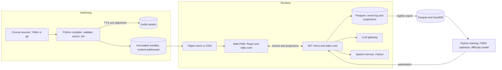

# Nabu: architecture gameplan for an open-source, script-first Duolingo-style app

> **Name: _Nabu_**, the Mesopotamian god of scribes and writing, whose emblem was the scribe's stylus. Fitting for a project that rests on writing systems and an append-only record of everything a learner does.

| | |
|---|---|
| Status | Planning draft v0, 2026-11-02 |
| Scope | Architecture only. Course content comes later. The fixture courses described here exist only to stress-test the architecture. |
| Audience | Ben, plus future Claude Code sessions. [Appendix A](#appendix-a-claudemd-seed) is a ready-to-paste `CLAUDE.md` and [Appendix B](#appendix-b-prompt-for-the-first-claude-code-session) is the prompt for the first session. |
| Languages | TypeScript for the runtime, Python for the content pipeline, NLP and speech, SQL (Postgres) for storage |

---

## 0. How to use this document

1. Save this file in the new repo as `docs/gameplan.md`, since the `CLAUDE.md` seed and the first-session prompt both refer to it there.
2. Read **§1** (the decisions) and **§16** (the roadmap) first. Each roadmap phase is sized for one to three Claude Code sessions and ends with acceptance criteria that can be checked mechanically.
3. Copy **Appendix A** into the new repo as `CLAUDE.md`. **Appendix B** is the prompt for the first session.
4. If you later change any decision in §1, record the change as an ADR in `docs/adr/`. The numbering in §1 is the initial ADR list.
5. Claims about Duolingo are footnoted to sources in **Appendix D**. Where only third-party or community sources exist, the text says so.

---

## 1. The decisions

| # | Decision | Why |
|---|---|---|
| 1 | **The runtime is TypeScript end to end.** The web client and the API server share one pure package, `@nabu/core`. Python owns the offline content pipeline and the speech service. | Grading and scheduling have to behave identically online, offline and on the server. One implementation can't drift from itself. Python has the NLP ecosystem, which is only needed offline. |
| 2 | **Content is code.** Courses are YAML in git. A Python compiler turns them into immutable, content-addressed bundles. | Diffable, reviewable, lintable, and safe to have an LLM draft. Seeding content straight into a database (what the sanidhyy clone does) doesn't scale past a demo. |
| 3 | **Every piece of language data is `TaggedText`:** a BCP 47 tag that includes the script, plus an array of tokens. It is never a bare string and never uses character offsets. | Fonts, bidi, Han glyph selection, IME handling, TTS, word-bank tiles and credit assignment all depend on it. Token arrays also avoid the UTF-16 versus code point offset mismatch between TypeScript and Python. |
| 4 | **Writing systems are data.** Each `OrthographyProfile` declares normalization, matching policy, segmentation, annotation layers, input aids and layout. | Adding a script should mean adding data and fixtures, not editing the grader. |
| 5 | **Learner state is event-sourced.** | Offline sync, swapping models, re-optimizing FSRS, anti-cheat, data export and retroactive grading fixes all become projections of one log. |
| 6 | **Two models.** Memory uses FSRS-6 for each pair of knowledge component and facet. Performance prediction uses an Elo/IRT-style model, the equivalent of Duolingo's Birdbrain v1. The session planner aims for a success rate of about 85%. | Both are proven, open, cheap to train online and interpretable. Duolingo's own published research points the same way (§3.4). |
| 7 | **Grading is a deterministic cascade:** normalize, match against an accept lattice, apply a typo model, fall back to an LLM judge, then human review. Credit is assigned per token. | Duolingo's STAPLE work showed that accept-lists are the bottleneck. An LLM can rescue the long tail of correct answers without becoming the source of truth. |
| 8 | **The UI is a React + Vite PWA** built on React Aria Components, CSS Modules with logical properties only (lint-enforced), and MessageFormat 2 messages. | These are the strongest RTL and i18n primitives available. Vertical layout falls out of logical axes almost for free. |
| 9 | **Audio is generated at compile time** from pinned readings, with provenance and word alignment. **Speech scoring is tiered** and works at the phone level. | TTS errors get caught before a learner hears them. ASR transcripts alone hide pronunciation errors. |
| 10 | **Gamification is a rules engine over events,** with humane defaults: no hearts or energy gate unless you turn one on. | Mechanics stay configurable and never get tangled up with learning logic. |
| 11 | **Self-hosting comes first:** `docker compose` with web, API, Postgres and an object store, plus optional speech and LLM services. | No lock-in to hosted services like Clerk, Stripe or Neon. |
| 12 | **Licensing:** all code is dual-licensed **MIT OR Apache-2.0**. Content defaults to CC BY-SA 4.0. Every asset carries an SPDX identifier in the bundle manifest, and CI rejects copyleft code dependencies inside the shipped app. | Maximum reuse: anyone can embed the Unicode tooling or fork the app. Apache-2.0 adds a patent grant, which matters for a speech/ML-heavy codebase. Copyleft *data* (stroke data, CC BY-SA recordings) is fine as separately licensed assets; copyleft *code* (AGPL, GPL) can only be an optional, separately distributed plugin. |

---

## 2. Design principles

1. **Script-first, not Latin-first.** The hard cases are designed in from day one: no spaces between words, RTL, optional vowel marks, polyphonic characters, tone, vertical text, and IME input. Fixture courses in **Persian, Cantonese, Uzbek and Lebanese Arabic** get built before any real course. Together they cover Arabic script with optional vowel marks and ZWNJ; Han characters with tones, polyphones, ruby and vertical text; Latin/Cyrillic digraphia with modifier-letter apostrophes and heavy agglutination; and a spoken variety with no standard orthography, written in both Arabic script and Arabizi. An architecture that handles those four handles ordinary Latin-script languages for free. The reverse is never true.
2. **Functional core, imperative shell.** Grading, scheduling, session planning and game rules are pure functions of `(content bundle, event history, clock, seed)`. All I/O happens at the edges. Behavior can then be replayed from logs and tested with property-based tests.
3. **Data over code.** Writing-system behavior, exercise templates and game rules are declarative data run by small interpreters. Adding Tigrinya should mean adding an orthography profile, an analyzer adapter and fixtures.
4. **Determinism.** Seeded RNGs, immutable versioned bundles and an event log mean any session can be replayed exactly for debugging.
5. **Measure before personalizing.** New models run in *shadow mode* first: they log predictions without acting on them. Duolingo introduced Birdbrain this way (§3.4).
6. **Humane engagement.** Copy Duolingo's habit loop (streaks, goals, short sessions) but not its monetization pressure (hearts or energy gates, guilt-trip notification copy). Every mechanic is a config switch.
7. **Offline-capable by construction.** Offline mode may ship late, but client-generated event IDs, local-date semantics and pure projections are there from the first commit.

---

## 3. Duolingo deep dive: what it does, how, and what we take

This section only records behavior that changes our architecture. It isn't a feature tour.

### 3.1 Course structure

- **Path, not tree.** On 1 Nov 2022 Duolingo replaced the skill tree with a linear path. Each circle on the path equals one old "crown level". Levels from one skill are spread along the path, and Stories are placed wherever their difficulty fits.[^path] Duolingo reports that learners on the path scored higher in reading and listening than learners on the old tree.[^efficacy]
- **Hierarchy:** course → section → unit → level → lesson. Third-party scrapes report lessons of 1–18 exercises (usually 15), Legendary challenges, and optional "Personalized Practice" units.[^duodata]
- **Duolingo Score:** a 0–160 scale like the Duolingo English Test, tied to CEFR-aligned sections. The most advanced courses reach 120, the end of B2. The Score rises as you complete lessons and units.[^score]
- **"Shared content":** the 148 courses launched in April 2025 came from building one base course and customizing it for dozens of UI languages. All 148 target beginner levels, A1–A2.[^148]

**What we take**

- Keep the path as the default presentation, but model it as a *linearization of a prerequisite DAG of knowledge components* (§7.1). "Jump here", placement and personalized review then become graph operations.
- Use typed nodes: `lesson`, `practice`, `story`, `review`, `challenge` (Legendary-style) and `script` (an alphabet or characters track running alongside the path).
- Derive the proficiency score from the performance model (§9.5), not from position on the path. Duolingo's Score grows with lessons completed, which in my view measures exposure, not ability.
- Key content by target language and add a translation layer per support language (§7.2). That's the general version of Duolingo's "shared content".

### 3.2 Lesson anatomy and exercise types

Community documentation lists these exercise types: translate (typed); translate with a word bank; tap-complete; assist (multiple choice); dialogue; gap fill; reverse translation; tap the pairs; complete the translation; listen-and-tap; listen-and-type; listen-complete; listen isolation; speak; listen-and-speak; and picture selection.[^types] Courses in new scripts add sound drills, minimal pairs and sound-focused lessons.[^speaking] Learners can dictate answers into translation exercises with the microphone; the app transcribes the speech, just as it does in speaking exercises.[^dictation] The Practice Hub offers Speak, Listen, Mistakes, Stories, Radio and Words.[^practicehub] Mistakes get reviewed at the end of a lesson, and that review doesn't cost Energy.[^energy]

**What we take:** a template registry (§8.1) covering all of the above, plus template types Duolingo doesn't have (§8.2). Also "can't listen now" and "can't speak now" switches as hard constraints in the planner (§9.4), and re-queueing missed items at the end of a lesson.

### 3.3 Grading behavior

- Answers are compared against **lists of acceptable translations curated by expert translators.**[^staple-blog] Learners use the "Report" flag to submit answers they think should be accepted. Reports go to the Incubator backend, where staff and contributors decide whether to add them.[^reports]
- Duolingo ranks those reports with a model. Its features include word and two-word chunks from the learner's answer, a summary of the edits needed to turn the answer into an existing accepted translation, and past reviewer decisions.[^reports]
- **Typos:** an answer off by a small typo is accepted with a correction note, *unless the typo produces a different word the system recognizes*.[^typo] Missing accents usually get a "pay attention to the accents" note instead of a fail, though community reports say this is inconsistent.[^accents]
- **STAPLE (2020):** Duolingo released prompts with **weighted** accept sets, where the weights come from how often learners actually gave each answer. Even the best systems still struggled with Japanese and Korean.[^staple][^staple-blog]

**What we take**

1. An accept set is a weighted distribution, not a flat list.
2. The "a typo that forms a real word is a wrong answer" rule needs a lexicon, so the grader needs the course lexicon.
3. Learner reports are training data. They feed the judge evaluation and the accept-set promotion pipeline (§13.2).

### 3.4 Personalization: HLR, then Birdbrain v1, then Birdbrain v2

- **Half-life regression** (Settles & Meeder, ACL 2016) predicts recall as p = 2^(−Δ/h), where Δ is time since the last practice and the half-life h = 2^(Θ·x). Its prediction error was nearly half that of the Leitner system Duolingo used at launch.[^hlr] The code and a dataset of 13 million learning traces are public.[^hlr-data] In production it brought a 12% boost in engagement.[^vb]
- **Birdbrain v1 (2020)** was logistic regression inspired by item response theory. An exercise's difficulty was the sum of the difficulties of its features, such as exercise type and words. After each exercise, one step of stochastic gradient descent updated both the learner's ability and the exercise's difficulty, which the authors describe as a generalization of Elo. It ran in shadow mode before going live, then went through A/B tests. Training ran nightly in batch, and because data was only sent when a lesson finished, about 20% of started lessons lost their data.[^spectrum]
- **Birdbrain v2** is an LSTM. It compresses a learner's history into 40 numbers and updates within minutes of each exercise. v1 was retired in May 2022.[^spectrum]
- The **Session Generator** uses Birdbrain's predicted probability of a correct answer to keep exercises at the edge of the learner's ability.[^spectrum][^birdbrain]

**What we take:** a learner model shaped like Birdbrain v1 from day one. It's cheap and interpretable, and it can train online inside `@nabu/core`. The event log will be rich enough to train a v2-style sequence model later. We avoid the lost-data problem structurally by streaming an event per exercise, not per lesson.

### 3.5 Motivation mechanics

- **Streaks:** daily practice, protected by freezes and repairs. When Duolingo had outages, it rebuilt streaks from access logs, which shows the streak is really a projection of a log.[^streak] Third-party guides say lessons done offline must sync before local midnight to count.[^streak-sync] That's the bug we design out (§12.2).
- **Hearts, then Energy:** under the old system, free users had 5 hearts and lost one per mistake. Duolingo says beginners were twice as likely to run out mid-lesson. Energy (in testing from July 2025) charges each lesson a little energy, earns energy back for runs of correct answers, recharges fully in about a day, and is unlimited for subscribers.[^energy][^energy-wiki] Critics argue the gate exists mainly to sell subscriptions.[^energy-ux]
- **Leagues:** third-party guides describe 10 tiers from Bronze to Diamond, with weekly cohorts of about 30 people and promotion and demotion zones that narrow at higher tiers. The exact numbers vary by source.[^leagues]
- XP, gems, quests and chests round it out.

**What we take:** all of these as rules over events (§12), with the gate policy defaulting to `none`.

### 3.6 Notifications

Duolingo's practice reminders use a *sleeping, recovering* bandit (KDD 2020). The arms are message templates, and the reward is the learner completing a lesson. The algorithm accounts for the novelty effect, where new messages work better at first, and for templates that only some users are eligible for. Duolingo released 200 million notification records as replication data.[^bandit][^research]

**What we take:** a template-based notifier with novelty decay from the start (§12.6), and a bandit only once there's enough data to justify one.

### 3.7 AI features

- **Duolingo Max** launched in 2023 with Explain My Answer and Roleplay, both built on GPT-4. Video Call with the character Lily came later.[^max] Third-party reporting says Explain My Answer became free for all users in January 2026.[^ema-free]
- **148 AI-built courses** shipped in April 2025, alongside the "AI-first" memo. Users pushed back with complaints about inaccurate, lower-quality content.[^148][^tc]

**What we take:** Explain My Answer and Roleplay are cheap to build on a good learner model (§13). Generating courses is where quality fails. LLM output is a *draft* that has to pass the compiler's lints and human review.

### 3.8 Where we deliberately diverge

| Duolingo behavior | Problem | Nabu approach |
|---|---|---|
| Flat per-string accept-lists | The long tail of correct answers gets rejected, and fixing it depends on learner reports | Weighted accept lattice, an LLM judge as fallback, and a pipeline from reports to pull requests (§8.3, §13.2) |
| One typo notion: character edit distance | Meaningless for IME-typed scripts, where mistakes are wrong homophones, not adjacent keys | Typo models per input method: keyboard adjacency, IME homophone slips, mark-only differences (§8.4) |
| Whether a diacritic matters is roughly global | Spanish accents are minor slips; Vietnamese and Yoruba tone marks change the word | Contrastiveness is a property of the *orthography profile* (§6.3) |
| Offline lessons must sync before midnight | Travelers lose streaks | Events carry the local date and time zone, with a grace window (§12.2) |
| Hearts or energy gate | Blocks beginners; the incentive is monetization | Gate is off by default and configurable (§12.3) |
| Score tracks progress through the path | Measures exposure | Ability estimate from the performance model, shown with uncertainty (§9.5) |
| Speaking exercises check an ASR transcript | ASR is built to forgive accents, so it hides exactly the errors a learner needs to hear about | Tiered phone-level and tone scoring (§10.4) |
| Birdbrain v1 lost data from unfinished lessons | Biased training data | One event per exercise, streamed (§9.6) |

---

## 4. Prior art and building blocks

| Project | What it is | What we take | What we leave |
|---|---|---|---|
| **LibreLingo** and its 2025–26 forks (Community, Relive) | AGPL Svelte app, YAML course format, Python loader and exporter | Ideas for the course schema; an importer for existing courses | The app itself. Upstream stalled, the fork was created because the original maintainer was hard to reach, and the code is still in "dependency hell".[^librelingo] |
| **FreeLingo** | AGPL Next.js + FastAPI app. An LLM builds a CEFR study plan. Kokoro and Whisper for speech, SM-2 flashcards[^freelingo] | Swappable providers (local or API) for LLM, TTS and STT; the backend proxies every model call | The LLM as curriculum designer, SM-2, no RTL support |
| **sanidhyy/duolingo-clone** | MIT tutorial clone: Next.js, Drizzle, Clerk, Stripe[^sanidhyy] | Polish of the lesson-screen UX | Its schema (two exercise types, boolean progress), hosted-service lock-in, physical CSS |
| **duostories.org** | Community platform for Duolingo-style Stories, with a plain-text format for writing stories and exercises[^duostories] | Design ideas for a story format | Its content, which is licensed from Duolingo |
| **LEXIS** (Ben's) | JSON reading-comprehension quizzes with a glossary, a longest-match segmenter, matching that folds vocalized text, and a validation suite | **Lessons only**: validate with the real segmentation logic, a separate punctuation audit, dead-glossary-entry detection, folded and exact matching run in parallel, and generating content programmatically rather than writing JSON by hand. These become compiler lints (§7.5) and design rules. | The code, the data format and any content; LEXIS stays a separate project. Also RTL detection keyed on a language-name string (fixed by §6.2). |
| LWT, LUTE, LinguaCafe | Reading-first, self-hosted apps | Reading UX that tracks each word's status | — |
| **FSRS** (ts-fsrs, py-fsrs, fsrs-rs) | FSRS-6 scheduler (21 parameters) plus an optimizer, available as a WASM binding[^fsrs] | The memory model and per-user parameter optimization | — |
| duolingo/halflife-regression | 13 million learning traces plus code[^hlr-data] | An offline benchmark for memory models | — |
| STAPLE 2020 data | Prompts with weighted accept sets in 5 languages[^staple] | A benchmark for the judge and for accept-set expansion | — |
| **my_rime** | librime compiled to WASM, running as an offline PWA input method, including Cantonese[^rime] | Ideas for in-app Jyutping input | Bundling it: it's AGPL, which an MIT/Apache app can't ship. Offer it only as a separately distributed, optional plugin, or build our own WASM wrapper around librime itself (BSD-3-Clause) |
| hanzi-writer + Make Me a Hanzi; animCJK; KanjiVG | Stroke data and tracing quizzes[^mmah] | Tracing exercises | Using PRC stroke order for Traditional courses (§6.9) |
| OpenPronounce; wav2vec2-espeak; ZIPA; POWSM | Pronunciation assessment and recognition at the phone level[^openpronounce][^zipa] | Speech tier 2 (§10.4) | English-centric tuning |
| Tatoeba; Lingua Libre; Common Voice; Wiktionary (via kaikki.org) | Sentences, recordings, lexical data and IPA[^lingualibre] | Seed data and human audio | Anything whose license isn't tracked per item |
| **CLDR / ICU** | Locale data, MessageFormat 2, Keyboard 3.0, exemplar characters, RBNF, transforms, script metadata | Nearly all of the i18n layer | — |
| **React Aria** | Accessible, unstyled components with localized strings for 30+ languages, multiple calendars and numbering systems, and RTL interactions[^reactaria] | UI primitives | — |

---

## 5. System architecture



**Three flows**

1. **Authoring → bundle.** Course YAML is parsed, normalized, enriched by language analyzers, linted, voiced and packaged into a bundle whose identity is its hash. Bundles are cacheable forever.
2. **Learning → events → projections.** The client plays exercises and emits events. The API appends them to the log and recomputes projections such as memory state, XP and streaks. Server and client use the same pure `@nabu/core`, so they agree.
3. **Log → models.** Nightly exports train FSRS parameters and item difficulties. New parameters go back to the API as versioned configuration and run in shadow mode before they're used.

### 5.1 Repository layout

```text
nabu/
├─ apps/
│  ├─ web/                # React PWA (Vite)
│  └─ api/                # Hono server (Node)
├─ packages/
│  ├─ core/               # pure TS: text model, normalization, matching, templates, FSRS facets,
│  │                      #          performance model, planner, gamification rules
│  ├─ core-cli/           # JSON-lines CLI that exposes core to the Python pipeline
│  ├─ ui/                 # React Aria–based components, writing-mode aware
│  ├─ i18n/               # MF2 catalogs, locale negotiation, generated script metadata, font stacks
│  └─ schema/             # TS types generated from /schemas (never hand-edited)
├─ schemas/               # JSON Schema 2020-12 — single source of truth for bundles, events, profiles
├─ profiles/              # orthography profiles (YAML)
├─ pipeline/              # Python (uv): compiler, analyzers, TTS/alignment, LLM authoring, training
├─ services/speech/       # Python FastAPI: ASR, phone scoring, tone scoring
├─ courses/               # fixture courses (real courses can live in separate repos)
├─ conformance/           # shared JSON test vectors (run by both TS and Python harnesses)
├─ docs/adr/
└─ deploy/                # docker compose, env templates, Caddyfile
```

`schemas/` is the contract between the two halves. JSON Schema is neutral ground: TypeScript types are generated from it (`json-schema-to-typescript`), and so are Pydantic v2 models (`datamodel-code-generator`). Neither language owns the data model.

There is **one** implementation of normalization and matching, the TypeScript one. The Python compiler uses it through `core-cli`, a long-lived subprocess that speaks JSON lines. The compiler checks accept sets with the *same* code that will grade learners, which was one of the main lessons from LEXIS: validate with the real segmentation logic, not with substring checks.

### 5.2 Technology choices

| Layer | Choice | Why | Rejected |
|---|---|---|---|
| Monorepo | pnpm workspaces + Turborepo; `uv` for Python | Fast and boring | Nx (heavier than needed) |
| Web | React 19, Vite, TanStack Router + Query, `vite-plugin-pwa` | Large ecosystem; PWA and offline support | Next.js: server components get in the way of offline-first |
| Components | React Aria Components | The strongest RTL, locale, calendar and accessibility behavior available[^reactaria] | shadcn/Radix: fine, but weaker on locale-aware behavior |
| Styling | CSS Modules + design tokens as CSS custom properties, with `stylelint-use-logical` | Logical properties everywhere, so vertical writing modes work | Tailwind: its core sizing utilities (`w-*`, `h-*`) are physical, so you'd be fighting it in vertical mode. Revisit if it ships complete logical sizing. |
| Messages | MessageFormat 2 via `messageformat` 4.x, a polyfill of the proposed `Intl.MessageFormat` | MF2 became a stable spec in CLDR 47 (March 2025)[^mf2] | ICU MF1 / i18next plural hacks |
| API | Hono + Zod, with a typed RPC client | Runs on Node, Bun or Deno; small | tRPC (more coupling), NestJS (heavy OOP) |
| Database | Postgres 16+ via Drizzle; `pg-boss` for jobs | One stateful dependency | Redis (unnecessary at first) |
| Authentication | Better Auth, self-hosted, behind our own interface | MIT and self-hostable. Vercel acquired it in July 2026, so keep it swappable.[^betterauth] | Clerk (hosted lock-in) |
| Object store | Any S3-compatible store (MinIO, Garage) or the filesystem | Bundles are immutable and content-addressed | — |
| Python | Pydantic v2 (generated), Typer, PyICU; analyzers listed in §7.5 | The NLP ecosystem | — |
| Speech | FastAPI; faster-whisper or MMS for ASR; wav2vec2-espeak or ZIPA for phone recognition; Parselmouth or pYIN for pitch | §10 | Hosted-only APIs |
| Analytics | Parquet export + DuckDB | No third-party trackers; a single analyst can run it | — |
| Testing | Vitest + fast-check, Playwright (functional and visual), pytest + Hypothesis | Property tests suit a pure core | — |

---

## 6. Text and writing-system model

### 6.1 `TaggedText` and tokens

```ts
/** BCP 47. In content, always specific enough to carry a script: "yue-Hant-HK", "fa-Arab-IR", "ja-Jpan", "apc-Arab-LB". */
export type LangTag = string & { readonly __brand: "LangTag" };
export type OrthographyId = string & { readonly __brand: "OrthographyId" }; // "fa-Arab/standard", "apc-Latn/arabizi"

/** A run of language data. `tokens` concatenate, in logical order, to the NFC surface text. */
export interface TaggedText {
  readonly lang: LangTag;
  readonly orthography: OrthographyId;
  readonly tokens: readonly Token[];
}

export interface Token {
  readonly surface: string;                      // NFC; never splits a grapheme cluster
  readonly kind: "word" | "punct" | "space" | "number" | "symbol";
  readonly sense?: SenseId;                      // link to the lexicon (a knowledge component)
  readonly readings?: Readonly<Record<SchemeId, string>>; // {"jyutping": "hong4"}: pinned in content, never guessed at runtime
  readonly ruby?: Readonly<Record<SchemeId, readonly RubySegment[]>>; // per-base annotation; bases concatenate to `surface`
  readonly ipa?: string;                         // SURFACE pronunciation (after sandhi and changed tones), §10.4
  readonly tileGroup?: number;                   // tokens with the same group form one word-bank tile
  readonly variants?: readonly string[];         // accepted orthographic variants, e.g. HK and TW character forms
  readonly morphs?: readonly { readonly surface: string; readonly kc: KcId }[]; // agglutinative breakdown; surfaces concatenate to `surface`
}
export interface RubySegment { readonly base: string; readonly text: string }
```

**Why tokens and not offsets.** JavaScript indexes strings by UTF-16 code unit and Python by code point, so any annotation format built on offsets breeds bugs between the two languages. Tokens also give word-bank tiles, tap-for-gloss, per-word audio timing and credit assignment from one structure. When annotation has to go below the token, as with Japanese furigana covering only the kanji in `行く`, it uses `RubySegment` arrays, never integer offsets.

### 6.2 Language tags and direction

- **Direction comes from the script, never from a language name.** Run `new Intl.Locale(tag).maximize()` to get the script subtag, then look up a script-metadata table generated at build time from CLDR's `scriptMetadata.txt`, which has per-script flags for RTL, line breaks between letters, required shaping, required IME and case. `Intl.Locale.prototype.getTextInfo()` became Baseline in July 2026, so it can serve as a runtime cross-check, with the generated table as the fallback for older devices.[^textinfo]
- The *language* alone isn't enough either. Azerbaijani (`az-Latn` vs. `az-Arab`), Punjabi (`pa-Guru` vs. `pa-Arab`), Kurdish (`ckb-Arab` vs. `kmr-Latn`) and Lebanese Arabic (`apc-Arab` vs. `apc-Latn` Arabizi) all switch direction with the script. LEXIS's check for the string `'arabic'` is exactly the anti-pattern to avoid.
- Three language contexts are always in play: the **UI locale** for the app chrome, the **target** language of the course, and the **support** language for glosses and explanations. Each rendered element knows which of the three it shows, and `lang` and `dir` are never inherited implicitly across those boundaries (§11.2).

### 6.3 Orthography profiles

Two abbreviated examples:

```yaml
# profiles/fa-Arab.standard.yaml
id: fa-Arab/standard
lang: fa-Arab
exemplars: cldr:fa                     # main/auxiliary/punctuation/numbers exemplars drive lints (§7.5)
segmentation: { content: hazm, runtime: grapheme }
normalize:                             # applied identically to learner answers and to accept sets
  - nfc
  - fold-compat: arabic-presentation-forms         # U+FB50–U+FDFF, U+FE70–U+FEFF → base letters
  - map: { "\u0643": "\u06A9", "\u064A": "\u06CC", "\u0649": "\u06CC" }  # Arabic kaf/yeh → keheh/Farsi yeh
  - remove: ["\u0640"]                    # tatweel
  - digits: { canonical: latn, accept: [arabext, arab, latn] }
  - punctuation: strip
  - whitespace: collapse
match:
  marks: { set: "[\u064B-\u0652\u0670]", policy: ignore }   # harakat optional in answers
  zwnj:  { equivalents: ["\u200C", " ", ""], policy: accept-with-note, note: spacing }
  case:  none
  typo:  { model: keyboard, layout: cldr-kbd:fa, maxRatio: 0.15 }
annotations:
  - { id: vocalized, kind: vocalization, toggle: true, default: on-for-new-words }
input:
  keyboard: cldr-kbd:fa
  extraKeys: ["\u200C"]          # ZWNJ on the special-character bar
layout: { vertical: none }
fonts: { stack: [Vazirmatn, Noto Naskh Arabic], lineHeight: 1.9 }
```

```yaml
# profiles/yue-Hant-HK.standard.yaml
id: yue-Hant-HK/standard
lang: yue-Hant-HK
exemplars: cldr:yue_Hant
segmentation: { content: pycantonese, runtime: grapheme }
normalize:
  - nfc
  - fold-width: { ascii: half, punctuation: full }
  - whitespace: remove                 # spaces carry no meaning
  - punctuation: strip
match:
  variants:       { table: hk-tw-variants, policy: accept-with-note }   # per-course policy
  scriptMismatch: { detect: Hans, policy: reject-with-note }            # "use Traditional characters"
  homophones:     { model: jyutping-ime, policy: partial-credit }       # IME slip, see §8.4
  typo:           { model: ime-homophone }
annotations:
  - { id: jyutping, kind: reading, scheme: jyutping, toggle: true, render: ruby, fade: by-facet }
input:
  ime: [os, rime-wasm:jyutping]
layout: { vertical: vertical-rl, verticalScope: [prompt, reading, wordbank] }
strokeOrder: { target: hk, interim: tw, label: true }   # §6.9: TW order until HK data exists; always labeled
fonts: { stack: [Noto Sans HK, Noto Sans CJK HK], lineHeight: 1.6 }
```

```yaml
# profiles/uz-Latn.standard.yaml
id: uz-Latn/standard
lang: uz-Latn
exemplars: cldr:uz                     # check how CLDR spells oʻ/gʻ in the exemplars and follow it
letters: [a, b, d, e, f, g, "g\u02BB", h, i, j, k, l, m, n, ng, o, "o\u02BB", p, q, r, s, sh, t, u, v, x, y, z, ch]
segmentation: { content: hand-pinned, runtime: grapheme }   # morphology pinned in source, see below
normalize:
  - nfc
  - map:                               # every apostrophe learners actually type → the canonical letters
      { "o\u2018": "o\u02BB", "o'": "o\u02BB", "o`": "o\u02BB", "o\u2019": "o\u02BB",
        "g\u2018": "g\u02BB", "g'": "g\u02BB", "g`": "g\u02BB", "g\u2019": "g\u02BB" }
  - map: { "\u2019": "\u02BC", "'": "\u02BC" }              # remaining apostrophes → tutuq belgisi
  - punctuation: strip                 # never strips U+02BB/U+02BC: they are letters (gc=Lm), not punctuation
match:
  case: { locale: uz }
  apostrophe: { policy: accept-with-note }   # typed ASCII ' is fine, but tell them
  typo: { model: keyboard, unit: letters, layout: cldr-kbd:uz }   # distance over profile letters, not graphemes
input:
  extraKeys: ["\u02BB", "\u02BC"]
transliterate: { to: uz-Cyrl/standard, via: cldr-transform }       # powers script-convert exercises
```

A few consequences worth spelling out:

- **Contrastiveness is per orthography.** Harakat are optional in Persian answers. Spanish accents get a note. Vietnamese and Yoruba tone marks change the word, so a missing one is wrong. No global "diacritics" switch exists.
- Folding goes in both directions. Learners on an Arabic keyboard type ⁨ك⁩ and ⁨ي⁩, and those fold to ⁨ک⁩ and ⁨ی⁩. Courses for Arabic itself use a different profile that folds hamza seats (⁨أ إ آ⁩ → ⁨ا⁩), alef maqsura and yeh, and ta marbuta and ha, and gives a note for each.
- In Persian, ZWNJ is meaningful (⁨کِتاب‌ها⁩ vs. a space or nothing). Most learners can't type it, so it gets an equivalence class and a gentle note, not a fail.
- HK and Taiwan character forms such as 裏/裡, 綫/線 and 着/著 are accepted with a note, according to course policy. They are never silently equal and never wrong by default.
- **Uzbek letters are not grapheme clusters.** oʻ and gʻ are o/g + U+02BB, a modifier *letter*, so `Intl.Segmenter` counts them as two graphemes, and sh, ch and ng are single letters of the alphabet. Typo distance and letter-level exercises run over the profile's `letters` list (longest match first), falling back to graphemes only for orthographies without one. Learners type oʻ with ', ‘, ’ or a backtick; content is linted to the canonical code points, while answers are folded.
- **Agglutination changes the word bank.** An Uzbek word such as *kitoblarimizdan* ("from our books") is one token but four knowledge components (stem, plural, possessive, ablative). Tokens therefore get an optional pinned `morphs` breakdown that links each suffix to a `form` KC. Tiles stay whole words by default; a `morph-tiles` template variant splits them for suffix-ordering drills. Uzbek has no analyzer as mature as hazm or PyCantonese, so plan on pinning morphology in the source and evaluating rule-based options later.
- One language can have several orthographies. For Lebanese Arabic the **learner picks** Arabic script (`apc-Arab`) or Arabizi (`apc-Latn`) as their course orthography. Prompts, tiles, ruby and accepted answers all follow that choice. A `script-convert` track connects the two, so the choice can be switched later without losing progress. This works because every knowledge component and memory facet is keyed to the language, not the orthography. Only `read-script` and `write-script` facets are tracked separately for each orthography.
- **Lebanese Arabic has no standard spelling in either script.** Accept sets for `apc` are wide by design: MSA-influenced vs. phonetic spellings in Arabic script, and Arabizi variation (digit letters such as 3, 7 and 2 for ⁨ع⁩, ⁨ح⁩ and the hamza; *ch* vs. *sh*; doubled vs. single vowels). The judge (§13.2) will matter more here than for any other test course. Its false-accept target is the hardest to meet, and MSA forms must never be silently accepted as Lebanese. TTS coverage is weak, so `apc` audio defaults to `human-required`.

### 6.4 The normalization engine

- Profiles compile to a pipeline of pure step functions. The same pipeline normalizes accept sets at compile time (through `core-cli`) and learner answers at runtime.
- **Case** is locale-sensitive (`tr` and `az` dotted and dotless i), followed by explicit fold tables where lowercasing isn't enough, such as Greek final sigma (ς/σ) and ß/ẞ. Never call `toLowerCase()` without a locale on language data.
- **NFC everywhere, NFKC never by default.** Compatibility folding happens only through named profile steps such as `fold-width` and `arabic-presentation-forms`. NFKC would also flatten things like superscripts and ligatures that some courses care about.
- **NFC doesn't preserve glyphs** for CJK compatibility ideographs. U+F900 becomes U+8C48 under NFC. A course that needs a particular glyph (Korean hanja, some HK forms) must use standardized or ideographic variation sequences, and the compiler warns when compatibility ideographs appear in the source.
- The Unicode and CLDR versions are pinned in the bundle manifest. Conformance tests run on the minimum supported browsers, because `Intl.Segmenter` grapheme rules and normalization data follow each engine's Unicode version.

### 6.5 Segmentation

- **When content compiles:** Python analyzers segment, lemmatize and add readings (§7.5). Their output is frozen into tokens.
- **At runtime:** answers typed in scripts without spaces are compared **grapheme by grapheme** (`Intl.Segmenter` with `granularity: "grapheme"`). They are *never* word-segmented at runtime, because the ICU dictionaries behind word segmentation differ across browsers and versions. Word-level `Intl.Segmenter` is reserved for conveniences like double-tap selection in reading view.

### 6.6 Annotation layers

- **Ruby** for Jyutping, Pinyin, furigana and Zhuyin, all from `RubySegment`s:

  ```html
  <ruby>行<rt>い</rt></ruby>く
  ```

- **Vocalization:** store fully vocalized text and *derive* the unvocalized form by stripping a configured mark set. Never go the other way. Whether shadda survives stripping is a profile option. The pairing ⁨كِتَابٌ⁩ → ⁨كتاب⁩ is computed, not authored twice.
- **Fading scaffolds:** reading aids can be tied to the learner model. Show Jyutping only on characters whose `read-script` facet has retrievability below θ. The toggle overrides this, so learners stay in control.

### 6.7 Input

- **IME composition is sacred.** While `event.isComposing` is true (or during the legacy `keyCode === 229`), never submit on Enter, never normalize or rewrite the input value, and never re-render the field in a way that resets the selection. Grade only text that has settled after `compositionend`.
- Inputs get `lang`, set to the target orthography, which some virtual keyboards and spellcheckers respect. They also get `dir`, set to the *target* direction, not the UI direction, plus `autocapitalize="off"`, `autocorrect="off"` and `spellcheck="false"`.
- **Special-character bar:** characters come from the profile's `extraKeys` plus the auxiliary exemplar set: ZWNJ for Persian; ʻ (U+02BB) and ʼ (U+02BC) for Uzbek Latin; ў қ ғ ҳ for Uzbek Cyrillic.
- **Touch keyboards** are compiled from CLDR Keyboard 3.0 XML (UTS #35 Part 7, introduced in CLDR 45) into compact JSON.[^kbd] The same key geometry drives the keyboard-adjacency typo weights (§8.4).
- **In-app IME:** a librime WASM build for Jyutping and Pinyin, for learners without an OS input method (common on school Chromebooks). my_rime shows this works,[^rime] but it's AGPL. So either compile librime itself (BSD-3-Clause) to WASM behind our own thin wrapper, or ship my_rime only as a separately distributed plugin. Check the licenses of whichever Rime schema data is used, such as the Jyutping dictionary.
- **Digits:** accept every numbering system the profile lists (⁨۴۷⁩ ≡ ⁨٤٧⁩ ≡ 47).

### 6.8 Fonts and rendering

- Set `lang` on every element that holds language data. Han glyph selection depends on it: `yue-Hant-HK`, `zh-Hant-TW`, `ja` and `ko` choose different glyph forms from the same CJK font.
- Build font stacks per script as `:lang()` rules generated from the script metadata. Lazy-load fonts per script using `unicode-range`.
- **Tall-mark scripts** (vocalized Arabic, Nastaliq, Thai, Tibetan, Myanmar, stacked Devanagari conjuncts) get line-height and tile-padding tokens per script. Playwright checks that no glyph is clipped (§15).
- **Never wrap a single letter of a cursive or conjunct-forming run in its own element to highlight it.** Doing so breaks Arabic joining and Indic conjuncts. Highlight whole tokens instead. For letter-level teaching, render shaped SVG with harfbuzzjs, or use ZWJ-bracketed spans with explicit tests.

### 6.9 Stroke-order data

Make Me a Hanzi follows **PRC** stroke order. Its author notes that Japan, Taiwan and elsewhere differ, and points to animCJK and KanjiVG for Japanese.[^mmah] Taiwan and Hong Kong order is a separate standard again.[^stroke] **Decision:** `yue` tracing uses **Taiwan order as an interim**, labeled "Taiwan stroke order" in the UI, with HK as the stated target. The stroke-order standard is a profile field (`prc | tw | hk | ja`, with `target` and `interim`). A `strokeOrderDiffs` table lists characters where HK and TW differ: tracing for those is disabled until HK data exists, so nothing contradicts what HK schools teach. **Data caveat:** open *TW-order* data is also thin. Hanzi Writer's Traditional characters inherit Make Me a Hanzi's PRC order, and animCJK's Traditional set was last documented as covering only HSK 1 (197 characters), so check current coverage. Budget for building or licensing TW (and eventually HK) data before Phase 3 enables tracing, and release it openly if we build it. Stroke data licenses (Arphic PL, LGPL) are tracked like any other asset.

---

## 7. Content model and pipeline

### 7.1 Entities

```ts
type KcKind =
  | "sense"         // lemma + sense ("bank" as in money)
  | "form"          // a paradigm cell or inflected form
  | "construction"  // a grammar pattern, e.g. a sentence-final particle or the ezafe construction
  | "grapheme"      // a letter, kana or character
  | "reading"       // a grapheme→reading mapping, e.g. 行 → hong4 vs. haang4
  | "phone" | "tone"; // a perceptual or articulatory contrast

interface KnowledgeComponent {
  id: KcId; kind: KcKind;
  prerequisites: readonly KcId[];       // a DAG; the compiler rejects cycles
  cefr?: "A1" | "A2" | "B1" | "B2" | "C1" | "C2";
  notes?: Readonly<Record<LangTag, TaggedText>>; // per support language
}

interface Sentence {
  id: SentenceId;
  text: TaggedText;
  translations: Readonly<Record<LangTag, AcceptSet>>;  // support-language layers (§7.2)
  reverse?: AcceptSet;                                  // target-language accept set for L1→L2 production
  kcs: readonly KcRef[];                                // derived from tokens plus authored constructions
  register?: "formal" | "neutral" | "colloquial";
  audio?: readonly AudioRef[];
  provenance: Provenance; license: SpdxId;
}

interface PathNode {                    // what Duolingo calls a "level"
  id: NodeId;
  kind: "lesson" | "practice" | "story" | "review" | "challenge" | "script";
  introduces: readonly KcId[]; reinforces: readonly KcId[];
  templates?: readonly TemplateId[];    // optional restriction
}

interface Provenance {
  author: `human:${string}` | `llm:${string}@${string}`;   // model@prompt-hash
  status: "draft" | "reviewed" | "published";
  reviewedBy?: string; reviewedAt?: string;
}
```

Courses group `PathNode`s into units and sections. Stories, assets and lexemes complete the model: a lexeme has a lemma (`TaggedText`), senses and forms, plus optional Wiktionary references.

### 7.2 Support-language pivot

Content is keyed by **target** language. Each support language is a layer of translations, accept sets and notes on top. Offering the Cantonese course to Persian speakers means adding a `fa` layer, not building a new course. Grammar notes and predictable L1-transfer errors differ by support language, so notes are per layer, and the performance model takes the support language as a feature.

### 7.3 Source format

```yaml
# courses/yue/units/01-greetings.yaml
unit: greetings
cefr: A1
nodes:
  - { id: greetings.1, kind: lesson, introduces: [sense:早晨, construction:sfp-aa3] }
sentences:
  - id: s.greet.001
    tokens:
      - { surface: 早晨, jyutping: zou2 san4, sense: 早晨 }
      - { surface: 呀,   jyutping: aa3,       sense: sfp-aa3 }
      - { surface: "！", kind: punct }
    translations:
      en: |
        Good morning
        Morning
    reverse: |
      早晨[呀]
    provenance: { author: "human:ben", status: draft }
    license: CC-BY-SA-4.0
```

### 7.4 Accept-set notation

```text
# One alternative per line. (a|b) = alternation, [x] = optional, @w = relative weight (default 1).
[Yo] tengo un perro
Tengo un perrito   @0.2
```

The compiler expands each set, normalizes it with the orthography profile (through `core-cli`), and compiles it to a **token lattice**, a DAG. For orthographies without spaces, the lattice is over graphemes. Matching is dynamic programming over the lattice. It returns either an exact hit or the *closest path* with an alignment, and that alignment drives feedback (§8.6) and credit assignment (§8.5).

Weights start with the author's values and are later re-estimated from how often learners actually give each answer, the way STAPLE weighted its accept sets.[^staple] The compiler counts how many paths each set expands to and warns about combinatorial blow-up.

### 7.5 Compiler stages and lints

Each lint ships with a fixture that makes it fire.

1. **Parse:** YAML → models validated against the schema.
2. **Text hygiene:**
   - Every string is NFC.
   - No stray bidi controls (U+202A–U+202E, U+2066–U+2069), BOMs or zero-width characters, except where the profile allows them (ZWNJ in `fa`).
   - **Script audit:** every code point belongs to the orthography's CLDR main ∪ auxiliary ∪ punctuation ∪ numbers exemplars.
   - **Punctuation audit** as its own pass. LEXIS taught that structural validation can't catch wrong-script punctuation.
   - **Confusables audit** per UTS #39: Latin `a` inside Tajik Cyrillic, or Arabic yeh in Persian text.
3. **Enrichment** through analyzers: PyCantonese for `yue`; SudachiPy or fugashi with UniDic for `ja`; hazm for `fa`; hand-pinned morphology for `uz` (no mature analyzer yet); CAMeL Tools for Arabic (MSA plus some dialects); spaCy or Stanza for `es`; epitran or espeak-ng for G2P; Wiktionary data via kaikki.org for IPA and forms.
   - **Readings pinned in the source always win.** If the analyzer disagrees with a pinned reading, the compiler warns, which catches 行 typos in both directions.
4. **Generated drill families** (§7.6).
5. **Curriculum checks:**
   - Every token's `sense` exists.
   - Each knowledge component is introduced at or before its first use.
   - **The i+1 rule:** at most *k* new components per sentence (default *k* = 1).
   - The prerequisite DAG has no cycles.
   - The path is a valid topological order of the DAG.
6. **Grading checks:**
   - Accept sets expand within bounds.
   - No two alternatives are identical after normalization.
   - The canonical answer is present.
   - Every sentence used for L1→L2 production has a `reverse` set.
7. **Glossary and segmentation simulation**, again from LEXIS. Validate glossaries and tile groups with the *runtime* matcher through `core-cli`, not with substring checks. Detect dead entries that longest-match can never reach.
8. **Audio** (§10.1).
9. **Packaging:**
   - Content-addressed assets.
   - Chunks per unit, for offline download.
   - A manifest recording the versions of the schema, Unicode, CLDR and each analyzer, plus a per-asset SPDX license and attribution and a provenance summary.
   - Byte-for-byte deterministic: the same input always produces the same hash.

### 7.6 Generated drill families (CLDR and RBNF)

Some content can be generated *correctly by construction* from CLDR data:

- Cardinal and ordinal numbers come from **RBNF** rule sets (`%spellout-cardinal`, gendered and case-marked `%spellout-ordinal-*` where the locale has them). PyICU runs them at compile time, because `Intl` has no RBNF.
- Dates, times, clock readings, currency amounts and relative times come from CLDR patterns.

Number and time drills are a classic Duolingo weak spot. This gives them to every language with RBNF data for free, and it's a natural place to exercise ordinal and gender agreement.

### 7.7 IDs, versioning and importers

- IDs are authored slugs, never array indices. When a change alters meaning, the compiler compares a hash of the semantic fields with the previous bundle and requires `supersedes:`. Learner state is keyed by component IDs, and the manifest carries a migration map for merges and splits.
- **Importers:**
  - LibreLingo YAML: best effort, flagging any readings that can't be determined. Write our own parser: `librelingo-yaml-loader` is AGPL, so it can't be a dependency of MIT/Apache code. Check each course's own content license before importing it.

---

## 8. Exercise engine and grading

### 8.1 Template interface

```ts
export interface ExerciseTemplate<P, R> {
  readonly id: TemplateId;                                   // "translate-tap.l2-l1"
  readonly modality: {
    readonly audioOut: boolean; readonly mic: boolean;
    readonly input: "tiles" | "text" | "choice" | "voice" | "stroke";
  };
  readonly eligible: (item: ContentItem, ctx: PlanContext) => boolean;
  readonly instantiate: (item: ContentItem, ctx: PlanContext, rng: Rng) => P; // pure, seeded
  readonly facets: (instance: P) => readonly FacetRef[];     // which (KC, facet) pairs this instance exercises
  readonly grade: (instance: P, response: R, g: Grader) => Outcome;          // pure
}
```

Templates live in `@nabu/core` as data plus pure functions. The UI has a separate registry that maps each `TemplateId` to a React component.

### 8.2 Template catalog

| Template | Duolingo equivalent | Facets | Notes |
|---|---|---|---|
| `select-image` | picture select | sense·recognize | Images need licenses; no text inside images |
| `match-pairs` | tap the pairs | sense·recognize; grapheme·read | Also pairs glyphs with their readings |
| `choose-translation` | assist | sense·recognize | |
| `translate-tap` (both directions) | translate with word bank | recognize / produce | Tiles from `tileGroup`; distractors from the confusion log |
| `translate-type` | translate | produce | |
| `complete-translation` | complete the translation | produce (target component) | |
| `gap-fill`, `tap-complete` | gap fill, tap complete | form·produce; construction | |
| `dialogue` | dialogue | comprehension | |
| `listen-tap` | tap what you hear | listen | |
| `listen-type` | type what you hear | listen + spell | The LLM judge never runs here, since only one answer is right |
| `listen-select`, `minimal-pair` | listen isolation; sound drills | phone/tone·perceive | |
| `speak`, `listen-speak` | speak; repeat | speak | §10.4 |
| `char-read` | Characters / Alphabet | grapheme·read; reading | |
| `char-trace` | (tracing) | grapheme·write | Respects the stroke-order standard (§6.9) |
| **`reading-disambiguation`** | — | reading | New. Polyphones: 行 in 銀行 (hong4) vs. 行路 (haang4) |
| **`tone-identify`** | — | tone·perceive | New. Cantonese, Mandarin, Vietnamese, Thai, Yoruba |
| **`vocalize`** | — | form | New. Add the harakat to an Arabic word or phrase |
| **`script-convert`** | — | grapheme mapping between orthographies | New. Uzbek Latin *kitob* ↔ Cyrillic *китоб*; Tajik китоб ↔ Persian ⁨کِتاب⁩; Arabizi ↔ Arabic script |
| **`morph-build`** | — | form·produce | New. Order suffix tiles into an agglutinative word (Uzbek *kitob-lar-imiz-dan*) |
| **`number-drill`** | — | form | New. Generated from RBNF (§7.6) |
| `story` | Stories | comprehension | Phase 6 |

### 8.3 The grading cascade

```text
raw input ─► settled text (after compositionend)
  └─► normalize(profile)                 same pure pipeline as the accept sets
       ├─► exact path in accept lattice ─────────────► CORRECT  (+ "another correct solution" if not canonical)
       └─► closest path (DP alignment over tokens or graphemes)
            ├─ only mark differences, profile says warn ─► CORRECT + marks note ("pay attention to the accents")
            ├─ only orthographic variants ──────────────► CORRECT + variant note
            ├─ typo model accepts, edited token ∉ lexicon ► CORRECT_WITH_TYPO
            ├─ edited token ∈ lexicon (a real word) ───────► WRONG_WORD
            └─ otherwise
                 ├─ template allows free production? ──► LLM judge (cached by prompt + normalized answer)
                 │     ├─ accept, confidence ≥ θ ──────► CORRECT_PROVISIONAL → review queue
                 │     └─ reject ──────────────────────► WRONG  (+ report affordance)
                 └─ no ───────────────────────────────► WRONG
```

- **The costs are asymmetric.** A false accept teaches an error, while a false reject only annoys. So θ is set high, per language, and the judge never runs on dictation, choice or tile exercises.
- **Latency:** online, the judge gets up to about 2 seconds while a "checking…" state shows. Offline, the answer is graded WRONG and queued for judging. If the judge later accepts it, an `outcome_revised` event upgrades the result *retroactively*, and all projections recompute. Event sourcing makes this cheap.
- Provisional accepts gather evidence. After enough independent agreements, or one human approval, the answer becomes a weighted entry in the accept set through an automatically generated pull request against the course repo.

### 8.4 Typo models by input method

| Model | Applies to | Mechanism |
|---|---|---|
| `keyboard` | Alphabetic scripts typed on a keyboard | Weighted Damerau–Levenshtein over **grapheme clusters**. Substitution cost comes from key adjacency in the learner's CLDR layout, and the threshold scales with token length. |
| `ime-homophone` | Han, kana, any script typed through an IME | Swapping a character for one with the same reading (係/系, both hai6) is an *IME slip*. Per course policy it counts as Hard (partial credit) or Wrong, never as fully correct. |
| `marks` | Any script with diacritics | Differences only in marks go to the profile's `marks` policy: ignore, warn or wrong. |
| `stroke` | Tracing | Handled by the stroke matcher (hanzi-writer's quiz mode) |

### 8.5 Credit assignment

The alignment from §8.3 gives a status for each token. Each token maps to its knowledge components:

- Components behind failed tokens get rated **Again**.
- Correctly produced components get **Good** or **Hard**.
- Components the learner didn't have to produce get no update to their production facet. In tile exercises, for example, the tiles were handed to them.

When a learner picks a distractor tile, the system logs `confusion(kcA, kcB)`. That log feeds distractor choice and targeted notes, and gives the Explain My Answer feature better context.

### 8.6 Feedback categories

`CORRECT` · `CORRECT_ALT` ("another correct solution") · `CORRECT_MARKS` · `CORRECT_VARIANT` · `CORRECT_WITH_TYPO` · `CORRECT_PROVISIONAL` · `PARTIAL` (IME slip) · `WRONG_WORD` · `WRONG` · `SKIPPED(reason)`

Each category maps to an MF2 message, a sound, an icon, and the visual diff (§11.6). Learners can always report an answer, and a report is just another event.

---

## 9. Learner model and session planner

### 9.1 Knowledge components × facets

Each knowledge component has up to six **facets**. Each `(KC, facet)` pair is a separate memory, tracked as its own FSRS card.

| Facet | Direction | Example templates |
|---|---|---|
| `recognize` | L2 → meaning | choose-translation, translate-tap L2→L1 |
| `produce` | meaning → L2 | translate-type L1→L2, complete-translation |
| `listen` | audio → L2 form | listen-tap, listen-type |
| `speak` | L2 → audio | speak, listen-speak |
| `read-script` | glyph → reading | char-read, reading-disambiguation |
| `write-script` | reading → glyph | char-trace, IME-free typing drills |

Receptive and productive knowledge are separate memories, and the model doesn't collapse them. Cross-facet effects (practicing production probably also strengthens recognition) are left to the performance model rather than added to FSRS by hand.

### 9.2 Memory: FSRS-6

- Use `ts-fsrs`, which implements FSRS-6, in core. Per-user parameter optimization uses the `@open-spaced-repetition/binding` optimizer (WASM, runs nightly), with `py-fsrs` kept at parity for offline analysis.[^fsrs]
- Desired retention defaults to 0.9 and is adjustable per user.
- **Mapping outcomes to ratings** (learners never rate themselves):

| Outcome | Rating |
|---|---|
| `CORRECT` / `CORRECT_ALT` with no hint, latency ≤ the learner's median for this template | Good |
| `CORRECT` but slow, `CORRECT_WITH_TYPO`, `CORRECT_MARKS`, `CORRECT_VARIANT` | Hard |
| `PARTIAL` (IME slip) | Hard for `produce`; no update to `write-script` |
| `WRONG`, `WRONG_WORD`, answer revealed, skipped for a content reason | Again |
| `CORRECT_PROVISIONAL` | Hard until confirmed; `outcome_revised` replays it |

- *Easy* is never assigned automatically. Rate each facet at most once per session, and handle within-session repetitions as learning steps.

### 9.3 Performance: an Elo/IRT model, Birdbrain v1 in shape

```text
logit P(correct) = θ[user,course] + θ[user,facet]
                 − ( b[template] + Σ b[kc ∈ item] + b[item] )
                 + w · features(R of involved facets, support language, input method, length in graphemes, …)
```

- **Online updates:** one stochastic-gradient step per answer, with L2 regularization, exactly the "generalized Elo" approach Duolingo described.[^spectrum] Item and component difficulties are global, shared by all users (the server is authoritative and the client caches them). Abilities are per user.
- **Cold start:** initialize item difficulties from features such as length, frequency rank, script complexity and CEFR level. Duolingo's assessment research shows that predicting item difficulty from features can cut down on pilot data.[^jumpstart]
- **Shadow mode:** every presented exercise logs `prediction.p` and the model version. The planner only starts using predictions after a calibration curve (plotted in DuckDB) looks sane.
- **Later:** a sequence model like Birdbrain v2, trained offline on the event log and also run in shadow mode first.

### 9.4 Session planner

```ts
export const plan = (req: SessionRequest, s: LearnerState, c: ContentIndex, rng: Rng): SessionPlan => {
  // 1. targets: new KCs of this node ∪ due facets (R < desired retention) ∪ weak facets (high lapse rate)
  // 2. candidates: for each target facet, every (template, item) where template.eligible(item)
  //    and every NON-target KC in the item is known (R ≥ 0.8). This is the i+1 constraint at runtime.
  // 3. score(c) = expectedStabilityGain(c) × closeness(p̂(c), req.targetSuccess)
  //             + variety(c, chosen) − redundancy(c, chosen)
  //    hard constraints: modality switches (no audio / no mic), length, ≤ k new KCs,
  //    recognize-before-produce for new KCs, at least one listening item when audio is on
  // 4. select N ≈ 12–15 by greedy or beam search over score
  // 5. order: introduce new KCs (recognition templates) → interleave practice → end on a high-p̂ item
  // 6. runtime adaptation: missed items re-queued at the end; p̂ updated after every answer
};
```

- `targetSuccess` defaults to **0.85**, after the "Eighty Five Percent Rule". That result was derived for binary classification with gradient-descent learners, so treat it as a tunable heuristic, not a law.[^85]
- The function is pure and seeded. A replay of `(request, state, bundle, seed)` reproduces the plan exactly.

### 9.5 Placement and proficiency

- **Placement:** computerized adaptive testing over calibrated items, driven by the performance model. "Jump to section N" is a short adaptive test on that section's components.
- **Proficiency:** the ability estimate, mapped to CEFR through anchor items and shown with an uncertainty band. It is not a progress counter.

### 9.6 Event schema

```jsonc
// answer_submitted (one per exercise, streamed as it happens)
{
  "id": "0193f0e2-7c3a-7b2e-9a4f-3d2b1c0e9f8a",   // UUIDv7, generated on the client
  "type": "answer_submitted", "schema": 1,
  "user": "…", "device": "…", "course": "yue", "support": "en", "bundle": "sha256:…",
  "session": "…",
  "exercise": { "template": "translate-type.l1-l2", "item": "s.greet.001", "seed": 1234 },
  "clientTime": "2026-11-02T09:41:12.512-08:00",
  "localDate": "2026-11-02", "tz": "America/Los_Angeles",
  "input": { "method": "ime", "raw": "早晨呀", "latencyMs": 5230, "hints": 0, "composedSegments": 2 },
  "outcome": { "kind": "CORRECT", "grader": "core@0.4.1", "tokens": [ /* per-token status */ ] },
  "prediction": { "p": 0.82, "model": "elo@3" }
}
```

The other core events are `session_started`, `exercise_presented`, `exercise_skipped(reason)`, `outcome_revised`, `session_completed`, `report_filed`, `setting_changed`, `item_purchased` and `freeze_consumed`. Raw answers are personal data (§14.4).

---

## 10. Audio and speech

### 10.1 TTS at compile time

- **Synthesize from the pinned reading layer, not from raw text.** Use Jyutping or Pinyin syllables for Chinese varieties, and *fully vocalized* text for Arabic and Persian. Unvocalized ⁨كتب⁩ could be ⁨كَتَبَ⁩ ("he wrote"), ⁨كُتُبٌ⁩ ("books") or ⁨كُتِبَ⁩ ("it was written"). For ambiguous kanji, use the kana reading. Where a provider supports phoneme or SSML input, pass the reading explicitly.
- **Variants:** normal and slow speed (Duolingo's turtle button), several voices per course (a character cast), and audio per sentence and per token, or token timings (§10.3).
- **Provenance** for every clip: provider, model, voice, input string and settings hash. Regeneration is then deterministic, and fixing one reading re-synthesizes only the clips it affects.
- **Automatic QA:**
  - *Round-trip ASR:* synthesize, transcribe, compare with the expected text.
  - *Phone check:* run a phone recognizer on clips containing polyphones or rare characters and compare against the expected IPA.
  - A *human spot-check queue* sampled by risk: polyphones, rare characters, dialect content.
- **Providers sit behind one interface.** Local options include Piper, Kokoro and MMS-TTS; hosted APIs plug in the same way. Choose per language on measured quality.
- **Dialects and low-resource languages** (Lebanese Arabic, Haitian Creole, …) often have weak or no TTS. Content can be flagged `audio: human-required`, and the compiler then refuses to synthesize it.

### 10.2 Human recordings

Lingua Libre (CC BY-SA 4.0; 500,000+ recordings from 540 speakers in 120 languages as of mid-2021),[^lingualibre] Tatoeba audio (licensed per recording) and Common Voice (CC0) are ingested with SPDX identifiers and attribution. Human audio is preferred for isolated words and is required where the profile says so.

### 10.3 Alignment

CTC forced alignment produces token timings. Candidates are an MMS-based aligner that takes romanized input, or the Montreal Forced Aligner. The timings power karaoke-style highlighting, tap-a-word-to-hear-it, and checks that `listen-tap` tiles match the audio. They are stored in the bundle's audio index.

### 10.4 Speech exercises: four tiers

| Tier | What it checks | How | Ships in |
|---|---|---|---|
| 0 | Nothing automatically | Record, then compare with native playback and rate yourself | Phase 3 (no infrastructure needed) |
| 1 | Intelligibility: were the right words said? | faster-whisper or MMS ASR, compared with the normalized target. **Never prompt the ASR with the expected sentence**, because that biases it toward false accepts. | Phase 9 |
| 2 | Segments: which phones were wrong? | A phone recognizer (wav2vec2-lv-60-espeak-cv-ft, ZIPA, POWSM), aligned to the expected *surface* phones, giving substitution, deletion and insertion per phone plus a goodness-of-pronunciation-style confidence[^openpronounce][^zipa] | Phase 9 |
| 3 | Tone | F0 extracted with pYIN, Parselmouth or CREPE, then per-syllable contours (using the alignment), speaker-normalized (log-F0 z-scores from a short calibration), and classified against tone templates | Phase 9 |

- **Expected pronunciation must be the surface form.** Mandarin third-tone sandhi (你好 nǐ hǎo is said ní hǎo), 一/不 sandhi (不是 bú shì), and Cantonese changed tones (女 neoi5 but 仔女 zai2 neoi2) all have to be in the content's `ipa` and readings. If citation tones are expected, the system marks correct speech as wrong.
- **Treat scores as feedback, not verdicts.** ZIPA's authors found that phone recognizers lean toward standard, dictionary pronunciations and struggle with sociophonetic variation.[^zipa] Never fail a learner for a dialectal variant the course accepts.
- **Privacy:** audio is processed transiently and never stored by default. Retention for model improvement is opt-in. Tiers 1 and 2 can later run on-device (ONNX Runtime Web or WebGPU).

---

## 11. UI architecture and i18n

### 11.1 Rendering language data: the `<T>` component

Every `TaggedText` goes through one component. It sets `lang`, sets `dir` from the script metadata, applies the profile's font class, and renders ruby and toggleable layers. It also wraps tokens in spans with whole-token granularity (§6.8) for glossing, highlighting and audio sync. Nothing else in the app may render language data.

### 11.2 Locales

- **Three contexts** (§6.2): UI, target and support. An Arabic-speaking learner of Spanish gets RTL chrome, an LTR answer field and LTR tiles. The answer area's `dir` comes from the *target orthography*, not the UI.
- **Negotiation order:** the user's setting, then `Accept-Language`, then CLDR likely subtags. Fallback chains follow CLDR `parentLocales` (en-IN → en-001 → en).
- **Messages** are MF2 catalogs per UI locale, including plural, gender and number selection. **Placeholders are bidi-isolated.** MF2 defines a bidi strategy and a `u:dir` option, so use them instead of hand-inserting control characters.

### 11.3 Bidi rules

- Wrap user-generated text, such as names on leaderboards, in `<bdi>`.
- Icons that indicate direction (back and next arrows, progress chevrons) mirror with the *inline* direction. Media icons such as ▶ don't mirror, which is a common mistake.
- The progress bar fills along the inline axis, so it runs right to left in RTL chrome.
- Keyboard shortcuts use *logical* order: number keys choose tiles in reading order. Arrow keys follow React Aria's flipping behavior.

### 11.4 Vertical writing (top-to-bottom)

- **Scope:**
  - Vertical mode is available for the reading view (Stories), sentence prompts and word banks in CJK courses, as a user toggle.
  - **Traditional Mongolian is always vertical** (`writing-mode: vertical-lr`).
  - The app chrome stays horizontal. Mobile chrome in vertical mode is unusual even in Japan and Taiwan.
- **How it works:**
  - Build every component with logical properties (`inline-size`, `margin-inline-start`, `inset-block-start`…), and lay out along the inline axis with flex or grid. Setting `writing-mode: vertical-rl` on a container then turns rows of tiles into columns.
  - No `transform: rotate`.
  - Use `text-orientation: mixed`. Short numerals get `text-combine-upright: all` (*tate-chū-yoko*).
  - Ruby moves to the right side in `vertical-rl`. Rotated Jyutping or Pinyin ruby reads badly in vertical text, so it's hidden by default there and shown on tap.
- **Testing:** vertical cells are part of the visual matrix (§15).

### 11.5 Lesson player state machine

```ts
type PlayerState =
  | { tag: "presenting";  ex: ExerciseInstance }
  | { tag: "answering";   ex: ExerciseInstance; draft: Draft; composing: boolean }
  | { tag: "checking";    ex: ExerciseInstance; response: Response }
  | { tag: "feedback";    ex: ExerciseInstance; outcome: Outcome }
  | { tag: "interrupted"; reason: "cant-listen" | "cant-speak" | "quit-confirm"; resume: PlayerState }
  | { tag: "finished";    summary: SessionSummary };

type PlayerEvent =
  | { tag: "input"; draft: Draft } | { tag: "compositionstart" } | { tag: "compositionend"; text: string }
  | { tag: "submit" } | { tag: "graded"; outcome: Outcome } | { tag: "continue" }
  | { tag: "interrupt"; reason: "cant-listen" | "cant-speak" | "quit-confirm" } | { tag: "resume" };

/** Pure. Effects (play audio, emit event, call judge) are data, executed by the shell. */
export const step = (s: PlayerState, e: PlayerEvent): readonly [PlayerState, readonly Effect[]] => { /* … */ };
```

`submit` is ignored while `composing` is true, and the type system makes that impossible to forget.

### 11.6 Word bank and visual diff

- Each tile is one `tileGroup`. Arabic tiles are always whole words, never letters, so joining is preserved. Thai, Khmer, Lao and Burmese tiles come from compile-time segmentation. Japanese tiles can show ruby.
- The answer row runs in the *target* direction. Tiles can be moved by tapping, dragging or keyboard.
- **Distractors** come from components the learner actually confuses (the confusion log), plus same-radical characters, near-homophones, minimal pairs and false friends.
- **The feedback diff** comes from the grading alignment. Highlighting is per token in cursive scripts, and per grapheme only where shaping is unaffected.

### 11.7 Accessibility

- Correct `lang` attributes let screen readers switch voices.
- Feedback is announced through live regions.
- Feedback never relies on color alone: there's always an icon and text.
- `prefers-reduced-motion` is honored.
- Every drag interaction has a tap or keyboard alternative, and touch targets are adequately sized.
- Audio has captions, and Latin script offers a dyslexia-friendly font option.
- CI runs axe-core.

### 11.8 Formatting

- Numbers use the user's numbering system (`-u-nu-arabext`).
- Dates use the user's calendar (`-u-ca-persian`, `-u-ca-islamic-umalqura`, `-u-ca-hebrew`) and region-correct week start: `Intl.Locale#getWeekInfo()` where available, CLDR `weekData` otherwise.
- Time zones are IANA identifiers. Use `Intl.RelativeTimeFormat` and `Intl.ListFormat` where they apply.
- Streak *math* uses ISO local dates (§12.2). Only the *display* is localized.

### 11.9 Lint and CI rules

| Rule | Tool |
|---|---|
| No physical properties or values (`margin-left`, `left`, `text-align: left`, `width`/`height` in components) | `stylelint-use-logical` (strict) |
| No literal UI strings in JSX or TS; everything goes through messages | Custom ESLint rule |
| Language data only through `<T>`; no rendering `TaggedText.tokens` by hand | Custom ESLint rule |
| No `split("")`, `[...str]`, `.length` or `.charAt` on language data; use grapheme utilities | Custom ESLint rule (type-aware) |
| No `toLowerCase()` / `toUpperCase()` without a locale argument | Custom ESLint rule |
| Pseudo-locales `en-XA` (accented, expanded) and `ar-XB` (mirrored) in every story | Storybook/Ladle toolbar + CI |

---

## 12. Gamification, notifications and social

### 12.1 A rules engine

```ts
type Rule = (event: AppEvent, ctx: ProjectionCtx) => readonly GameEffect[];  // pure
```

XP, streaks, inventory, quests and leagues are **projections** of the event log, computed by rules that are configured per deployment. No learning logic reads gamification state, with one exception: the session-gate policy (§12.3), and it defaults to off.

### 12.2 XP and streaks

- **XP:** a base amount per exercise and per session, plus configurable bonuses. XP never depends on gate state.
- **Streak semantics:**
  - A day counts if at least one qualifying event has `localDate = D`. The local date is recorded on the device at answer time, along with the time zone.
  - **Offline-safe:** events that sync late still count for their own `localDate`, as long as they sync within a grace window (default 72 hours). This fixes the "sync before midnight" problem.[^streak-sync]
  - **Anti-gaming:** check that `localDate` is consistent with `clientTime` and `tz` and with when the server received the event. Bound how often the time zone can change, and reject future dates.
  - Tests cover crossing the date line, DST transitions, and syncing after 48 hours offline (§15).
- **Freezes** are inventory items that get consumed automatically for a missed day. "Repair" is just recomputing the projection, the same idea as Duolingo rebuilding streaks from logs.[^streak]

### 12.3 Session-gate policy

```yaml
gate:
  policy: none            # none | hearts | energy
  hearts: { max: 5, regenMinutes: 300, refillByPractice: true }
  energy: { max: 25, costPerExercise: 1, earnOnCorrectRun: 3, fullRechargeHours: 24 }
```

The default is `none`. Reviewing mistakes never costs anything, and practicing always restores the gate (Duolingo's own data on beginners running out of hearts is reason enough).[^energy]

### 12.4 Leagues (opt-in per instance, off by default)

Leagues use weekly cohorts of about 30 people per tier, with configurable promotion and demotion zones per tier. A learner joins a cohort with their first XP of the week, and the week boundary is configurable. There are no bots. XP gets rate limits and plausibility checks such as minimum response times. A family-sized self-hosted instance would probably turn leagues off.

### 12.5 Quests and achievements

Quests and achievements are declarative templates: counts or thresholds over event predicates within a time window, such as "complete 3 listening exercises today" or "30-day streak". They're localized through MF2 with plural and gender selection.

### 12.6 Notifications

- Web Push, which works on iOS for installed PWAs, with Capacitor later (Phase 10).
- Reminders are scheduled at the learner's habitual practice hour, the median of their recent session start times.
- **Choosing a template:** start with rotation plus *novelty decay*. Move to a sleeping, recovering bandit (Yancey & Settles 2020) only once there's enough traffic.[^bandit]
- Hard caps on how many reminders are sent. The default copy is kind, not guilt-tripping, and it's localized with grammatical gender and plurals.

### 12.7 Social

- **Usernames:** uniqueness is decided on NFKC_Casefold, with UTS #39 restrictions on mixed scripts and confusables. Display names are free-form and always rendered inside `<bdi>`.
- Name order follows CLDR person-name data where names are structured (family name first for `zh`, `ja`, `ko`, `hu`, …).
- Follows, friend quests and shared streaks come later.

---

## 13. AI services

### 13.1 Gateway

- **Providers sit behind adapters.** The default is a local model (Ollama or llama.cpp); Anthropic and OpenAI-compatible APIs are opt-in per instance. Every feature degrades gracefully when no model is reachable, which is common in local-first use: the judge falls back to accept sets plus reports, and Explain My Answer and Roleplay are hidden.
- Model choice is **per feature and per language**, gated by the evaluation results (§13.6). A language whose local model fails the judge gate gets no judge, not a bad one.
- Prompt templates are versioned in the repo and referenced by hash.
- All outputs are structured, validated against JSON Schema.
- **Controls:** a response cache, per-user and per-instance budgets, and a kill switch per feature and per language.
- Logs never include anything that identifies the user.

### 13.2 Judge

- **Input:**
  - The prompt (`TaggedText`).
  - The accept set (the canonical answer plus the most heavily weighted variants).
  - The learner's normalized answer and its alignment diff.
  - Register notes.
- **Output:** `{ verdict, confidence, category: paraphrase | register | meaning-change | grammar | spelling }`.
- **Evaluation:**
  - The **main metric is false accepts**, measured on an adversarial set of near-miss wrong answers: wrong tense or person, a dropped negation, the wrong classifier or measure word, the wrong sentence-final particle, the wrong case ending.
  - False rejects are measured on STAPLE-style paraphrases.
  - Thresholds are set per language.
  - Expect weaker performance for Japanese and Korean (even STAPLE's best systems struggled there)[^staple-blog] and for orthographies without a standard, such as Lebanese Arabic.

### 13.3 Explain My Answer

The output is **a structured list of language-tagged segments, never free markdown:**

```ts
type ExplanationSegment =
  | { kind: "support"; text: TaggedText }      // the explanation itself, in the support language
  | { kind: "target";  text: TaggedText }      // quoted target-language material
  | { kind: "ref";     answerTokens: readonly number[] };  // points into the learner's answer
```

Mixed text, such as an English explanation quoting Cantonese for an Arabic-UI learner, then renders with correct `lang`, fonts and bidi isolation. Explanations are cached per exercise and normalized answer, and learners rate them with thumbs up or down.

### 13.4 Roleplay

- Scenario cards define each conversation.
- The system prompt includes the learner's **known vocabulary** (facets with R ≥ θ) and a budget of *k* new items.
- **Every model turn is checked** by the course analyzer before it's shown: out-of-vocabulary rate, script and orthography audit, and register. Turns over budget are regenerated.
- Runtime TTS for model turns pins readings with the analyzer before synthesizing, for Cantonese and Japanese.
- Learner turns are graded gently, with the judge in a conversation mode.

### 13.5 Authoring assistant (on the pipeline side)

The assistant drafts units, sentences, accept-set expansions and notes against the component graph and the i+1 constraints. Everything it produces is tagged `llm:<model>@<prompt-hash>` and has `status: draft` until a human reviews it, and it must pass every compiler lint. Users' complaints that Duolingo's 2025 AI-generated content was inaccurate are the cautionary tale here.[^tc]

### 13.6 Evaluations

- Golden sets live in the repo, per language and per feature.
- CI runs cheap evaluations whenever a prompt template changes.
- Human-rated samples are tracked over time.

---

## 14. Backend, data and operations

### 14.1 API surface (Hono + Zod)

| Method and path | Purpose |
|---|---|
| `GET /v1/courses` · `GET /v1/courses/:id/manifest` | Catalog and current bundle hash. The bundle files themselves come from the object store or CDN, cached as immutable. |
| `POST /v1/sessions` | Optional server-side planning, for thin clients and debugging. **The client plans locally by default** (local-first, §17 #4), with the same core function. |
| `POST /v1/events` | Batch upload. **Idempotent** by event ID. Returns a new cursor plus projection deltas. |
| `GET /v1/state?since=<cursor>` | Projection deltas: facet states, XP, streak, inventory, quests |
| `POST /v1/judge` | Asynchronous LLM judging; the verdict comes back as an `outcome_revised` event |
| `POST /v1/reports` | Learner reports, which are also events |
| `GET /v1/leagues/current` | Cohort standings |
| `/v1/auth/*` | Better Auth, behind our own adapter |

### 14.2 Sync protocol

- The client keeps an IndexedDB queue of events with UUIDv7 IDs and uploads in batches. The server removes duplicates by ID.
- Conflicts can't happen by design. Events are append-only, and projections are recomputed by the server, which is authoritative.
- **Local-first:** the device is a complete node. It stores its own event log (IndexedDB, or SQLite-WASM on OPFS), computes its own projections and plans sessions with the same core. A learner without an account never talks to the server except to fetch bundles.
- **Signing up** uploads the existing local log under the new user ID. Because events are append-only and keyed by UUIDv7, this is an ordinary sync. Afterwards the client applies the server's deltas and checks that its own recomputation matches.
- Server-only features (leagues, friends, shared item difficulties, nightly FSRS optimization) need an account. Without one, the device falls back to default FSRS parameters and the item difficulties shipped in the bundle.
- **Clock skew:** the server records its own receipt time. Streak validation uses both timestamps (§12.2).

### 14.3 Postgres schema sketch

```sql
-- Append-only log. Start unpartitioned; when needed, range-partition on the UUIDv7 `id`
-- itself (it is time-ordered), which keeps `primary key (id)` legal on a partitioned table.
create table events (
  id           uuid primary key,          -- UUIDv7 from the client: the idempotency key
  user_id      uuid        not null,
  device_id    uuid        not null,
  type         text        not null,
  schema       smallint    not null,
  course       text,
  bundle       text,
  client_time  timestamptz not null,
  local_date   date        not null,
  tz           text        not null,      -- IANA
  server_time  timestamptz not null default now(),
  payload      jsonb       not null
);
create index events_user_time on events (user_id, server_time);

-- Projections (rebuildable from events at any time)
create table facet_state (
  user_id uuid, course text, kc text, facet text,
  stability real, difficulty real, last_review timestamptz, due timestamptz,
  reps int, lapses int,
  primary key (user_id, course, kc, facet)
);
create index facet_due on facet_state (user_id, course, due);

create table item_params  (template text, item text, b real, n int, model text,
                           primary key (template, item, model));
create table user_ability (user_id uuid, course text, theta real, theta_facet jsonb, model text,
                           primary key (user_id, course, model));
create table fsrs_params  (user_id uuid, course text, params real[], fitted_at timestamptz,
                           primary key (user_id, course));
create table judgments    (prompt_hash bytea, answer_norm text, source text,  -- rule | llm:<model> | human:<id>
                           verdict text, confidence real, created_at timestamptz default now(),
                           primary key (prompt_hash, answer_norm, source));
```

### 14.4 Privacy and data rights

- **Export** (GDPR and California's CCPA) dumps the user's events plus the current projections.
- **Deletion** removes the user's events and recomputes the shared aggregates (item difficulties).
- Audio is never stored by default (§10.4).
- LLM requests are stripped of identifiers.
- Deployments that may serve minors get an age gate.
- Self-hosted instances send no telemetry anywhere unless the operator opts in.

### 14.5 Self-hosting topology

```text
deploy/compose.yaml
  web      (static files behind Caddy, with automatic HTTPS: microphone access needs it)
  api      (Node)
  postgres
  storage  (filesystem by default; MinIO or Garage optional)
  speech   (optional; GPU optional)
  llm      (optional; Ollama)
```

One `.env` file configures everything. Backups are `pg_dump` plus a sync of the object store. Bundles can be rebuilt from git, so they don't need backing up.

### 14.6 Observability and experiments

- **Observability:** OpenTelemetry traces and structured logs. Product analytics come from the event log, with no third-party trackers.
- **Experiments:** deterministic bucketing by `hash(userId, experimentId)`, exposure events, and analysis in DuckDB. Duolingo's "test everything" culture[^bandit] assumes millions of users. A self-hosted instance won't have the statistical power, so use experiments for safety and regression checks, not for micro-optimization.

---

## 15. Testing strategy

| Layer | What gets tested | How |
|---|---|---|
| **Conformance vectors** (`conformance/*.json`) | Normalization, matching, typo models, grapheme comparison, direction detection, accept-lattice expansion | The *same files* run in Vitest and in pytest through `core-cli` |
| **Property tests** | Normalization is idempotent. Grading is invariant under NFC vs. NFD input. The lattice always contains the canonical answer. Credit assignment conserves tokens. The planner never violates a hard constraint. The streak is monotonic under late sync. | fast-check (TS), Hypothesis (Python) |
| **Torture strings** | é as one code point vs. e + U+0301; Hangul jamo vs. precomposed syllables; ZWJ emoji sequences; Persian ZWNJ; Arabic presentation forms and tatweel; stray bidi controls; full-width ASCII; Turkish İ/ı; Greek final sigma; Devanagari nukta (U+0958 → U+0915 U+093C under NFC, because it's a composition exclusion); Thai sara am (U+0E33 vs. U+0E4D U+0E32); half-width katakana; CJK compatibility ideographs (U+F900 → U+8C48); ideographic variation sequences; regional-indicator flags | Part of the conformance vectors |
| **Visual matrix** | Every component and the lesson player across UI locale {en, en-XA, ar-XB, plus each real UI locale as it ships} × target {fa, yue-Hant-HK, uz-Latn, uz-Cyrl, apc-Arab, apc-Latn} × writing mode {horizontal, vertical-rl where allowed} × viewport {mobile, desktop} | Playwright screenshots, plus DOM checks that no glyph is clipped (ink bounding box inside the container) |
| **End-to-end** | Completing a lesson with only the keyboard and with emulated touch; simulated IME composition (Enter during composition must not submit); offline queue, reload, sync | Playwright |
| **Golden sessions** | Recorded event logs replayed through new code produce identical projections, or the differences are reviewed and explained | CI snapshot |
| **Simulated learners** | The planner keeps success near target; FSRS intervals are sane | Synthetic agents with known forgetting curves; offline benchmark of memory models on the HLR dataset[^hlr-data] |
| **LLM evaluations** | The judge's false-accept and false-reject rates; explanation quality; roleplay vocabulary compliance | §13.6 |
| **Linguistic review** | A checklist per fixture course: readings, register, variants, audio | Human, with Ben signing off |

---

## 16. Roadmap

Each phase is a branch or pull request (or a few). "Done" means the acceptance criteria pass in CI.

### Phase 0: Skeleton and i18n harness

- **Deliverables:**
  - The monorepo and toolchain.
  - `schemas/` v0 with code generation for TypeScript and Pydantic.
  - CI covering lint, type-checking, unit tests and visual tests.
  - `@nabu/i18n`: MF2 loader, locale negotiation, and *generated* script metadata built from CLDR `scriptMetadata`, likely subtags, exemplars and parent locales.
  - The `<T>` component.
  - Storybook or Ladle with a toolbar for UI locale, target, `dir`, writing mode and pseudo-locale.
  - The custom lint rules from §11.9.
- **Acceptance:**
  - A demo "exercise card" renders correctly in every cell of UI {en, en-XA, ar-XB} × target {fa, yue-Hant-HK, uz-Latn, apc-Arab} × {horizontal, vertical-rl where allowed}.
  - Introducing a physical CSS property fails CI. Test the rule itself with a fixture.

### Phase 1: Text core

- **Deliverables:**
  - `TaggedText`.
  - The profile loader and normalization engine.
  - Accept-set notation → lattice compiler, plus a matcher with closest-path alignment.
  - Typo models: keyboard, marks and IME-homophone.
  - `core-cli`.
  - Profiles: `fa-Arab`, `yue-Hant-HK`, `uz-Latn`, `uz-Cyrl`, plus `ar-Arab`, `apc-Arab`, `apc-Latn`, `tg-Cyrl` and `tr-Latn` (the last is a casing torture test).
- **Acceptance:**
  - At least 300 conformance vectors pass in both the TypeScript and Python harnesses.
  - Property tests pass.
  - Grading takes under 5 ms at p95 for a typical sentence on a throttled mid-range mobile profile.

### Phase 2: Content compiler and fixture courses

- **Deliverables:**
  - The course schema.
  - Compiler stages 1–7 and 9 (no audio yet).
  - Analyzer adapters.
  - All the lints in §7.5.
  - The RBNF drill generator.
  - A LibreLingo importer.
  - **Fixture courses:** one unit each (about 20 sentences and 30 knowledge components) in `fa`, `yue-Hant-HK`, `uz` (Latin primary, with Cyrillic as a second orthography and a `script-convert` demo) and `apc` (learner-selectable Arabic script or Arabizi, with a `script-convert` track between them). Stretch goal: a `tg` ↔ `fa` `script-convert` demo.
- **Acceptance:**
  - Bundle builds are byte-for-byte deterministic.
  - Every lint has a fixture that makes it fire.
  - i+1 violations are reported with file and line.

### Phase 3: Lesson player

- **Deliverables:**
  - The player state machine.
  - Templates: `select-image`, `match-pairs`, `choose-translation`, `translate-tap` (both directions), `translate-type`, `complete-translation`, `gap-fill`, `char-read`, `reading-disambiguation`, and speak tier 0.
  - The feedback-category UI.
  - The special-character bar and CLDR touch keyboards for `fa`, `uz-Latn`, `uz-Cyrl` and `apc-Arab`.
  - IME-safe inputs.
  - Ruby and harakat toggles.
  - Word banks in RTL and vertical layouts.
- **Acceptance:**
  - Playwright completes one lesson per fixture course, by keyboard and by touch.
  - The IME composition test passes.
  - The visual matrix passes.
  - axe-core reports no serious violations.

### Phase 4: Learner model, local-first store, planner, path

- **Deliverables:**
  - The on-device event store and projections (the app works fully with no account).
  - Server event store and sync endpoints, plus optional accounts with "sign up and upload local history".
  - Projections: FSRS facets via `ts-fsrs`, the Elo model and XP.
  - Credit assignment.
  - The planner.
  - The path UI generated from the manifest.
  - Practice modes: review and mistakes.
  - Placement v0.
  - Shadow-mode logging and a calibration notebook.
- **Acceptance:**
  - Golden-session replays are deterministic.
  - In simulations of 30 days, the planner holds observed success within ±5 percentage points of target.
  - Duplicate uploads are idempotent.
  - The offline queue survives a page reload.
  - A learner can finish three sessions with no account and no network, sign up, and end up with server projections identical to the local ones.

### Phase 5: Audio and listening

- **Deliverables:**
  - The TTS adapter interface with two providers, at least one of them local.
  - Synthesis from pinned readings, plus slow variants.
  - Forced alignment.
  - Round-trip QA.
  - Ingestion of human recordings with license tracking.
  - Templates: `listen-tap`, `listen-type`, `listen-select` and `minimal-pair`.
  - The "can't listen now" switch.
- **Acceptance:**
  - The polyphone fixture (行 in 銀行 vs. 行路) is synthesized correctly and passes round-trip verification.
  - Every audio file has an SPDX identifier and provenance.
  - Karaoke highlighting is within 80 ms on the fixtures.

### Phase 6: Reading (Stories)

- **Deliverables:**
  - The story schema and renderer: dialogue lines, inline questions and tap-for-gloss.
  - Vertical reading mode.
  - Glossary longest-match running on the runtime matcher, with LEXIS's lessons built in: folded and exact passes run in parallel and take the longer span, and dead entries are detected.
  - One fixture story per test course.
- **Acceptance:**
  - Fixture stories compile with zero lint errors.
  - Vertical `yue` stories pass visual checks.
  - A vocalized `apc-Arab` story glosses correctly against unvocalized glossary keys.

### Phase 7: Gamification and notifications

- **Deliverables:**
  - The rules engine.
  - XP and streaks (local dates, grace window, freezes).
  - Quests.
  - Leagues: cohorts and an idempotent weekly rollover job.
  - Gate policies, defaulting to off.
  - Web Push.
  - Profiles, with UTS #39 rules for usernames.
- **Acceptance:**
  - Property tests cover the date line, DST, and syncing after 48 hours offline.
  - The league rollover is idempotent.
  - Notifications are localized for every UI locale.

### Phase 8: AI features

- **Deliverables:**
  - The LLM gateway.
  - Judge fallback, a review queue, and pull-request generation that promotes approved answers into accept sets.
  - Explain My Answer with structured segments.
  - Roleplay with the vocabulary constraint.
  - An authoring-assistant CLI.
  - The evaluation harness.
- **Acceptance:**
  - The judge's false-accept rate is at most 2% on the adversarial set for each fixture language; otherwise the judge stays off for that language.
  - An Arabic-UI learner sees `yue` explanations with correct bidi.
  - Every AI output carries provenance.

### Phase 9: Speech

- **Deliverables:**
  - The speech service with tiers 1–3.
  - `speak` and `listen-speak` with automatic scoring.
  - `tone-identify` plus tone production for `yue`.
  - Privacy controls.
- **Acceptance:**
  - Tone accuracy is reported per tone on a recorded fixture set of native and deliberately wrong tones.
  - A test proves no audio is stored by default.

### Phase 10: Full offline and mobile

- **Deliverables:**
  - Per-unit bundle downloads (OPFS or IndexedDB), so whole courses work offline. Local planning and the local event store already exist from Phase 4.
  - Background sync.
  - A Capacitor wrapper, with push notifications on iOS and Android.
- **Acceptance:**
  - Three sessions in airplane mode, synced a day later, produce correct streak dates.
  - Client and server projections match exactly.

---

## 17. Open decisions and risks

### Decisions (all settled 2026-11-02)

| # | Question | My recommendation |
|---|---|---|
| 1 | Name and license | **Decided:** Nabu; code MIT OR Apache-2.0; content CC BY-SA 4.0 by default |
| 2 | How courses are paired | **Decided:** content keyed by target language, with support-language layers (§7.2). With English as the only launch support language, this costs nothing now and keeps an Uzbek-from-Persian course a data-only change later. |
| 3 | Default gate; leagues on or off | **Decided:** no gate. Leagues are opt-in per instance. Streaks, XP and quests are on by default. |
| 4 | Accounts | **Decided:** local-first. Accounts are optional and add sync, leagues and friends. This moves the local event store and client-side planning into Phase 4. |
| 5 | Default LLM | **Decided:** local by default (Ollama or llama.cpp); hosted APIs are opt-in per instance. Consequence: the judge's per-language gate (≤2% false accepts) will probably keep it **off for `apc` and `uz`** with local models at first. Those languages then rely on accept sets plus reports until a local model passes, or until an instance opts into an API. |
| 6 | Fixture languages | **Decided:** `fa`, `yue-Hant-HK`, `uz` (Latn + Cyrl), `apc` (Arab + Latn); stretch `tg`. Japanese-specific paths (furigana, kana/kanji equivalence) stay in the design but have no fixture until a `ja` course exists. |
| 7 | LEXIS | **Decided:** kept separate. Nabu inherits its lessons (lints, matching rules, programmatic generation), not its code, format or content. |
| 8 | Stroke order for Traditional characters | **Decided:** Taiwan order as an interim for `yue`, always labeled, with HK as the target. Characters whose HK and TW orders differ stay untraceable. Open TW-order data is itself thin, so sourcing it is a Phase 3 prerequisite for tracing. |
| 9 | Lebanese Arabic orthography | **Decided:** the learner picks Arabic script or Arabizi; a `script-convert` track links them (§6.3) |
| 10 | Launch UI and support languages | **Decided:** English only. The pseudo-locales en-XA (accented, expanded) and ar-XB (mirrored RTL) run in CI so expansion and RTL chrome stay honest. Real UI locales and support layers are added later as plain data (§7.2, §11.2). |

### Risks

- **Content quality is the real bottleneck.** No architecture fixes it. Mitigation: provenance, draft-until-reviewed, and lints.
- **TTS and ASR quality for dialects and low-resource languages.** Mitigation: `human-required` flags, and preferring human recordings.
- **LLM judge false accepts.** Mitigation: high thresholds, adversarial evaluations, and a kill switch per language.
- **Differences between browsers' Unicode and Intl data.** Mitigation: conformance tests on the minimum supported browsers, and pinned versions.
- **License contamination** (content derived from Duolingo; Arphic and LGPL stroke data; AGPL or GPL code such as my_rime slipping into a permissively licensed app). Mitigation: an SPDX identifier on every asset, and a CI license check that fails on copyleft code dependencies in the shipped app.
- **Dependency rot with one maintainer.** That's how LibreLingo stalled: the maintainer became hard to reach and the dependencies decayed.[^librelingo] Mitigation: few dependencies, Renovate, boring technology, and a pure core that barely depends on anything.
- **Stroke-order data.** Open Traditional-character data in TW order (let alone HK order) is scarce. Mitigation: ship `yue` without tracing if needed; tracing is a nice-to-have, not core.
- **Gamification scope creep.** Mitigation: keep it inside the rules engine and ship the minimum.

---

## Appendix A: CLAUDE.md seed

````markdown
# CLAUDE.md: Nabu

Open-source, script-first, Duolingo-style language-learning app.
Architecture and roadmap: docs/gameplan.md. §1 lists the decisions; any change to one needs an ADR in docs/adr/.

## Non-negotiables
- Language data is never a bare string. Use `TaggedText` (a BCP 47 tag with script, plus tokens) and render it only through `<T>`.
- No physical CSS (left/right, margin-left, text-align: left, width/height in components). Use logical properties.
  stylelint enforces this. Never disable the rule.
- No user-facing string literals. Add MF2 messages in packages/i18n/messages/.
- Never index, slice, reverse or count user-visible text by UTF-16 unit or code point. Use the grapheme utilities in @nabu/core/text.
- NFC at every boundary. NFKC only through a named orthography-profile step.
- No toLowerCase()/toUpperCase() on language data without a locale. Prefer the profile's case folding.
- packages/core is pure: no I/O, no Date.now(), no Math.random(). Inject the clock and a seeded RNG.
- Direction comes from the script subtag (Intl.Locale#maximize plus generated script metadata), never from a language name.
- During IME composition: never submit, never normalize, never reset the input value.
- Every new normalization or matching behavior needs vectors in conformance/ that pass in BOTH the TS and Python harnesses.
- Every content item and asset needs provenance and an SPDX license.
- The fixture courses (fa, yue-Hant-HK, uz, apc) must stay green, and UI changes must pass the visual matrix (LTR, RTL, vertical).
- Never hand-edit packages/schema or the Pydantic models. Edit schemas/ and regenerate.

## Style
- TypeScript: strict; functional; discriminated unions; Result types for expected failures; no classes in core.
- Python: uv; generated Pydantic models; Typer CLIs; pytest + Hypothesis; type-checked with pyright.
- Conventional commits. Small PRs, one roadmap deliverable each.

## Commands
- pnpm i && pnpm dev               # web + api
- pnpm test · pnpm test:visual · pnpm lint
- pnpm conformance                 # TS + Python harnesses over conformance/
- uv run nabu build courses/<id> # compile a course bundle
````

## Appendix B: Prompt for the first Claude Code session

```text
Read docs/gameplan.md, focusing on §1, §5, §6.1–6.2, §11 and §16 Phase 0. Then do Phase 0 only:

1. Scaffold the monorepo exactly as §5.1 lays it out: pnpm workspaces + Turborepo, plus a uv project in pipeline/.
2. Create schemas/ with a v0 JSON Schema for TaggedText, Token, RubySegment and OrthographyProfile.
   Wire up code generation to packages/schema (TS) and to pipeline/ (Pydantic v2).
3. Build packages/i18n:
   - a script that generates script metadata from CLDR (scriptMetadata, likelySubtags, parentLocales, exemplars)
     into checked-in JSON;
   - locale negotiation;
   - an MF2 catalog loader using messageformat 4.x;
   - an en message catalog plus the pseudo-locales en-XA and ar-XB (English is the only real UI and support language at launch).
4. Build packages/ui with the <T> component, and Storybook (or Ladle) with toolbar controls for
   UI locale, target, dir, writing mode and pseudo-locale.
5. Add stylelint-use-logical (strict) and the custom ESLint rules from §11.9, each with a fixture that proves it fires.
6. Set up Playwright visual tests for a demo "exercise card" across
   {en, en-XA, ar-XB} × target {fa, yue-Hant-HK, uz-Latn, apc-Arab} × {horizontal, vertical-rl where allowed}.
7. Set up CI that runs lint, typecheck, unit tests and visual tests.

Stop when the Phase 0 acceptance criteria pass. Report what you built, anything you had to decide that the doc
didn't cover (propose ADRs for those), and anything in the doc that turned out to be wrong.
```

## Appendix C: Glossary

| Term | Meaning here |
|---|---|
| **KC (knowledge component)** | A unit of knowledge: a sense, a form, a construction, a grapheme, a reading, a phone or a tone (§7.1) |
| **Facet** | One direction or modality of knowing a KC: recognize, produce, listen, speak, read-script, write-script. Each (KC, facet) pair has its own memory state (§9.1). |
| **Orthography profile** | Declarative description of how a writing system behaves: normalization, matching, input, layout and annotations (§6.3) |
| **Accept lattice** | The compiled DAG of every accepted answer, used for matching and alignment (§7.4) |
| **Surface form** | Pronunciation as actually spoken, after tone sandhi and changed tones, as opposed to citation form (§10.4) |
| **i+1** | Each item introduces at most *k* new KCs; everything else in it is already known (§7.5, §9.4) |
| **Projection** | State computed purely from the event log: memory state, XP, streaks and so on (§12.1) |
| **Shadow mode** | A model logs predictions without affecting what learners see (§9.3) |
| **Tile group** | Tokens shown as a single word-bank tile (§6.1, §11.6) |
| **Gate policy** | Optional hearts or energy mechanics; off by default (§12.3) |

## Appendix D: References

Footnotes marked *third-party* or *community* are not official Duolingo sources.

[^path]: Duolingo Blog, "New Duolingo home screen design" (2022). https://blog.duolingo.com/new-duolingo-home-screen-design
[^efficacy]: Duolingo Blog, "Results of Duolingo efficacy studies." https://blog.duolingo.com/results-duolingo-efficacy-studies
[^duodata]: *Third-party* course scrapes, e.g. Hindi from English (May 2024). https://duolingodata.com/dat/hifen32.html
[^score]: Duolingo Blog, "Duolingo Score." https://blog.duolingo.com/duolingo-score/
[^148]: Duolingo press release, "Duolingo Launches 148 New Language Courses" (30 Apr 2025). https://investors.duolingo.com/news-releases/news-release-details/duolingo-launches-148-new-language-courses
[^tc]: TechCrunch, "Duolingo launches 148 courses created with AI…" (30 Apr 2025). https://techcrunch.com/2025/04/30/duolingo-launches-148-courses-created-with-ai-after-sharing-plans-to-replace-contractors-with-ai
[^types]: *Community*: duolingo-memo README, https://github.com/MatiasDuhalde/duolingo-memo ; Duolingo Wiki, "Exercise," https://duolingo.fandom.com/wiki/Exercise
[^speaking]: Duolingo Blog, "Covering all the bases: Duolingo's approach to speaking skills." https://blog.duolingo.com/covering-all-the-bases-duolingos-approach-to-speaking-skills
[^dictation]: Duolingo Blog, "Sneaky pronunciation practice." https://blog.duolingo.com/sneaky-pronunciation-practice/
[^practicehub]: Duolingo Blog, "Guide to the Duolingo Practice Hub." https://blog.duolingo.com/guide-to-duolingo-practice-hub/
[^energy]: Duolingo Blog, "Energy" (2025). https://blog.duolingo.com/duolingo-energy/
[^energy-wiki]: *Community*: Duolingo Wiki, "Energy." https://duolingo.fandom.com/wiki/Energy
[^energy-ux]: *Third-party*: UX Collective, "Duolingo's small UI switch that changes everything." https://uxdesign.cc/duolingos-small-ui-switch-that-changes-everything-fae257203633
[^staple-blog]: Duolingo Blog, "Using AI to open up bottlenecks in course content creation." https://blog.duolingo.com/using-ai-to-open-up-bottlenecks-in-course-content-creation/
[^staple]: STAPLE shared task, https://sharedtask.duolingo.com ; Mayhew et al., "Simultaneous Translation and Paraphrase for Language Education," WNGT@ACL 2020, https://aclanthology.org/2020.ngt-1.28/
[^reports]: Duolingo Blog, "How machine learning helps Duolingo prioritize course improvements." https://blog.duolingo.com/how-machine-learning-helps-duolingo-prioritize-course-improvements
[^typo]: *Community*: TV Tropes, "Duolingo." https://www.tvtropes.org/pmwiki/pmwiki.php/VideoGame/Duolingo
[^accents]: *Community*: r/duolingo thread on accent warnings (Aug 2023). https://www.reddit.com/r/duolingo/comments/15rn25h/
[^hlr]: Settles & Meeder, "A Trainable Spaced Repetition Model for Language Learning," ACL 2016, https://aclanthology.org/P16-1174/ ; Duolingo Blog, "How we learn how you learn," https://blog.duolingo.com/how-we-learn-how-you-learn
[^hlr-data]: duolingo/halflife-regression (code and 13M learning traces). https://github.com/duolingo/halflife-regression
[^vb]: VentureBeat, "How Duolingo is using AI to humanize virtual language lessons." https://venturebeat.com/business/how-duolingo-is-using-ai-to-humanize-virtual-language-lessons
[^spectrum]: IEEE Spectrum, "How Duolingo's AI Learns What You Need to Learn." https://spectrum.ieee.org/duolingo
[^birdbrain]: Duolingo Blog, "Learning how to help you learn: Introducing Birdbrain." https://blog.duolingo.com/learning-how-to-help-you-learn-introducing-birdbrain
[^streak]: Duolingo Blog, "Protecting streaks from site issues." https://blog.duolingo.com/protecting-streaks-from-site-issues
[^streak-sync]: *Third-party*: Duolingo Guides, offline-sync and streak rules. https://duolingoguides.com/how-many-duolingo-lessons-can-i-miss-without-losing-my-streak/
[^leagues]: *Third-party*: Duolingo Guides, "How many leagues in Duolingo." https://duolingoguides.com/how-many-leagues-in-duolingo/
[^bandit]: Yancey & Settles, "A Sleeping, Recovering Bandit Algorithm for Optimizing Recurring Notifications," KDD 2020, https://research.duolingo.com/papers/yancey.kdd20.pdf ; Duolingo Blog, "Hi, it's Duo: the AI behind the meme," https://blog.duolingo.com/hi-its-duo-the-ai-behind-the-meme/
[^research]: Duolingo Research, data and tools. https://research.duolingo.com/
[^max]: Duolingo Blog, "Duolingo Max." https://blog.duolingo.com/duolingo-max
[^ema-free]: *Third-party*: "Duolingo Max explained" (2026). https://beginnersinai.org/duolingo-max-explained/
[^jumpstart]: McCarthy, Yancey, LaFlair, Egbert, Liao & Settles, "Jump-Starting Item Parameters for Adaptive Language Tests," EMNLP 2021. Listed at https://aclanthology.org/people/burr-settles
[^85]: Wilson, Shenhav, Straccia & Cohen, "The Eighty Five Percent Rule for optimal learning," *Nature Communications* 10:4646 (2019). https://doi.org/10.1038/s41467-019-12552-4
[^librelingo]: LibreLingo Community fork README, https://zff.dev/cypheon/LibreLingo ; LibreLingoRelive, https://codeberg.org/LibreLingoRelive
[^freelingo]: FreeLingo wiki. https://github.com/ArtCC/freelingo/wiki
[^sanidhyy]: sanidhyy/duolingo-clone. https://github.com/sanidhyy/duolingo-clone
[^duostories]: duostories.org FAQ, https://duostories.org/faq ; story-editing docs, https://duostories.org/docs/story-editing/exercises
[^fsrs]: ts-fsrs, https://github.com/open-spaced-repetition/ts-fsrs ; py-fsrs, https://github.com/open-spaced-repetition/py-fsrs ; awesome-fsrs, https://github.com/open-spaced-repetition/awesome-fsrs
[^rime]: LibreService/my_rime. https://github.com/LibreService/my_rime
[^mmah]: Make Me a Hanzi, https://github.com/skishore/makemeahanzi ; Hanzi Writer license, https://hanziwriter.org/license.html ; animCJK, https://github.com/parsimonhi/animCJK
[^stroke]: Wikipedia, "Stroke order." https://en.wikipedia.org/wiki/Stroke_order
[^openpronounce]: OpenPronounce (wav2vec2 phoneme-level assessment). https://github.com/Halleck45/OpenPronounce
[^zipa]: Zhu, Samir, Chodroff & Mortensen, "ZIPA: A family of efficient models for multilingual phone recognition," ACL 2025. https://aclanthology.org/2025.acl-long.961/
[^lingualibre]: Wikipedia, "Lingua Libre." https://en.wikipedia.org/wiki/Lingua_Libre
[^reactaria]: React Aria, "Internationalization." https://react-spectrum.adobe.com/react-aria/internationalization.html
[^mf2]: Unicode Blog, "Unicode CLDR 47 Release: MessageFormat 2.0 Stable" (Mar 2025). https://blog.unicode.org/2025/03/unicode-cldr-47-release-messageformat-2.html
[^textinfo]: MDN, `Intl.Locale.prototype.getTextInfo()`. https://developer.mozilla.org/en-US/docs/Web/JavaScript/Reference/Global_Objects/Intl/Locale/getTextInfo
[^kbd]: UTS #35 Part 7, "Keyboards," https://unicode.org/reports/tr35/tr35-keyboards.html ; CLDR 45 release note, https://cldr.unicode.org/downloads/cldr-45
[^betterauth]: Better Auth organization profile (notes the Vercel acquisition, July 2026). https://www.ai.engineer/orgs/better-auth
