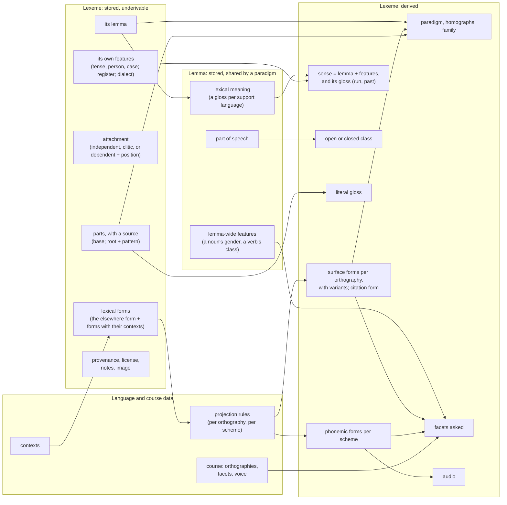
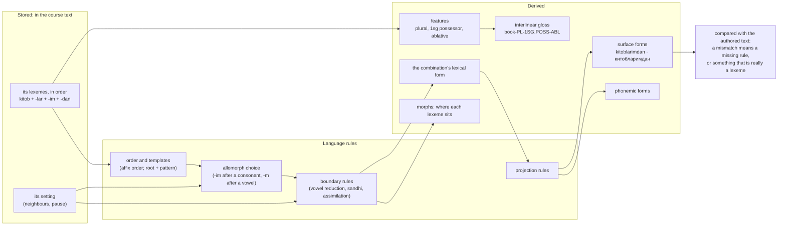
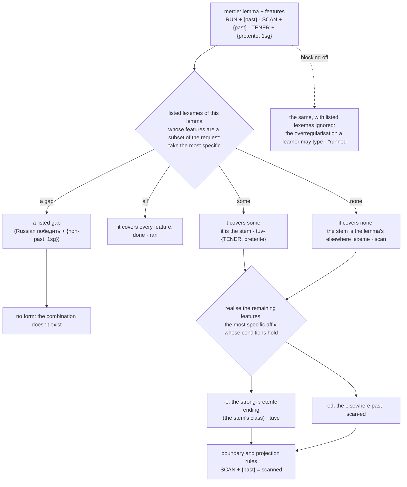

# The lexeme, diagrammed

- Status: working notes, 2026-11-18, beside [lexemes.md](lexemes.md) (the discussion and its decisions).
- Uses the proposed renames (lexemes.md §2): **lemma** for the lexical meaning, **lexical form** for the
  fully specified form, **surface form** for a projection, **features** for cells and properties.

## What is stored, and what is derived

### Stored on the lemma (shared by every lexeme of a paradigm)

| | Examples |
|---|---|
| lexical meaning, as a gloss per support language | RUN "run"; HOUSE "house" |
| part of speech | VERB, NOUN |
| lemma-wide features | *casa*: feminine; *pensar*: e→ie |

### Stored on the lexeme (underivable)

| | Examples |
|---|---|
| its lemma | *ran* → RUN |
| its own features | *ran*: past; *nedha*: krama; *carro*: Cuban |
| attachment | independent; clitic (*me*); dependent + position (‑ga, suffix) |
| lexical forms: the elsewhere form, plus forms with their contexts | ‑ga; ‑ka after k; ‑qa after q |
| parts, with a source (where it has them) | *writer* (occupation) ← *write* + ‑er; مَكْتَب ← ك‑ت‑ب + مَفْعَل |
| provenance, license, notes, image | |

### Derived

| | From |
|---|---|
| surface forms per orthography, with variants; the citation form | lexical forms + projection rules |
| phonemic forms per scheme | lexical forms + projection rules |
| audio | phonemic forms |
| sense, and its gloss (*ran*: "run (past)") | lemma + its own features |
| open or closed class | part of speech |
| inflectional or derivational (an affix) | its lemma: a feature value, or a function making a new lemma |
| paradigm | lexemes sharing its lemma |
| homographs | lexemes sharing its surface forms |
| family | parts |
| literal gloss | parts and their glosses |
| facets asked | surface and phonemic forms (where they're unpredictable), lemma-wide features needing evidence, the course's orthographies, facets and voice |

## Worked examples

| | *casa* | ‑ga (uz) | *fue* (*ser*) | *me* (es) |
|---|---|---|---|---|
| **lemma** | HOUSE (NOUN, feminine) | dative: Case=Dat, "to" | BE (*ser*) | 1SG pronoun |
| **own features** | none | none | preterite, 3sg | object case |
| **attachment** | independent | dependent, suffix | independent | clitic |
| **lexical forms** | *casa* | ‑ga; ‑ka after k; ‑qa after q | *fue* | *me* |
| **parts** | none | none | none | none |
| *derived* | *casas* by rule (a combination); gloss "house" | closed; inflectional; gloss "to (dative)" | gloss "was"; a homograph of *fue* (*ir*) | paradigm with *yo*, *mí*; joined in *dame* by the orthography's projection |

## What diagramming surfaced

1. **Features split by where they're stored, not by UD's lexical / inflectional line.** Register and dialect
   vary within a lemma (*mangan* / *nedha* / *dhahar*; *carro* / *coche*), so they sit on the lexeme, like
   tense. Lemma-wide features (part of speech, a noun's gender, a verb's class) sit on the lemma.
2. **The gloss belongs to the lemma.** A lexeme's gloss is derived from the lemma's and its own features,
   with an override where that reads badly.
3. **An affix's lemma says what kind it is.** ‑ga's lemma is a feature value (Case=Dat), so it's
   inflectional; ‑er's is a function that makes a new lemma, so it's derivational. Nothing to store.
4. **Open or closed comes from the part of speech**, as UD groups its tags, with a language override where
   needed.
5. **Where do lexemes live?** Today KCs belong to a course. With surface forms projected per orthography,
   a language-wide lexicon that courses draw on would let two courses of one language share lexemes.
6. **Next: combinations** (below).

## What the learner learns (Proposed)

**The lexeme is the primary unit of what is taught and stored:** every listed pairing of form and meaning a
learner has to memorise. But learned knowledge has three sides, and lexemes are one of them:

| Kind | What it is | Examples |
|---|---|---|
| **meaning** | lemmas (lexical meaning, with lemma-wide features) and features (grammatical meaning) | RUN; *casa* is feminine; past; dative; krama |
| **form** | lexemes: the listed forms that realise meanings | *run*, *ran*, ‑ga, *tuv-*, *nedha* |
| **rule** | productive patterns: affixation, allomorph choice, boundary and projection rules (letters and marks included) | ‑ga → ‑qa after q; the e→ie pattern; reading unpointed Hebrew |

- **Most lemmas have exactly one lexeme** (*casa*, *kitob*, 呀), so the split is invisible. It shows where a
  lemma has several listed members: *run* / *ran*, *ser*'s forms, *mangan* / *nedha* / *dhahar*, *carro* /
  *coche*.
- **Meaning is learned once per lemma.** A learner who knows *run* doesn't relearn RUN for *ran*; *ran* adds a
  form for a feature. Recognising *ran* is evidence for RUN; producing it is evidence for the lexeme *ran*
  and the feature past.
- **Features are to grammar what lemmas are to vocabulary**: units of meaning, realised by lexemes (‑ga for
  dative; ‑ó, fused, for preterite 3sg) or by nothing (uz COP.3SG).
- **Order follows:** a lemma's elsewhere lexeme before its listed members (*run* before *ran*), as a base
  before its derivatives.
- **The word list groups by lemma**, its listed lexemes beneath like principal parts (*ser*: *soy*, *eres*, *es*,
  *fue*…).
- **Open:** "learned" per lemma (its meaning facets and lemma-wide features) and per lexeme (its form
  facets), or per lexeme only as now?

## Combinations

A combination is derivable by definition: whatever isn't is a lexeme (lexemes.md §3). Only its lexemes are
stored, in the course text; everything else is derived, and the derived surface form is checked against
what the author wrote.

**Combining is more than concatenating.** It works on lexical forms, then projects:
- **order and templates:** affix order; a root interleaved with its pattern;
- **allomorph choice by context:** uz ‑im after a consonant, ‑m after a vowel; ‑qa after q;
- **boundary rules on the lexical form:** Hebrew vowel reduction (דָּבָר + ‑ִים → דְּבָרִים), sandhi;
- **projection rules on the result:** Spanish *da* + *me* + *lo* keeps its stress on *da*, and the
  orthography writes *dámelo* because that stress is now antepenultimate; Persian کتاب + ‑ها is written
  with a ZWNJ; chg puts one before ‑dur.

**What is derived:**
- the combination's lexical form, surface forms and phonemic forms;
- its features: the union of its lexemes' (plural, 1sg possessor, ablative);
- its interlinear gloss (book‑PL‑1SG.POSS‑ABL), mechanically. A natural translation ("from my books") is
  the sentence's job, authored with its accept sets;
- its morphs: where each lexeme's exponent sits. The combining rules must keep track of this.

**A mismatch with the authored text** means a missing rule, or a "combination" that is really a lexeme.
That is the lint from lexemes.md §3.7.

**The span is open-ended.** A word (*kitoblarimdan*) is a combination; so is a phrase (*the writer of X*) and
a sentence. Constructions are rules at the phrase level: apc's *used to* is a periphrastic way of filling a
feature. A construction whose meaning isn't derivable is a lexeme with slots.

### Order (Proposed)

**Linear order can be dropped from a combination; hierarchy can't.**
- **Inflection:** a combination is a lexeme plus features (kitob + {plural, 1sg possessor, ablative}). The
  language's template orders the exponents, as realizational morphology has it, so nothing is stored but
  the features.
- **Order rules are stated once per language, never per combination:** affix templates and position
  classes, clitic clusters (Spanish *se* > 2nd > 1st > 3rd: *se te lo*), clitic placement by host (*me lo
  da*, *dámelo*), head direction.
- **Hierarchy carries meaning, and the same order can hide two:** *un‑lock‑able* is [un‑[lock‑able]] "can't
  be locked" or [[un‑lock]‑able] "can be unlocked"; stacked causatives and passives scope by their order
  (Baker's Mirror Principle). So a combination stores its structure, which affix or word applies to what,
  and rules linearise it: Merge without order, then linearisation.
- **Free word order isn't underivable either:** where several orders are grammatical, each is a
  linearisation. Information structure (topic, focus) would pick one; a prompt that doesn't specify it
  accepts them all (ADR 0085).
  - **The payoff:** order variants in accept sets are generated, not hand-listed (hbo's subject and
    predicate orders, ADR 0084). Generated at compile time, so the grader stays literal (ADR 0085).
- **Where order is data: the utterance.** An attested text (a Bible verse, a Perseus passage, a story line)
  is one linearisation an author chose, and its order is a fact about that text. So: a combination is
  structure; an utterance is a combination plus the order it was said in.
- Written order isn't always spoken order even within a word: Thai and Lao store preposed vowels in visual
  order, an exception to Unicode's logical order. Projection rules handle it.

### Blocking: where *ran* is stored, and how it's found (Proposed)

**Merge takes a lemma and features (RUN + {past}); realising them picks the forms.**

**The irregular lexeme is the exception table.** *ran* is already stored as lemma RUN + {past}, so "the
past of *run* is *ran*" is written once, on *ran*, and nowhere else.

**The lookup is the Elsewhere Condition** (Pāṇini's principle, in Stump's Paradigm Function Morphology; the
Subset Principle in Distributed Morphology): the most specific item wins.

1. Index the lexicon at compile time by lemma. Among a lemma's listed lexemes, take those whose features
   are a subset of the request, and the most specific of them.
2. If it covers every feature, that's the answer: *ran*.
3. If it covers some, it's the stem: *tuv-* is TENER + {preterite}. Its own lexical features (a
   strong-preterite stem) condition what comes next.
4. If it covers none, the stem is the lemma's elsewhere lexeme: *scan* (SCAN + {past} still ends as
   *scanned*, after steps 5 and 6).
5. The remaining features are realised by affixes, again the most specific whose conditions hold: the
   strong-preterite ‑e (*tuve*) beats the regular ‑í; the elsewhere ‑ed applies to *scan*.
6. Then boundary and projection rules: *scanned*.

**Three ways a merge can "fail", each stored differently:**
- **Blocked** (RUN + past): not a failure. The lookup returns *ran*; *runned* is never built.
- **Conditions not met** (*\*greenen*, *\*unsad*): a rule's conditions don't hold, so it produces nothing.
  Nothing is stored.
- **An arbitrary gap** (Russian победить has no 1sg non-past): stored on the lemma as a feature set with no
  form, a listed item that blocks the rule and supplies nothing.

**Blocking off gives the learner's error.** Run the same realisation ignoring listed lexemes and RUN + past
comes out *runned*: exactly the overregularisation a learner types. The compiler can put those forms in the
bundle beside the right answer, so the grader can say "right tense, irregular verb" while staying literal.

**Merge runs at compile time**, in the pipeline: accept sets, overregularisations and wugs are generated
there, and the bundle carries the results.

### Where lexemes and combinations meet

Some lexemes have an underivable meaning but a derivable form: *writer* (the occupation) is spelled *write*
+ ‑er; fa زمین خوردن "fall" is زمین + خوردن; *darse cuenta*; *kick the bucket*.
- **Such a lexeme stores its parts, not a lexical form**, and its form is combined from them like any
  combination's. Only its meaning is listed.
- **One part is where inflection goes:** زمین خوردم "I fell" inflects خوردن; *me di cuenta* inflects *dar*;
  *kicked the bucket* inflects *kick*. The lexeme names that part.
- **Parts now do two jobs:** the literal gloss (lexemes.md §10) and the form, inflection included.
- So a lexeme stores **either lexical forms or parts**: forms where the form is underivable (*ran*, *casa*),
  parts where only the meaning is.
