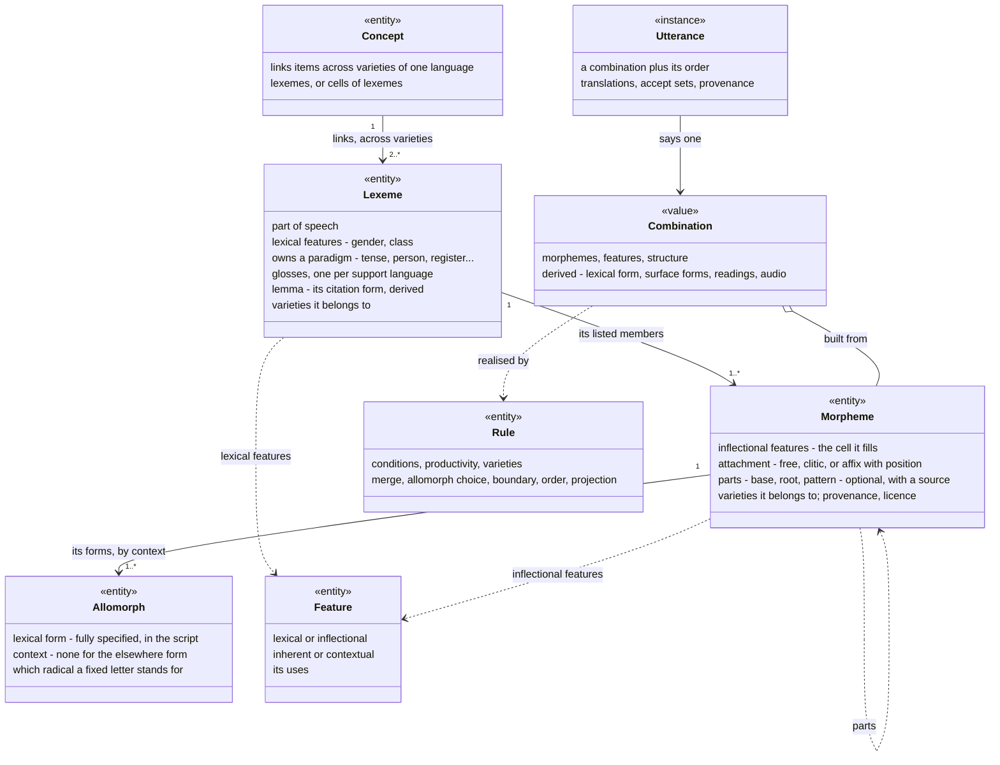
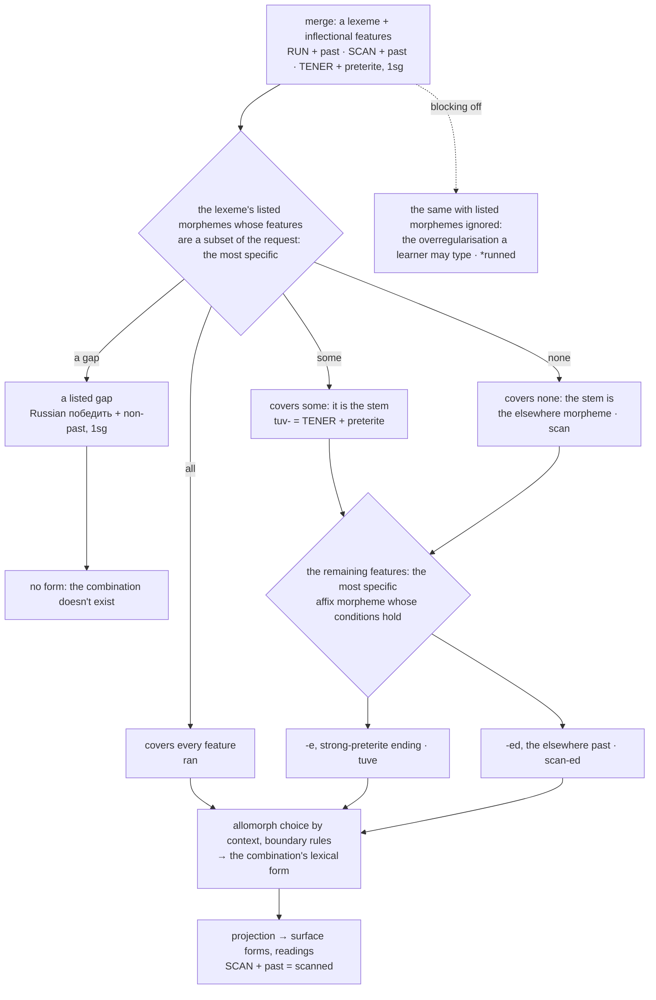
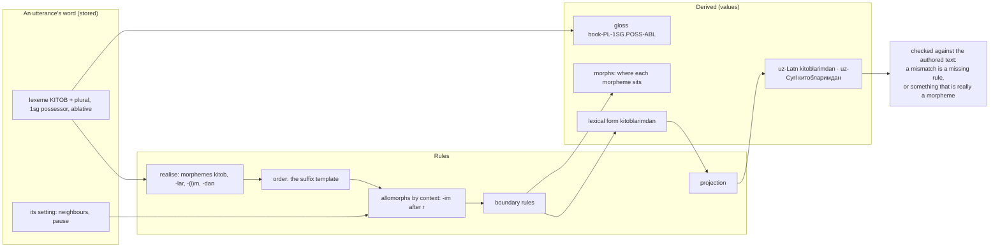
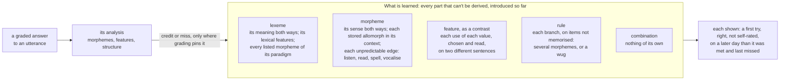

# The morpheme, diagrammed

- Status: working notes, 2026-11-18, beside [lexemes.md](lexemes.md) (the discussion and its decisions).
- Terms as in "Naming" below; also **lexical form** for the fully specified form, **surface form** for a
  projection, **features** for cells and properties.

## Naming (Decided 2026-11-19)

**concept** (EAT, CAR) > **lexeme** (owns a paradigm: SER; *nedha*, with its own forms) > **morpheme** (the
listed sign: *kitob*, ‑dan, *ran*, 東西, *darse cuenta*) > **allomorph** (its forms by context). **Lemma** keeps
its ordinary sense, a lexeme's citation form, as in UD (`LEMMA`), the code (ADR 0061) and the glossary.

Every term keeps its textbook sense. The morpheme is Bloomfield's (1933): a form with no partial
phonetic-semantic resemblance to any other form (東西 "thing" resembles 東 and 西 in sound only). The stretches:
- a portmanteau (*ran*: run + past in one form; Hockett's portmanteau morph);
- a morpheme whose form is a combination of other morphemes' forms (*me di cuenta* inflects *dar* inside it);
- semi-transparent listed items (*writer* the occupation, 大學) resemble their parts (that is why their literal
  glosses help), so they are morphemes by being listed, not by Bloomfield's test.

Earlier drafts called the listed unit a "lexeme" and the paradigm-owner a "lemma"; this doc and lexemes.md
now use the names above.

## Diagrams (2026-11-19)

The whole model in the current terms. Where older prose in this file or lexemes.md disagrees, these win.

### 1. The objects: entities (stored), values (computed), instances (content)

### 2. Examples: a concept across social forms, a concept across varieties, two-stem and irregular paradigms, affixes

**Settled on these diagrams (2026-11-19):**
- **Every morpheme has a lexeme and a concept, affixes included** (Decided): ‑dan's lexeme is "ablative",
  its concept a feature value. Grammatical concepts and inflectional feature values are one thing seen from
  two sides.
- **Concepts have no learning state** (Decided, softly). Proposed: a *derived* view of a concept's lexemes,
  for learners who care: "EAT: you know *mangan* and *nedha*, not yet *dhahar*". Computed from the lexemes'
  states, never stored.
- **The lemma is not the elsewhere morpheme** (a correction to what the first draft of these diagrams
  asked). The lemma is the realisation of the language's **citation cell**, a combination of one, which
  goes through realisation and blocking like any other: the infinitive for es, uz and fa (*ser* = SER +
  infinitive, خوردن = past stem + ‑ن), third person masculine singular perfect for Arabic and Hebrew
  (*kataba*, *qāṭal*), first person singular present for Greek (λύω). The elsewhere morpheme is the stem
  rules use by default (SER's *s‑*: *seré*, *sido*). Where a lexeme has several listed stems and none is
  the default (Persian present and past stems), one is named as elsewhere.
- **An utterance keeps its order for now** (Decided). In full Merge, order would follow from the
  combination and the language's rules; what is left over, the choice among grammatical orders, is
  information structure (topic, focus). The stored order stands in for that, until we model it.

**Resolved (2026-11-19), in the order it was argued: is register a lexical feature at all?** The owner's observation: *mangan* / *nedha*
could be one lexeme EAT + register, as *ran* is RUN + past. The model supports it: register is realised
like inflection, by the most specific listed morpheme (*nedha* for EAT + krama) and otherwise by the
elsewhere one (a word with no krama form is said the same way in krama speech), and *nedha* takes the krama
affixes (*dipun-*) as *tuv-* takes the preterite endings. It distributes over the utterance like agreement
(speech level with the addressee, honorifics with the referent, as Korean's ‑si‑ agrees with its subject).
If so, register (and dialect, which distributes the same way) are paradigm dimensions, and the concept has
no job left inside a language. See lexemes.md §16.

Proposed refinement (2026-11-19), after the owner found *carro* / *coche* as one lexeme "decidedly weird":
**a paradigm lives inside one grammar; dialect is a choice of grammar.**
- One Javanese speaker has *mangan*, *nedha* and *dhahar* and picks among them by situation, so register is a
  paradigm dimension. One Cuban speaker has *carro*; *coche* is another variety's word, known if at all as
  someone else's. Nobody's paradigm holds both.
- Varieties differ in more than words (seseo, voseo, Cuban *¿Qué tú quieres?*), so a dialect is a scope over
  morphemes, lexemes and rules alike: each entry in the language's one lexicon belongs to the varieties
  that have it (shared by default), and a course picks its variety.
- So *carro* and *coche* are two lexemes in two scopes, and what links them is a meaning shared **across
  grammars**: the **concept** comes back with that job, and only that one. A dialect slip ("that's the word
  in Spain; in Cuba, *carro*") follows the concept from the prompt's variety to another.
- The test for a paradigm dimension gains a condition: a choice one speaker makes within their own grammar.
  Register, tense and natural gender pass; dialect doesn't.

**Edges that test the line (2026-11-19):**
- **Diglossia.** A Hong Kong speaker says 佢 / 係 / 嘅 and reads 他 / 是 / 的 in written Standard Chinese; a
  Beirut speaker says *shu* and reads ماذا. One speaker, systematic, with grammatical machinery: the tests
  say paradigm, intuition says two languages.
- **Stylistic doublets without grammar.** Uzbek *samolyot* (Russian) / *tayyora* "aeroplane": one speaker,
  hundreds of such pairs, but no affix or agreement realises the choice. Separate lexemes, so a concept
  links synonyms *within* a grammar too, not only across.
- **Variety-scoped cells.** *tú* / *usted* is a paradigm dimension everywhere, but only Spain's grammar has a
  familiar plural (*vosotros*): varieties scope features and cells, not just entries.
- **Natural gender.** *padre* / *madre* may be one lexeme (*padres* = "parents": the default form covers both
  values), *toro* / *vaca* two (*toros* is not "cattle"). Neutralisation to a default is diagnostic.
- **Many-to-one registers.** Avoidance styles (Dyirbal's is the textbook case) have one word for several
  everyday words; a morpheme in several lexemes' paradigms breaks the tree.
- **Strata.** Cantonese 生 is *saang1* in 生日 and *sang1* in 學生: allomorphs by the word they're in, or a
  literary layer that behaves like a second grammar inside the first?

The diagnostics so far: is the choice one speaker's; does grammar (affixes, agreement) realise it; does a
default cover both values; is the mapping one-to-one. Where they disagree is where concept and lexeme blur.

**The learner's test** (the owner, 2026-11-19: "what a learner needs"). Decided as the definition of a
lexeme's boundary: **Y belongs to X's lexeme if a learner who knows X but not Y doesn't fully know X**, for
a speaker of the course's variety. It is the "learned" principle read backwards: a lexeme's parts are
exactly what learning it requires. The diagnostics above are its evidence, not its definition.

| Has | Lacks | A gap in knowing the first? | So |
|---|---|---|---|
| *run* | *ran* | yes: can't say it in the past | one lexeme |
| *carro* (Cuba) | *coche* | no: another variety's word | two lexemes, a concept between them |
| *padre* | *madre* | no: another word | two lexemes |
| 佢 (spoken) | 他 (written) | no, for spoken Cantonese: another language's word | a concept, or nothing |
| *tayyora* | *samolyot* | no: a synonym, a separate vocabulary gap | two lexemes |
| *mangan* | *nedha* | yes: can't say it to an elder without being rude | one lexeme, register as a paradigm dimension |

**Decided: register is a paradigm dimension; dialect is a variety scope; the concept links lexemes and cells
across varieties; "meaning" is not an object** (glosses and accept sets carry it). Javanese register was the
case to watch: speakers also talk about it as a layer ("he can't speak krama"), not
word by word. Both views can be derived from one model: register cells on each lexeme, and a krama
vocabulary count summed over them. A course can still stage it: ngoko first, krama cells introduced later.

**Register outside Javanese** (the owner, 2026-11-19: "at least when it's this formalized; I'm not so sure
about Spanish or French"). Proposed: register is a paradigm dimension only where the language realises it
inside paradigms. Elsewhere it is chosen by picking a lexeme.
- **Javanese** (and Korean's speech levels, Japanese *‑masu*, *meshiagaru* for *taberu*): verbs, nouns and
  affixes have register cells, with a default. A paradigm dimension.
- **Spanish and French T–V**: no verb has a formality cell. Formality is chosen by picking a pronoun, whose own
  person and number then drive agreement: *usted es* is a third-person form, *vous êtes* a plural one
  (with singular adjectives: *vous êtes gentil*). So *tú* and *usted*, *tu* and *vous*, are separate lexemes.
  Knowing *tú* without *usted* is a gap in addressing people, not in knowing *tú*, as with *padre* and *madre*.
  French *vous* has two senses, plural and polite singular, so two morphemes.
- Either way, register is still a feature the learner chooses from the situation: the prompt tags it (§12 of
  lexemes.md) and it is learned as a contrast. What differs is only how the language realises it: inside a
  lexeme's paradigm, or by choosing between lexemes.
- So the variety example changes level: Spain's *vosotros* and Cuba's *ustedes* are pronoun lexemes linked by
  a concept, and the verb forms that agree with them (*habláis* / *hablan*) are cells linked by one.

**Then Javanese too?** (the owner: "by this logic, Javanese register feels like a concept link"). Proposed,
reversing "register is a paradigm dimension" for Javanese by applying the T–V reasoning consistently. Register
is realised in three ways, and only one is a paradigm dimension:
- **A dedicated exponent: a paradigm dimension.** Korean's speech-level endings (‑yo, ‑seumnida), Japanese
  ‑masu: every verb has the cells, and the ending's meaning *is* the politeness.
- **Substituted forms: a scope, like a variety.** Javanese speech levels replace words (*mangan* → *nedha*) and
  affixes (*di‑* → *dipun‑*) with other forms of the same things, and anything without a krama form is shared,
  exactly as entries are shared across varieties by default. Ngoko and krama are then lects within one
  speaker's repertoire: the krama affixes are allomorphs whose context is the utterance's speech level,
  *nedha* is a krama-scoped lexeme, and a concept links it to *mangan*. It matches how speakers put it:
  "he can't speak krama" is a missing lect, not a missing form of *mangan*.
- **A lexeme with its own feature: a lexical choice.** Spanish and French T–V pronouns, and Javanese honorifics
  for a referent (*dhahar* for a respected person's eating, *matur* for one's own speaking to them), which
  vary word by word within one utterance (*Kula sampun nedha, Bapak sampun dhahar*).

The learner sees the same thing whichever way: the prompt tags the situation and the choice is learned as a
contrast; a concept's coverage ("EAT: ngoko, krama, not yet krama inggil") is the view a learner of Javanese
would want.

**A rule of thumb, and its thorn** (the owner, 2026-11-19): most lexemes have a single morpheme, so a property
that consistently causes suppletion probably works at the concept level, not inside a lexeme.
- **The thorn: Persian verb stems.** Every Persian verb has a past and a present stem, and for the common verbs
  the pair is unpredictable: رفتن *raft‑* / *rav‑* "go", دیدن *did‑* / *bin‑* "see", کردن *kard‑* / *kon‑* "do",
  گفتن *goft‑* / *gu‑* "say", آمدن *āmad‑* / *ā‑* "come" (the ‑idan verbs are regular: *xābid‑* / *xāb‑*).
  Tense consistently causes suppletion across the verb lexicon, yet *raft‑* and *rav‑* are plainly one
  lexeme: knowing one without the other is a gap in knowing "go". Arabic broken plurals are the same thorn.
- **A second, smaller one, also Persian:** formal Persian uses Arabic plurals beside ‑hā (خبرها / اخبار
  "news", اسناد "documents"): register-conditioned suppletion inside a single cell.
- Proposed refinement: consistent suppletion points to the concept level only when the property selects a lect
  (speech level, variety) and leaves the proposition alone; a property with its own meaning in the
  proposition (tense, number) stays inside the lexeme however suppletive it is.

**How a scoped morpheme is triggered** (Persian Arabic plurals, 2026-11-19). Proposed:
- **Scope is part of the Elsewhere lookup.** A listed morpheme is a candidate only if it belongs to the
  utterance's scope; among the candidates, the most specific wins. KETĀB + plural in a formal utterance finds
  کتب *kotob* (listed for plural, formal); in an everyday one *kotob* isn't a candidate, nothing listed
  covers plural, and the rule gives کتاب‌ها *ketābhā*.
- **Scopes have two axes:** variety (Cuban, Tehrani) and register (krama; formal written Persian). Each
  morpheme, lexeme and rule belongs to the scopes that have it, shared by default; an utterance has one of
  each, a course a range, and a prompt tags it ("in an official letter").
- **Each listed form carries its own register range**, since Persian formality is a gradient: کتب is
  written-only, اخبار is everyday too.
- **A plural with its own sense is a separate morpheme**, not a register form: اخبار "the news" (a broadcast)
  beside خبرها "news items".
- **Persian register is a scope pair like ngoko and krama**, realised three ways: scoped rules (colloquial
  *mi‑ram* for *mi‑ravam*, ‑e for است), sporadic scoped morphemes (Arabic plurals), and scoped lexemes linked
  by a concept (*hālā* / *aknun* "now"). The fa course has to choose its register scope(s) anyway.
- **A register slip gets feedback**, as a dialect slip does: "that's the everyday plural; in formal writing,
  کتب".

**Decided (2026-11-19): every Javanese register form is at the concept level.** *Mangan* (ngoko), *nedha*
(krama) and *dhahar* (honorific: a respected person's eating) are three lexemes linked by the concept EAT;
the speech level is a scope, the honorific a lexical feature of *dhahar*. Persian *raft‑* / *rav‑* are two
listed stems of one lexeme. So a **concept links lexemes that differ only in social form**: the variety, the
speech level, the honorific, who is speaking to whom about whom. Never in what is said.
- Resolved below: Spanish and French T–V are concept-linked; the Javanese krama affixes are separate affix
  lexemes linked by a concept, like the words.

**The owner's rule (2026-11-19): a base case makes a paradigm.** If a feature has a regular, base-case
morpheme that realises it, then the feature is a dimension of the lexeme's paradigm, and its suppletive forms
elsewhere are cells of that lexeme, however many there are. Arabic broken plurals are cells of their singular
because the sound plural ‑ون exists, even though broken plurals are the norm.

The two readings of the owner's first wording ("any systematic way to trigger something") are one rule seen
from two sides: **the base case decides whether a feature is a paradigm dimension; the dimension decides
whether a suppletive form fills cells or is a word of its own.**
1. Does the feature have an overt base-case morpheme? Then it is a dimension of the paradigm.
2. Within a dimension, every form, however suppletive, fills cells of the one lexeme (*rav‑* fills Persian's
   present cells, 드시다 Korean's honorific ones).
3. Without a base case, an alternative is a whole word with a paradigm of its own: a separate lexeme, linked
   by a concept if it differs only in social form (*nedha*, *usted*, *coche*), unlinked otherwise (*madre*).
Read alone, "a cell or a whole word" would have put Korean 드시다 at the concept level (it inflects on its own);
the base case is what makes it a cell.
- **Lexeme-level:** English past (‑ed, so *ran*, *went*); Persian tense (regular stems in ‑id, so *raft‑* / *rav‑*);
  Persian plural (‑hā, so formal کتب *kotob* is a cell of KETĀB, picked by register); Korean subject honorific
  (‑si‑, so 드시다 *deusida* is a cell of 먹다 "eat"); Japanese honorifics (*o‑V‑ni naru*, so *meshiagaru* is a
  cell of *taberu*).
- **Concept-level, for want of a base case:** Javanese speech level and honorific (no regular krama or
  honorific morpheme for stems; words without a krama form stay as they are), Spanish and French T–V (no
  formality affix), dialect (no dialect morpheme).
- **Corrected (the owner: "how is that different than *mangan* vs *nedha*?"):** it isn't. *Dipun‑* replaces *di‑*
  everywhere *di‑* occurs, in krama, as *nedha* replaces *mangan*: two affix lexemes linked by a concept, as
  are ‑e / ‑ipun and ‑ake / ‑aken. (An earlier line here made them allomorphs.)
- **What separates both from Persian *kotob*: whole or partial replacement.** Scopes (variety, register, speech
  level) are never paradigm dimensions, having no base case. A scoped form that replaces a lexeme's every
  form is a separate lexeme, linked by a concept (*nedha*, *dhahar*, *dipun‑*, *usted*, *coche*). One that
  replaces only some cells is a scoped morpheme of the same lexeme: formal Persian says کتب *kotob* in the
  plural but still کتاب *ketāb* in the singular.
- **The rule predicts a typological contrast:** "eat" honorific is a cell in Korean and Japanese, a separate
  lexeme in Javanese.
- **Its thorn: Spanish feminine ‑a** (*niño* / *niña*) is a base case, so *padre* / *madre*, *toro* / *vaca* would be
  cells of one lexeme, which the owner rejected. Proposed: noun gender marking is derivational, not
  inflectional, and the rule is about inflection; derivation never merges lexemes. *Niña* is then *niño* + a
  derivational feminine (a combination), and *madre* a lexeme of its own.

**The owner's verdicts (2026-11-19):**
- **Natural-gender pairs are separate lexemes** (*padre* / *madre*, *toro* / *vaca*; Decided). No semantic
  decomposition: no KING + F = QUEEN. A lexeme has a cell only for a feature it inflects for; *padre* is a
  masculine noun as *casa* is a feminine one. (Open: *niño* / *niña*, where the ‑a is regular.)
- **Literary and colloquial readings are different words** (生 *saang1* in 生日, *sang1* in 學生; Decided).
  Diachrony is not our concern.
- **Variety-scoped cells are concept territory** (Decided): Spain's 2nd plural familiar (*vosotros*) and Cuba's
  2nd plural (*ustedes*) are linked by a concept. A concept can link cells as well as lexemes.
- **A further layer, provisionally "meaning"** (it may not exist): diglossic pairs (佢 / 他), stylistic
  doublets without grammar (*samolyot* / *tayyora*) and many-to-one registers sit between meaning and concept.
  Proposed working line: a **concept** is a correspondence the community itself makes between items of one
  language's grammars ("in Cuba we say *carro* for Spain's *coche*"); a **meaning** is only an equivalence of
  sense, as in translation. Proposed: meaning stays implicit, carried by glosses and accept sets, never an
  object, until a feature needs it. Both serve the same feedback: "another word that would be right under a
  different scope".

### 3. What is stored, and what is derived

### 4. Realising a lexeme and features: blocking by the most specific listed morpheme

### 5. A combination, from morphemes to surface forms

### 6. What is learned, and what counts as shown

## What is stored, and what is derived

(Now Diagram 3, below "Naming".)

### Stored on the lexeme (shared by every morpheme of a paradigm)

| | Examples |
|---|---|
| lexical meaning, as a gloss per support language | RUN "run"; HOUSE "house" |
| part of speech | VERB, NOUN |
| lexeme features: constant across its paradigm | *casa*: feminine; *pensar*: e→ie; *nedha*: krama; *carro*: Cuban |

### Stored on the morpheme (underivable)

| | Examples |
|---|---|
| its lexeme | *ran* → RUN |
| its inflectional features: what varies across the paradigm | *ran*: past; *fue*: preterite 3sg |
| attachment | independent; clitic (*me*); dependent + position (‑ga, suffix) |
| lexical forms: the elsewhere form, plus forms with their contexts | ‑ga; ‑ka after k; ‑qa after q |
| parts, with a source (where it has them) | *writer* (occupation) ← *write* + ‑er; مَكْتَب ← ك‑ت‑ب + مَفْعَل |
| provenance, license, notes, image | |

### Derived on the morpheme

| | From |
|---|---|
| sense, and its gloss (*ran*: "run (past)") | lexeme + its own features |
| open or closed class | part of speech |
| inflectional or derivational (an affix) | its lexeme: a feature value, or a function making a new lexeme |
| paradigm | morphemes sharing its lexeme |
| family | parts |
| literal gloss | parts and their glosses |
| facets asked | the forms of its combinations (where they're unpredictable), lexeme-wide features needing evidence, the course's orthographies, facets and voice |

### Derived on combinations, never on a morpheme (Decided)

Merge and projection rules work on combinations: contexts, boundaries and order only exist there. A
morpheme's "own" surface form is the surface form of a **combination of one**.

| | Examples |
|---|---|
| surface forms per orthography, with variants | *kitoblarimdan*; *dámelo* |
| the citation form: a combination of one, with the lexeme's citation features, in isolation | *run*; *ichmoq*; ‑ga shown as "‑ga / ‑ka / ‑qa" by the citation convention for dependents |
| phonemic forms per scheme | |
| audio | a word clip is a combination of one in a carrier context (fa's carrier, yue's 跟住我讀) |
| homographs | *como* is EAT + present 1sg and also "like, as": combinations, not morphemes |

## Worked examples

| | *casa* | ‑ga (uz) | *fue* (*ser*) | *me* (es) |
|---|---|---|---|---|
| **lexeme** | HOUSE (NOUN, feminine) | dative: Case=Dat, "to" | BE (*ser*) | 1SG pronoun |
| **own features** | none | none | preterite, 3sg | object case |
| **attachment** | independent | dependent, suffix | independent | clitic |
| **lexical forms** | *casa* | ‑ga; ‑ka after k; ‑qa after q | *fue* | *me* |
| **parts** | none | none | none | none |
| *derived* | gloss "house"; *casas* is a combination | closed; inflectional; gloss "to (dative)" | gloss "was"; a homograph of *fue* (*ir*) | paradigm with *yo*, *mí*; joined in *dame* by the orthography's projection |

## What diagramming surfaced

1. **Superseded (see "Resolved" above):** every lexical feature is on the lexeme, but register is a paradigm
   dimension and dialect a variety scope, so neither is a lexical feature. A morpheme carries only
   inflectional ones. The line is what stays constant across a paradigm: *nedha* and
   *dhahar* each have their own inflected forms, as *carro* and *coche* have their plurals. That is UD's
   lexical / inflectional line after all (an earlier draft put register and dialect on the morpheme).
   - So *mangan*, *nedha* and *dhahar* are three lexemes, and *carro* and *coche* two. Decided: what they
     share is a **concept** (EAT, CAR), the object glosses belong to; a register or dialect question ("which
     would you say to your grandmother?") asks among a concept's lexemes, and a register or dialect slip is
     another lexeme of the same concept. Two lexemes of one concept with every feature alike are the hole
     noted in lexemes.md §8.
2. **The gloss belongs to the concept** (Proposed; first the lexeme). A lexeme's gloss is the concept's plus
   its features ("eat (krama)"), a morpheme's adds its inflectional ones ("run (past)"), with an override where
   that reads badly.
3. **An affix's lexeme says what kind it is.** ‑ga's lexeme is a feature value (Case=Dat), so it's
   inflectional; ‑er's is a function that makes a new lexeme, so it's derivational. Nothing to store.
4. **Open or closed comes from the part of speech**, as UD groups its tags, with a language override where
   needed.
5. **Decided: one lexicon per language**, which every course of that language draws on; a language with
   several orthographies projects them all from it. Where it could bite:
   - an orthography whose spellings no rule gives (simplified from traditional Chinese merges 發 and 髮 into
     发; the reverse can't be derived), so the lexical form must hold the fuller one;
   - two courses wanting different analyses of one morpheme: a question of who owns the lexicon and signs it
     off;
   - provenance and review per morpheme, across courses, instead of per course file;
   - bundles carry only the morphemes a course uses.
   Varieties (Cuban, Beirut) live in one lexicon through dialect features; different languages that share a
   script (lzh and yue, hbo and Modern Hebrew) have separate lexicons.
6. **Next: combinations** (below).

## A morpheme's manifestations (allomorphs Decided 2026-11-19)

A morpheme shows up in two different ways, and only one needs an object:
- **Its stored forms: an object, the allomorph** (the term in lexemes.md §2). Each holds a lexical form, its
  context (none for the elsewhere form), which radical any fixed letter stands for, and its source. They are
  parts of the morpheme, stored with it, and learned one by one (each is a part no rule gives).
- **Its forms in combinations, the word forms** (*kitoblarimdan*, *kitobga*): values, not objects. A word
  form is a combination of one (a morpheme plus inflectional features), identified by its content, so data
  derived for it (a clip, a homograph mark) is keyed by that content, the way clips said alike already share
  a file.

## What the learner learns (Proposed)

**The morpheme is the primary unit of what is taught and stored:** every listed pairing of form and meaning a
learner has to memorise. But learned knowledge has three sides, and morphemes are one of them:

| Kind | What it is | Examples |
|---|---|---|
| **meaning** | lexemes (lexical meaning, with lexeme-wide features) and features (grammatical meaning) | RUN; *casa* is feminine; past; dative; krama |
| **form** | morphemes: the listed forms that realise meanings | *run*, *ran*, ‑ga, *tuv-*, *nedha* |
| **rule** | productive patterns: affixation, allomorph choice, boundary and projection rules (letters and marks included) | ‑ga → ‑qa after q; the e→ie pattern; reading unpointed Hebrew |

- **Most lexemes have exactly one morpheme** (*casa*, *kitob*, 呀), so the split is invisible. It shows where a
  lexeme has several listed members: *run* / *ran*, *ser*'s forms, *mangan* / *nedha* / *dhahar*, *carro* /
  *coche*.
- **Meaning is learned once per lexeme.** A learner who knows *run* doesn't relearn RUN for *ran*; *ran* adds a
  form for a feature. Recognising *ran* is evidence for RUN; producing it is evidence for the morpheme *ran*
  and the feature past.
- **Features are to grammar what lexemes are to vocabulary**: units of meaning, realised by morphemes (‑ga for
  dative; ‑ó, fused, for preterite 3sg) or by nothing (uz COP.3SG).
- **Order follows:** a lexeme's elsewhere morpheme before its listed members (*run* before *ran*), as a base
  before its derivatives.
- **The word list groups by lexeme**, its listed morphemes beneath like principal parts (*ser*: *soy*, *eres*, *es*,
  *fue*…).
- **Decided: to have learned something is to have learned every part of it that can't be derived**, for
  every kind of thing:
  - **a morpheme:** its forms (each with its context), its sense, its features, every unpredictable edge;
  - **a lexeme:** its meaning, its lexeme-wide features, and every listed morpheme of its paradigm. Knowing *fue*
    is not knowing BE: *soy*, *eres*, *es*… are parts of it no rule gives. Evidence of the meaning can come
    through any of its morphemes; each listed form needs its own;
  - **a rule:** every branch of it, each context it distinguishes (‑ka after k *and* ‑qa after q), shown on
    items the learner can't have memorised it on;
  - **a feature** (Proposed, 2026-11-19): only an *inherent* feature is learned as a feature, and what is
    learned is **when to use it**, not how to spell it (forms belong to morphemes and rules). Preterite vs
    imperfect (*comí* / *comía*), krama vs ngoko, uz ‑di vs ‑ibdi: a learner can know every form and still
    choose wrong. Its parts are its uses (the imperfect's habitual, ongoing-in-the-past, backdrop, polite
    *quería*), each introduced and shown on its own where no core meaning predicts it. Shown both ways:
    choosing it from a situation (a prompt tagged "(every day)", never "(imperfect)", §12 of lexemes.md) and
    reading it off a form ("*comía*: once, or habitually?"). A *contextual* feature (agreement, a case a
    verb governs, the subjunctive *querer que* forces) is not learned as a feature: it is a rule plus a
    lexical feature of a lexeme (*casa* is feminine; *querer que* takes the subjunctive);
  - **a combination:** nothing of its own. It is derivable, so it is learned when its parts are.
- **Proposed: exactly what counts**, every item under ADR 0100's rule for a skill shown (a first try, right,
  not self-rated, on a later local date than the part was met and than it was last missed), over the parts
  introduced so far:
  - **A morpheme:**
    1. its sense recognised (its form → its meaning) and produced (its meaning → its form);
    2. each stored form produced in its own context (‑ka after k; *el* before *agua*), where no rule gives it;
    3. each lexical feature that needs it (*casa* feminine: *la casa* produced from the meaning, not handed
       over by a word bank);
    4. each edge the course asks and the profile marks unpredictable: listening, reading aloud, spelling,
       vocalising.
  - **A feature** is learned as its **contrast** (Decided 2026-11-19: aspect is preterite against imperfect,
    a structuralist unit, and the right one here), since a learner who
    always picks one value would otherwise get every card for it right. For each use of each value
    introduced (preterite: a completed event, a sequence; imperfect: habitual, ongoing, description, polite):
    1. chosen right where the situation calls for it, the alternative on offer or typed;
    2. read right off the form;
    3. each on at least two different sentences with different lexemes carrying the feature, so a memorised
       sentence can't stand in for the use.

    A wrong value counts against the use that was called for, and only where grading pins it (a minimal-pair
    card, or a typed answer with the right lexeme in the wrong cell).

    A contrast belongs to its language, even where UD gives its values the same names: Spanish preterite
    against imperfect, English simple against progressive, Biblical Hebrew wayyiqtol against qatal. Two
    languages' "past" are two features, and a learner whose own language lacks a contrast meets it through
    the prompt's situation (lexemes.md §12).
- Proposed: **"every part" means every part introduced so far**, of those the course asks for this learner.
  A course that never teaches *sois* can still teach *ser* to the end, and a lexeme whose new irregular form
  arrives in a later unit goes back to learning until that form is shown, as a miss sends a word back now
  (ADR 0100, D3).
- Proposed: the word list shows a lexeme's progress (*ser*: meaning, 5 of 9 forms), not only learned or not.

## Combinations

A combination is derivable by definition: whatever isn't is a morpheme (lexemes.md §3). Only its morphemes are
stored, in the course text; everything else is derived, and the derived surface form is checked against
what the author wrote.

(Now Diagram 4.)

**Combining is more than concatenating.** It works on lexical forms, then projects:
- **order and templates:** affix order; a root interleaved with its pattern;
- **allomorph choice by context:** uz ‑im after a consonant, ‑m after a vowel; ‑qa after q;
- **boundary rules on the lexical form:** Hebrew vowel reduction (דָּבָר + ‑ִים → דְּבָרִים), sandhi;
- **projection rules on the result:** Spanish *da* + *me* + *lo* keeps its stress on *da*, and the
  orthography writes *dámelo* because that stress is now antepenultimate; Persian کتاب + ‑ها is written
  with a ZWNJ; chg puts one before ‑dur.

**What is derived:**
- the combination's lexical form, surface forms and phonemic forms;
- its features: the union of its morphemes' (plural, 1sg possessor, ablative);
- its interlinear gloss (book‑PL‑1SG.POSS‑ABL), mechanically. A natural translation ("from my books") is
  the sentence's job, authored with its accept sets;
- its morphs: where each morpheme's exponent sits. The combining rules must keep track of this.

**A mismatch with the authored text** means a missing rule, or a "combination" that is really a morpheme.
That is the lint from lexemes.md §3.7.

**The span is open-ended.** A word (*kitoblarimdan*) is a combination; so is a phrase (*the writer of X*) and
a sentence. Constructions are rules at the phrase level: apc's *used to* is a periphrastic way of filling a
feature. A construction whose meaning isn't derivable is a morpheme with slots.

### Order (Proposed)

**Linear order can be dropped from a combination; hierarchy can't.**
- **Inflection:** a combination is a morpheme plus features (kitob + {plural, 1sg possessor, ablative}). The
  language's template orders the exponents, as realizational morphology has it, so nothing is stored but
  the features.
- **Order rules are stated once per language, never per combination:** affix templates and position
  classes, clitic clusters (Spanish *se* > 2nd > 1st > 3rd: *se te lo*), clitic placement by host (*me lo
  da*, *dámelo*), head direction.
- **Hierarchy carries meaning, and the same order can hide two:** *un‑lock‑able* is [un‑[lock‑able]] "can't
  be locked" or [[un‑lock]‑able] "can be unlocked"; stacked causatives and passives scope by their order
  (Baker's Mirror Principle). So a combination stores its structure, which affix or word applies to what,
  and rules linearise it: Merge without order, then linearisation.
- **Free word order isn't underivable either:** where several orders are grammatical, each is a
  linearisation. Information structure (topic, focus) would pick one; a prompt that doesn't specify it
  accepts them all (ADR 0085).
  - **The payoff:** order variants in accept sets are generated, not hand-listed (hbo's subject and
    predicate orders, ADR 0084). Generated at compile time, so the grader stays literal (ADR 0085).
- **Where order is data: the utterance.** An attested text (a Bible verse, a Perseus passage, a story line)
  is one linearisation an author chose, and its order is a fact about that text. So: a combination is
  structure; an utterance is a combination plus the order it was said in.
- Written order isn't always spoken order even within a word: Thai and Lao store preposed vowels in visual
  order, an exception to Unicode's logical order. Projection rules handle it.

### Blocking: where *ran* is stored, and how it's found (Proposed)

**Merge takes a lexeme and features (RUN + {past}); realising them picks the forms.**

**The irregular morpheme is the exception table.** *ran* is already stored as lexeme RUN + {past}, so "the
past of *run* is *ran*" is written once, on *ran*, and nowhere else.

**The lookup is the Elsewhere Condition** (Pāṇini's principle, in Stump's Paradigm Function Morphology; the
Subset Principle in Distributed Morphology): the most specific item wins.

(Now Diagram 5.)

1. Index the lexicon at compile time by lexeme. Among a lexeme's listed morphemes, take those whose features
   are a subset of the request, and the most specific of them.
2. If it covers every feature, that's the answer: *ran*.
3. If it covers some, it's the stem: *tuv-* is TENER + {preterite}. Its own lexical features (a
   strong-preterite stem) condition what comes next.
4. If it covers none, the stem is the lexeme's elsewhere morpheme: *scan* (SCAN + {past} still ends as
   *scanned*, after steps 5 and 6).
5. The remaining features are realised by affixes, again the most specific whose conditions hold: the
   strong-preterite ‑e (*tuve*) beats the regular ‑í; the elsewhere ‑ed applies to *scan*.
6. Then boundary and projection rules: *scanned*.

**Three ways a merge can "fail", each stored differently:**
- **Blocked** (RUN + past): not a failure. The lookup returns *ran*; *runned* is never built.
- **Conditions not met** (*\*greenen*, *\*unsad*): a rule's conditions don't hold, so it produces nothing.
  Nothing is stored.
- **An arbitrary gap** (Russian победить has no 1sg non-past): stored on the lexeme as a feature set with no
  form, a listed item that blocks the rule and supplies nothing.

**Blocking off gives the learner's error.** Run the same realisation ignoring listed morphemes and RUN + past
comes out *runned*: exactly the overregularisation a learner types. The compiler can put those forms in the
bundle beside the right answer, so the grader can say "right tense, irregular verb" while staying literal.

**Merge runs at compile time**, in the pipeline: accept sets, overregularisations and wugs are generated
there, and the bundle carries the results.

### Merge all the way up (Proposed)

The owner would like Merge to reach phrases and sentences. Proposed: yes as the architecture, with coverage
growing rule by rule, so it is never all or nothing.
- **An utterance's structure is annotated as a UD dependency tree** (heads and relations), which carries the
  hierarchy linearisation needs; Merge's binary sets aren't needed for that. We already use UD's parts of
  speech and features, and a parser (Stanza) can draft the trees for a reviewer to correct.
- **Each language's linearisation rules start empty.** With none, only the authored order is generated, which
  is today's behaviour; each rule added (adjective after noun, clitic clusters, subject–predicate in hbo)
  generates more orders for accept sets, at compile time.
- **The risk is over-generation**: a wrong rule accepts wrong answers. So every rule has conformance vectors,
  and generated variants carry `generated` provenance for review, like wug items.
- **What it buys:** order variants and agreement in accept sets generated instead of listed; credit
  assignment from structure (which word a slip belongs to); a check that every authored sentence derives
  from its annotation.

### Where morphemes and combinations meet

Some morphemes have an underivable meaning but a derivable form: *writer* (the occupation) is spelled *write*
+ ‑er; fa زمین خوردن "fall" is زمین + خوردن; *darse cuenta*; *kick the bucket*.
- **Such a morpheme stores its parts, not a lexical form**, and its form is combined from them like any
  combination's. Only its meaning is listed.
- **One part is where inflection goes:** زمین خوردم "I fell" inflects خوردن; *me di cuenta* inflects *dar*;
  *kicked the bucket* inflects *kick*. The morpheme names that part.
- **Parts now do two jobs:** the literal gloss (lexemes.md §10) and the form, inflection included.
- So a morpheme stores **either lexical forms or parts**: forms where the form is underivable (*ran*, *casa*),
  parts where only the meaning is.
