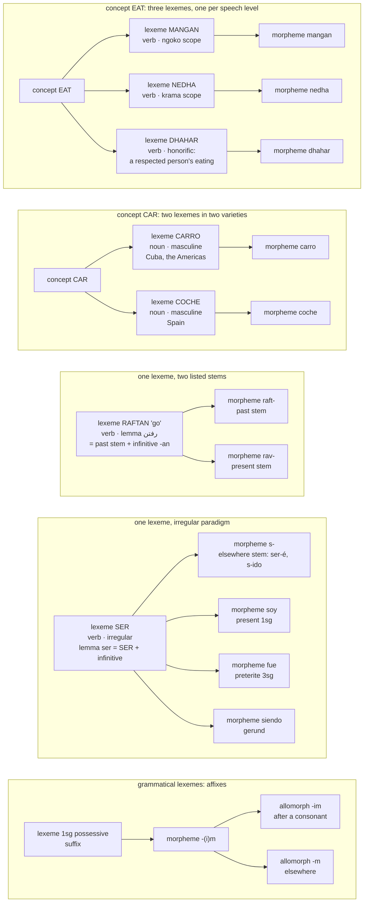
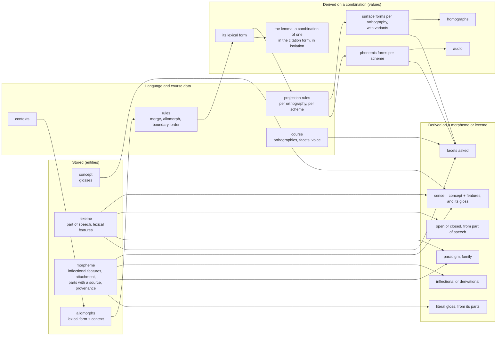
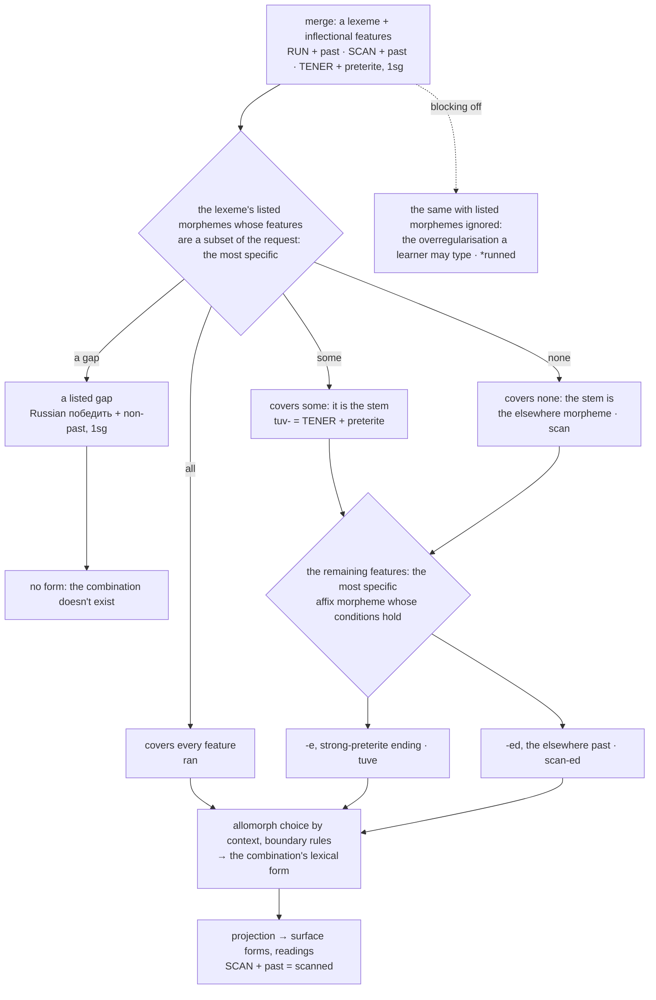
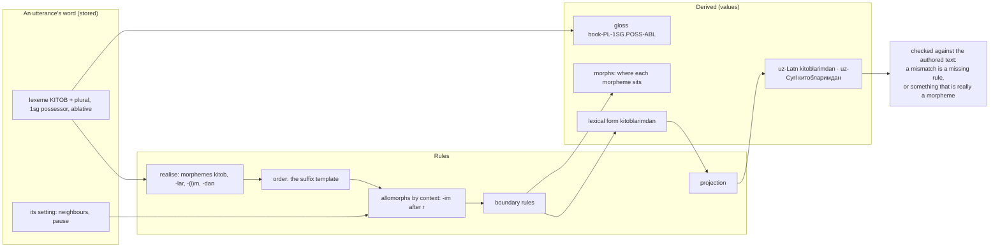
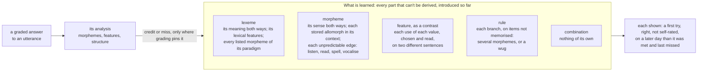

# The morpheme, diagrammed

- Status: working notes, 2026-11-18, beside [lexemes.md](lexemes.md) (the discussion and its decisions).
- Terms as in "Naming" below; also **lexical form** for the fully specified form, **surface form** for a
  projection, **features** for forms and properties.

## Naming (Decided 2026-11-19)

**concept** (EAT, CAR) > **lexeme** (owns a paradigm: SER; *nedha*, with its own forms) > **morpheme** (the
listed sign: *kitob*, ‑dan, *ran*, 東西, *darse cuenta*) > **allomorph** (its forms by context). **Lemma** keeps
its ordinary sense, a lexeme's citation form, as in UD (`LEMMA`), the code (ADR 0061) and the glossary.

Every term keeps its textbook sense. The morpheme is Bloomfield's (1933): a form with no partial
phonetic-semantic resemblance to any other form (東西 "thing" resembles 東 and 西 in sound only). The stretches:
- a portmanteau (*ran*: run + past in one form; Hockett's portmanteau morph);
- a morpheme whose form is a combination of other morphemes' forms (*me di cuenta* inflects *dar* inside it);
- semi-transparent listed items (*writer* the occupation, 大學) resemble their parts (that is why their literal
  glosses help), so they are morphemes by being listed, not by Bloomfield's test.

Earlier drafts called the listed unit a "lexeme" and the paradigm-owner a "lemma"; this doc and lexemes.md
now use the names above.

## Diagrams (2026-11-19)

The whole model in the current terms. Where older prose in this file or lexemes.md disagrees, these win.

### 1. The objects: entities (stored), values (computed), instances (content)

### 2. Examples: a concept across speech levels, a concept across varieties, two-stem and irregular paradigms, affixes

**Settled on these diagrams (2026-11-19):**
- **Every morpheme has a lexeme and a concept, affixes included** (Decided): ‑dan's lexeme is "ablative",
  its concept a feature value. Grammatical concepts and inflectional feature values are one thing seen from
  two sides.
- **Concepts have no learning state** (Decided, softly). Proposed: a *derived* view of a concept's lexemes,
  for learners who care: "EAT: you know *mangan* and *nedha*, not yet *dhahar*". Computed from the lexemes'
  states, never stored.
- **The lemma is not the elsewhere morpheme** (a correction to what the first draft of these diagrams
  asked). The lemma is the realisation of the language's **citation form**, a combination of one, which
  goes through realisation and blocking like any other: the infinitive for es, uz and fa (*ser* = SER +
  infinitive, خوردن = past stem + ‑ن), third person masculine singular perfect for Arabic and Hebrew
  (*kataba*, *qāṭal*), first person singular present for Greek (λύω). The elsewhere morpheme is the stem
  rules use by default (SER's *s‑*: *seré*, *sido*). Where a lexeme has several listed stems and none is
  the default (Persian present and past stems), one is named as elsewhere.
- **An utterance keeps its order for now** (Decided). In full Merge, order would follow from the
  combination and the language's rules; what is left over, the choice among grammatical orders, is
  information structure (topic, focus). The stored order stands in for that, until we model it.

**Resolved (2026-11-19), in the order it was argued: is register a lexical feature at all?** The owner's observation: *mangan* / *nedha*
could be one lexeme EAT + register, as *ran* is RUN + past. The model supports it: register is realised
like inflection, by the most specific listed morpheme (*nedha* for EAT + krama) and otherwise by the
elsewhere one (a word with no krama form is said the same way in krama speech), and *nedha* takes the krama
affixes (*dipun-*) as *tuv-* takes the preterite endings. It distributes over the utterance like agreement
(speech level with the addressee, honorifics with the referent, as Korean's ‑si‑ agrees with its subject).
If so, register (and dialect, which distributes the same way) are paradigm dimensions, and the concept has
no job left inside a language. See lexemes.md §16.

Proposed refinement (2026-11-19), after the owner found *carro* / *coche* as one lexeme "decidedly weird":
**a paradigm lives inside one grammar; dialect is a choice of grammar.**
- One Javanese speaker has *mangan*, *nedha* and *dhahar* and picks among them by situation, so register is a
  paradigm dimension. One Cuban speaker has *carro*; *coche* is another variety's word, known if at all as
  someone else's. Nobody's paradigm holds both.
- Varieties differ in more than words (seseo, voseo, Cuban *¿Qué tú quieres?*), so a dialect is a scope over
  morphemes, lexemes and rules alike: each entry in the language's one lexicon belongs to the varieties
  that have it (shared by default), and a course picks its variety.
- So *carro* and *coche* are two lexemes in two scopes, and what links them is a meaning shared **across
  grammars**: the **concept** comes back with that job, and only that one. A dialect slip ("that's the word
  in Spain; in Cuba, *carro*") follows the concept from the prompt's variety to another.
- The test for a paradigm dimension gains a condition: a choice one speaker makes within their own grammar.
  Register, tense and natural gender pass; dialect doesn't.

**Edges that test the line (2026-11-19):**
- **Diglossia.** A Hong Kong speaker says 佢 / 係 / 嘅 and reads 他 / 是 / 的 in written Standard Chinese; a
  Beirut speaker says *shu* and reads ماذا. One speaker, systematic, with grammatical machinery: the tests
  say paradigm, intuition says two languages.
- **Stylistic doublets without grammar.** Uzbek *samolyot* (Russian) / *tayyora* "aeroplane": one speaker,
  hundreds of such pairs, but no affix or agreement realises the choice. Separate lexemes, so a concept
  links synonyms *within* a grammar too, not only across.
- **Variety-scoped forms.** *tú* / *usted* is a paradigm dimension everywhere, but only Spain's grammar has a
  familiar plural (*vosotros*): varieties scope features and forms, not just entries.
- **Natural gender.** *padre* / *madre* may be one lexeme (*padres* = "parents": the default form covers both
  values), *toro* / *vaca* two (*toros* is not "cattle"). Neutralisation to a default is diagnostic.
- **Many-to-one registers.** Avoidance styles (Dyirbal's is the textbook case) have one word for several
  everyday words; a morpheme in several lexemes' paradigms breaks the tree.
- **Strata.** Cantonese 生 is *saang1* in 生日 and *sang1* in 學生: allomorphs by the word they're in, or a
  literary layer that behaves like a second grammar inside the first?

The diagnostics so far: is the choice one speaker's; does grammar (affixes, agreement) realise it; does a
default cover both values; is the mapping one-to-one. Where they disagree is where concept and lexeme blur.

**The learner's test** (the owner, 2026-11-19: "what a learner needs"). Decided as the definition of a
lexeme's boundary: **Y belongs to X's lexeme if a learner who knows X but not Y doesn't fully know X**, for
a speaker of the course's variety. It is the "learned" principle read backwards: a lexeme's parts are
exactly what learning it requires. The diagnostics above are its evidence, not its definition.

| Has | Lacks | A gap in knowing the first? | So |
|---|---|---|---|
| *run* | *ran* | yes: can't say it in the past | one lexeme |
| *carro* (Cuba) | *coche* | no: another variety's word | two lexemes, a concept between them |
| *padre* | *madre* | no: another word | two lexemes |
| 佢 (spoken) | 他 (written) | no, for spoken Cantonese: another language's word | a concept, or nothing |
| *tayyora* | *samolyot* | no: a synonym, a separate vocabulary gap | two lexemes |
| *mangan* | *nedha* | yes: can't say it to an elder without being rude | one lexeme, register as a paradigm dimension |

**Decided: register is a paradigm dimension; dialect is a variety scope; the concept links lexemes and forms
across varieties; "meaning" is not an object** (glosses and accept sets carry it). Javanese register was the
case to watch: speakers also talk about it as a layer ("he can't speak krama"), not
word by word. Both views can be derived from one model: register forms on each lexeme, and a krama
vocabulary count summed over them. A course can still stage it: ngoko first, krama forms introduced later.

**Register outside Javanese** (the owner, 2026-11-19: "at least when it's this formalized; I'm not so sure
about Spanish or French"). Proposed: register is a paradigm dimension only where the language realises it
inside paradigms. Elsewhere it is chosen by picking a lexeme.
- **Javanese** (and Korean's speech levels, Japanese *‑masu*, *meshiagaru* for *taberu*): verbs, nouns and
  affixes have register forms, with a default. A paradigm dimension.
- **Spanish and French T–V**: no verb inflects for formality. Formality is chosen by picking a pronoun, whose own
  person and number then drive agreement: *usted es* is a third-person form, *vous êtes* a plural one
  (with singular adjectives: *vous êtes gentil*). So *tú* and *usted*, *tu* and *vous*, are separate lexemes.
  Knowing *tú* without *usted* is a gap in addressing people, not in knowing *tú*, as with *padre* and *madre*.
  French *vous* has two senses, plural and polite singular, so two morphemes.
- Either way, register is still a feature the learner chooses from the situation: the prompt tags it (§12 of
  lexemes.md) and it is learned as a contrast. What differs is only how the language realises it: inside a
  lexeme's paradigm, or by choosing between lexemes.
- So the variety example changes level: Spain's *vosotros* and Cuba's *ustedes* are pronoun lexemes linked by
  a concept, and the verb forms that agree with them (*habláis* / *hablan*) are forms linked by one.

**Then Javanese too?** (the owner: "by this logic, Javanese register feels like a concept link"). Proposed,
reversing "register is a paradigm dimension" for Javanese by applying the T–V reasoning consistently. Register
is realised in three ways, and only one is a paradigm dimension:
- **A dedicated exponent: a paradigm dimension.** Korean's speech-level endings (‑yo, ‑seumnida), Japanese
  ‑masu: every verb has the forms, and the ending's meaning *is* the politeness.
- **Substituted forms: a scope, like a variety.** Javanese speech levels replace words (*mangan* → *nedha*) and
  affixes (*di‑* → *dipun‑*) with other forms of the same things, and anything without a krama form is shared,
  exactly as entries are shared across varieties by default. Ngoko and krama are then lects within one
  speaker's repertoire: the krama affixes are allomorphs whose context is the utterance's speech level,
  *nedha* is a krama-scoped lexeme, and a concept links it to *mangan*. It matches how speakers put it:
  "he can't speak krama" is a missing lect, not a missing form of *mangan*.
- **A lexeme with its own feature: a lexical choice.** Spanish and French T–V pronouns, and Javanese honorifics
  for a referent (*dhahar* for a respected person's eating, *matur* for one's own speaking to them), which
  vary word by word within one utterance (*Kula sampun nedha, Bapak sampun dhahar*).

The learner sees the same thing whichever way: the prompt tags the situation and the choice is learned as a
contrast; a concept's coverage ("EAT: ngoko, krama, not yet krama inggil") is the view a learner of Javanese
would want.

**A rule of thumb, and its thorn** (the owner, 2026-11-19): most lexemes have a single morpheme, so a property
that consistently causes suppletion probably works at the concept level, not inside a lexeme.
- **The thorn: Persian verb stems.** Every Persian verb has a past and a present stem, and for the common verbs
  the pair is unpredictable: رفتن *raft‑* / *rav‑* "go", دیدن *did‑* / *bin‑* "see", کردن *kard‑* / *kon‑* "do",
  گفتن *goft‑* / *gu‑* "say", آمدن *āmad‑* / *ā‑* "come" (the ‑idan verbs are regular: *xābid‑* / *xāb‑*).
  Tense consistently causes suppletion across the verb lexicon, yet *raft‑* and *rav‑* are plainly one
  lexeme: knowing one without the other is a gap in knowing "go". Arabic broken plurals are the same thorn.
- **A second, smaller one, also Persian:** formal Persian uses Arabic plurals beside ‑hā (خبرها / اخبار
  "news", اسناد "documents"): register-conditioned suppletion inside a single form.
- Proposed refinement: consistent suppletion points to the concept level only when the property selects a lect
  (speech level, variety) and leaves the proposition alone; a property with its own meaning in the
  proposition (tense, number) stays inside the lexeme however suppletive it is.

**How a scoped morpheme is triggered** (Persian Arabic plurals, 2026-11-19). Proposed:
- **Scope is part of the Elsewhere lookup.** A listed morpheme is a candidate only if it belongs to the
  utterance's scope; among the candidates, the most specific wins. KETĀB + plural in a formal utterance finds
  کتب *kotob* (listed for plural, formal); in an everyday one *kotob* isn't a candidate, nothing listed
  covers plural, and the rule gives کتاب‌ها *ketābhā*.
- **Scopes have two axes:** variety (Cuban, Tehrani) and register (krama; formal written Persian). Each
  morpheme, lexeme and rule belongs to the scopes that have it, shared by default; an utterance has one of
  each, a course a range, and a prompt tags it ("in an official letter").
- **Each listed form carries its own register range**, since Persian formality is a gradient: کتب is
  written-only, اخبار is everyday too.
- **A plural with its own sense is a separate morpheme**, not a register form: اخبار "the news" (a broadcast)
  beside خبرها "news items".
- **Persian register is a scope pair like ngoko and krama**, realised three ways: scoped rules (colloquial
  *mi‑ram* for *mi‑ravam*, ‑e for است), sporadic scoped morphemes (Arabic plurals), and scoped lexemes linked
  by a concept (*hālā* / *aknun* "now"). The fa course has to choose its register scope(s) anyway.
- **A register slip gets feedback**, as a dialect slip does: "that's the everyday plural; in formal writing,
  کتب".

**Decided (2026-11-19): every Javanese register form is at the concept level.** *Mangan* (ngoko), *nedha*
(krama) and *dhahar* (honorific: a respected person's eating) are three lexemes linked by the concept EAT;
the speech level is a scope, the honorific a lexical feature of *dhahar*. Persian *raft‑* / *rav‑* are two
listed stems of one lexeme. So a **concept links lexemes that differ only socially**: the variety, the
speech level, the honorific, who is speaking to whom about whom. Never in what is said.
- Resolved below: Spanish and French T–V are concept-linked; the Javanese krama affixes are separate affix
  lexemes linked by a concept, like the words.

**The owner's rule (2026-11-19): a base case makes a paradigm.** If a feature has a regular, base-case
morpheme that realises it, then the feature is a dimension of the lexeme's paradigm, and its suppletive forms
elsewhere are forms of that lexeme, however many there are. Arabic broken plurals are forms of their singular
because the sound plural ‑ون exists, even though broken plurals are the norm.

The two readings of the owner's first wording ("any systematic way to trigger something") are one rule seen
from two sides: **the base case decides whether a feature is a paradigm dimension; the dimension decides
whether a suppletive form is a form of a lexeme or a word of its own.**
1. Does the feature have an overt base-case morpheme? Then it is a dimension of the paradigm.
2. Within a dimension, every form, however suppletive, is a form of the one lexeme (*rav‑* fills Persian's
   present forms, 드시다 Korean's honorific ones).
3. Without a base case, an alternative is a whole word with a paradigm of its own: a separate lexeme, linked
   by a concept if it differs only socially (*nedha*, *usted*, *coche*), unlinked otherwise (*madre*).
Read alone, "a form or a whole word" would have put Korean 드시다 at the concept level (it inflects on its own);
the base case is what makes it a form.
- **Lexeme-level:** English past (‑ed, so *ran*, *went*); Persian tense (regular stems in ‑id, so *raft‑* / *rav‑*);
  Persian plural (‑hā, so formal کتب *kotob* is a form of KETĀB, picked by register); Korean subject honorific
  (‑si‑, so 드시다 *deusida* is a form of 먹다 "eat"); Japanese honorifics (*o‑V‑ni naru*, so *meshiagaru* is a
  form of *taberu*).
- **Concept-level, for want of a base case:** Javanese speech level and honorific (no regular krama or
  honorific morpheme for stems; words without a krama form stay as they are), Spanish and French T–V (no
  formality affix), dialect (no dialect morpheme).
- **Corrected (the owner: "how is that different than *mangan* vs *nedha*?"):** it isn't. *Dipun‑* replaces *di‑*
  everywhere *di‑* occurs, in krama, as *nedha* replaces *mangan*: two affix lexemes linked by a concept, as
  are ‑e / ‑ipun and ‑ake / ‑aken. (An earlier line here made them allomorphs.)
- **What separates both from Persian *kotob*: whole or partial replacement.** Scopes (variety, register, speech
  level) are never paradigm dimensions, having no base case. A scoped form that replaces a lexeme's every
  form is a separate lexeme, linked by a concept (*nedha*, *dhahar*, *dipun‑*, *usted*, *coche*). One that
  replaces only some forms is a scoped morpheme of the same lexeme: formal Persian says کتب *kotob* in the
  plural but still کتاب *ketāb* in the singular.
- **The rule predicts a typological contrast:** "eat" honorific is a form in Korean and Japanese, a separate
  lexeme in Javanese.
- **Its thorn: Spanish feminine ‑a** (*niño* / *niña*) is a base case, so *padre* / *madre*, *toro* / *vaca* would be
  forms of one lexeme, which the owner rejected. Decided (native apc judgement: *khāl* / *khāle* one word,
  *imm* / *bayy* two): noun gender marking is derivational, not inflectional, and the rule is about
  inflection; derivation never merges lexemes. *Niña* is then *niño* + a
  derivational feminine (a combination), and *madre* a lexeme of its own.

**The owner's verdicts (2026-11-19):**
- **Natural-gender pairs are separate lexemes** (*padre* / *madre*, *toro* / *vaca*; Decided). No semantic
  decomposition: no KING + F = QUEEN. A lexeme has a form only for a feature it inflects for; *padre* is a
  masculine noun as *casa* is a feminine one. (*niño* / *niña*: noun gender marking is derivation, Decided on apc evidence, so *niña* is *niño* + the
  derivational feminine, a combination.)
- **Literary and colloquial readings are different words** (生 *saang1* in 生日, *sang1* in 學生; Decided).
  Diachrony is not our concern.
- **Variety-scoped forms are concept territory** (Decided): Spain's 2nd plural familiar (*vosotros*) and Cuba's
  2nd plural (*ustedes*) are linked by a concept. A concept can link forms as well as lexemes.
- **A further layer, provisionally "meaning"** (it may not exist): diglossic pairs (佢 / 他), stylistic
  doublets without grammar (*samolyot* / *tayyora*) and many-to-one registers sit between meaning and concept.
  Proposed working line: a **concept** is a correspondence the community itself makes between items of one
  language's grammars ("in Cuba we say *carro* for Spain's *coche*"); a **meaning** is only an equivalence of
  sense, as in translation. Proposed: meaning stays implicit, carried by glosses and accept sets, never an
  object, until a feature needs it. Both serve the same feedback: "another word that would be right under a
  different scope".

### 3. What is stored, and what is derived

### 4. Realising a lexeme and features: blocking by the most specific listed morpheme

### 5. A combination, from morphemes to surface forms

### 6. What is learned, and what counts as shown

## What is stored, and what is derived

(Now Diagram 3, below "Naming".)

### Stored on the lexeme (shared by every morpheme of a paradigm)

| | Examples |
|---|---|
| lexical meaning, as a gloss per support language | RUN "run"; HOUSE "house" |
| part of speech | VERB, NOUN |
| lexeme features: constant across its paradigm | *casa*: feminine; *pensar*: e→ie; *nedha*: krama; *carro*: Cuban |

### Stored on the morpheme (underivable)

| | Examples |
|---|---|
| its lexeme | *ran* → RUN |
| its inflectional features: what varies across the paradigm | *ran*: past; *fue*: preterite 3sg |
| attachment | independent; clitic (*me*); dependent + position (‑ga, suffix) |
| lexical forms: the elsewhere form, plus forms with their contexts | ‑ga; ‑ka after k; ‑qa after q |
| parts, with a source (where it has them) | *writer* (occupation) ← *write* + ‑er; مَكْتَب ← كَتَبَ + مَفْعَل |
| provenance, license, notes, image | |

### Derived on the morpheme

| | From |
|---|---|
| sense, and its gloss (*ran*: "run (past)") | lexeme + its own features |
| open or closed class | part of speech |
| inflectional or derivational (an affix) | its lexeme: a feature value, or a function making a new lexeme |
| paradigm | morphemes sharing its lexeme |
| family | parts |
| literal gloss | parts and their glosses |
| facets asked | the forms of its combinations (where they're unpredictable), lexeme-wide features needing evidence, the course's orthographies, facets and voice |

### Derived on combinations, never on a morpheme (Decided)

Merge and projection rules work on combinations: contexts, boundaries and order only exist there. A
morpheme's "own" surface form is the surface form of a **combination of one**.

| | Examples |
|---|---|
| surface forms per orthography, with variants | *kitoblarimdan*; *dámelo* |
| the citation form: a combination of one, with the lexeme's citation features, in isolation | *run*; *ichmoq*; ‑ga shown as "‑ga / ‑ka / ‑qa" by the citation convention for dependents |
| phonemic forms per scheme | |
| audio | a word clip is a combination of one in a carrier context (fa's carrier, yue's 跟住我讀) |
| homographs | *como* is EAT + present 1sg and also "like, as": combinations, not morphemes |

## Worked examples

| | *casa* | ‑ga (uz) | *fue* (*ser*) | *me* (es) |
|---|---|---|---|---|
| **lexeme** | HOUSE (NOUN, feminine) | dative: Case=Dat, "to" | BE (*ser*) | 1SG pronoun |
| **own features** | none | none | preterite, 3sg | object case |
| **attachment** | independent | dependent, suffix | independent | clitic |
| **lexical forms** | *casa* | ‑ga; ‑ka after k; ‑qa after q | *fue* | *me* |
| **parts** | none | none | none | none |
| *derived* | gloss "house"; *casas* is a combination | closed; inflectional; gloss "to (dative)" | gloss "was"; a homograph of *fue* (*ir*) | paradigm with *yo*, *mí*; joined in *dame* by the orthography's projection |

## What diagramming surfaced

1. **Superseded (see "Resolved" above):** every lexical feature is on the lexeme, but register is a paradigm
   dimension and dialect a variety scope, so neither is a lexical feature. A morpheme carries only
   inflectional ones. The line is what stays constant across a paradigm: *nedha* and
   *dhahar* each have their own inflected forms, as *carro* and *coche* have their plurals. That is UD's
   lexical / inflectional line after all (an earlier draft put register and dialect on the morpheme).
   - So *mangan*, *nedha* and *dhahar* are three lexemes, and *carro* and *coche* two. Decided: what they
     share is a **concept** (EAT, CAR), the object glosses belong to; a register or dialect question ("which
     would you say to your grandmother?") asks among a concept's lexemes, and a register or dialect slip is
     another lexeme of the same concept. Two lexemes of one concept with every feature alike are the hole
     noted in lexemes.md §8.
2. **The gloss belongs to the concept** (Decided, round 3; the lexeme's where it has none). A lexeme's gloss is
   the concept's plus its features ("eat (krama)"), a morpheme's adds its inflectional ones ("run (past)"), with
   an override where that reads badly. **Both are shown, as a starting point:** the support language's own
   form where it has one ("ran") and the analysis ("run (past)"); the owner prefers the analysis but expects
   others to want the form.
3. **An affix's lexeme says what kind it is.** ‑ga's lexeme is a feature value (Case=Dat), so it's
   inflectional; ‑er's is a function that makes a new lexeme (a computed one, unless something about it is listed), so it's
   derivational. Nothing to store.
4. **Open or closed comes from the part of speech**, as UD groups its tags, with a language override where
   needed.
5. **Decided: one lexicon per language**, which every course of that language draws on; a language with
   several orthographies projects them all from it. Where it could bite:
   - an orthography whose spellings no rule gives (simplified from traditional Chinese merges 發 and 髮 into
     发; the reverse can't be derived), so the lexical form must hold the fuller one;
   - two courses wanting different analyses of one morpheme: a question of who owns the lexicon and signs it
     off;
   - provenance and review per morpheme, across courses, instead of per course file;
   - bundles carry only the morphemes a course uses.
   Varieties (Cuban, Beirut) live in one lexicon through dialect features; different languages that share a
   script (lzh and yue, hbo and Modern Hebrew) have separate lexicons.
6. **Next: combinations** (below).

## A morpheme's manifestations (allomorphs Decided 2026-11-19)

A morpheme shows up in two different ways, and only one needs an object:
- **Its stored forms: an object, the allomorph** (the term in lexemes.md §2). Each holds a lexical form, its
  context (none for the elsewhere form), which radical any fixed letter stands for, and its source. They are
  parts of the morpheme, stored with it, and learned one by one (each is a part no rule gives).
- **Its forms in combinations, the word forms** (*kitoblarimdan*, *kitobga*): values, not objects. A word
  form is a combination of one (a morpheme plus inflectional features), identified by its content, so data
  derived for it (a clip, a homograph mark) is keyed by that content, the way clips said alike already share
  a file.

## Roots and families (Decided 2026-11-19, revised below)

**A Semitic root is not a morpheme; it is the key of a family.**
- A morpheme has one sense. A root's meaning is at best a field (ك‑ت‑ب "to do with writing") and often not even
  that: ع‑ل‑م gives عِلْم "knowledge", عالِم "scholar", عَلَم "flag", عالَم "world". The word-based side of the
  long debate (Bat-El 1994; Ussishkin 1999; Benmamoun 1999; Aronoff 2007, "In the beginning was the word") argues that
  Hebrew and Arabic morphology works on words and stems, and that roots need not mean anything.
- So productive derivation starts from a lexeme, not a bare root: the active participle كاتِب is KATABA + the
  participle pattern, the root coming with the verb as part of its lexical form.
- **A listed derivative's parts are its base and its pattern too (Proposed):** مَكْتَب "office, desk" ← كَتَبَ +
  مَفْعَل, as *writer* (occupation) ← *write* + *‑er*. The root is never a part where a base exists; it comes
  through the base's lexical form.
  - The pattern's allomorph reads the verb: مَفْعَل after an imperfective in a or u (يَكْتُبُ → مَكْتَب, يَلْعَبُ →
    مَلْعَب, يَدْخُلُ → مَدْخَل), مَفْعِل after one in i (يَجْلِسُ → مَجْلِس, يَنْزِلُ → مَنْزِل). The theme vowel
    belongs to the verb; a root has none. Grammarians call مَسْجِد (يَسْجُدُ) irregular: a listed form.
  - The literal hint comes out right: "place of writing", from two glosses; a root has no gloss to give.
  - The base is chosen by meaning, word by word: I'd take مَكْتَبة "library" from كِتاب (a place where books
    are, the denominal مَفْعَلة of places where something abounds, مَأْسَدة "lion country"), not from كَتَبَ.
  - A root stands in as a part only where the language has no base lexeme: loan families (fa مدرسه: Persian
    has no verb درس‑) and bound roots (*‑duc‑*).
- **The barest pattern shows it: the Form I active participle, always a combination (a verb + the pattern
  فاعِل), never a lexeme of its own.** Every Form I verb has one, meaning "one who
  Vs, Ving", and its shape ignores the verb's own vowels (كَتَبَ/يَكْتُبُ → كاتِب, ضَرَبَ/يَضْرِبُ → ضارِب,
  شَرِبَ/يَشْرَبُ → شارِب). Its constituents are the verb and the participle morpheme; the root is read off the
  verb, as the English plural reads the last sound of *cat* without that sound being a constituent. Distributed
  Morphology (Arad 2005) says root + head instead; four facts point to the lexeme:
  - **Valency:** the passive participle keeps the verb's preposition (غَضِبَ عَلَى → المَغْضُوبِ عَلَيْهِمْ).
    Verbs govern prepositions; roots don't.
  - **Stems:** in the derived Forms the participle is mu‑ on the verb's imperfective stem (Benmamoun 1999):
    يُعَلِّمُ → مُعَلِّم, يَسْتَعْمِلُ → مُسْتَعْمِل.
  - **Gaps and blocking follow the verb:** no Form X verb, no Form X participle; a stative verb normally takes an
    adjective (حَسُنَ → حَسَن), not فاعِل.
  - **Lexical features:** the diminutive فُعَيْل takes the noun's gender (شَمْس, feminine with no ة → شُمَيْسَة;
    أُذُن → أُذَيْنَة). The root ش‑م‑س has no gender.
- **So the root is a field of a Semitic lexeme's lexical form**, with the Form (a lexical feature, like Spanish
  conjugation class) and the root class; the string is computed from them. It must be stored, not parsed: قالَ
  and باعَ look alike until يَقُولُ and يَبِيعُ. It carries no learning state of its own: once the forms that show
  it are known, it is derived.
- **The participle pattern is one morpheme whose allomorphs are templates** (the pattern, not the words it
  makes: كاتِب "one who writes" is a combination), chosen by the base's Form and root class:
  فاعِل (Form I), قائِل (hollow), رامٍ (defective), مادّ (geminate), mu‑ + the imperfective stem (derived Forms).
  The faint-slot display (lexemes.md §9) is how such an allomorph is shown.
- **With no base lexeme there is no combination:** a coinage on a root with no verb is a listed morpheme, its
  pattern a link. A lexicalised sense (كاتِب "scribe, author", مَشْرُوب "a drink") is its own morpheme, blocking
  per sense, as *writer* (occupation) is.
- **Decided (the owner, round 2): apc's participle is a combination** of its verb and the participle pattern's
  lexeme, being predictable and compositional (شايف = شاف + فاعِل). Its sense KCs (`sense:raye7`, `2a3ed`,
  `wa2ef`, `seken`) go; a listed sense (جاي "next (week)") stays a lexeme. Whether that head is inflectional
  or derivational waits on the open question below (kinds of head).
- **Part of speech stays on the lexeme; a derivation's output is a computed lexeme.** فاعِل changes
  category, so كاتِب "one who writes" isn't a verb, but it isn't a form of كَتَبَ either: if derived words sat
  under their base's lexeme, derivation would be inflection. The output is a lexeme computed from its parts:
  its category from its head (فاعِل takes a fiʿl and makes an ism), its meaning from both, its paradigm from its
  category (كاتِب, كاتِبة, كاتِبُون, الكاتِبُ: case and definiteness, which no verb has). It is stored only where
  something isn't derivable: كاتِب "writer, clerk" has the listed plural كُتّاب, so it is a lexeme of its own,
  while the participle takes the sound plural a rule gives.
  - Rules read the category (فاعِل takes verbs, فُعَيْل nouns); without it, lexemes are DM's category-neutral roots.
  - **Decided (the owner, round 2): lexemes have an inherent part of speech, and Merge takes the result's
    features from its constituents by underspecification, never by a hierarchy or a "strength":** whatever
    one constituent leaves unspecified, the other supplies. **Decided (round 3): where both specify a feature, the
    one that selects the other wins**, and that is all a head is: ‑er takes a verb (its input consumes the verb's
    category) and makes a noun, so nothing conflicts. Spanish ‑ito specifies neither category nor gender, so
    both come from its base (*ahorita* an adverb, *chiquito* an adjective, *el problemita* masculine); ‑ción
    specifies both (a feminine noun). A construction can be the selector: Spanish verb + noun compounds make
    masculine nouns whatever the noun (*el abrelatas*, though *lata* is feminine).
  - **The pattern is the head, so the result's category falls out.** A derivational morpheme's lexeme stores a
    signature, not a plain part of speech: what it takes, what it makes, and which features it sets (فاعِل: fiʿl
    → ism; Spanish ‑ción: verb → feminine noun). Features it doesn't set come up from the base (Lieber 1980;
    Di Sciullo & Williams 1987): the diminutive sets neither category nor gender, so شَمْس → شُمَيْسَة stays
    feminine and *el problema* → *el problemita* masculine. The pattern itself is closed-class, whatever it makes.
  - The categories are the language's own (the *yaxshi* principle): Arabic's are ism, fiʿl, ḥarf, and whether
    كاتِب is a noun or an adjective is an English question.
  - A form can still differ in external category: word-class-changing inflection (Haspelmath 1996), as a
    participle or an infinitive. A proposed test for Q5: a form that takes dimensions its base's paradigm lacks
    (the Standard Arabic participle: case, definiteness) is a derived lexeme; one that uses only the base's own
    (apc شايف, شايفة, شايفين, شايفه: gender, number, an object) can be a form. Russian participles decline for
    case and are still verb forms, so the test is a choice for Nabu, not a universal.
- What learners do with roots is a skill, not a sense: **root extraction** (a word → its root, a pattern
  applied backwards) is credited to the pattern's rule; the root itself has no learning state.

**A family is an object, as the concept is.** Both link lexemes and neither is learned:

| | Links lexemes that… | Key | Example |
|---|---|---|---|
| **concept** | differ only socially | a meaning | EAT: *mangan*, *nedha*, *dhahar* |
| **family** | share a base or root, with different meanings | a root, or a base lexeme | ك‑ت‑ب: كَتَبَ, كاتِب, كِتاب, مَكْتَب; WRITE: *writer*, *rewrite* |

- **Concept or family: two questions about a pair of lexemes.**

  | | Shared base or root | No shared base or root |
  |---|---|---|
  | **Same meaning, differing only socially** | concept (*video* / *vídeo*) | concept (*carro* / *coche*, *mangan* / *nedha*) |
  | **Different meanings** | family (*write* / *writer*, كِتاب / مَكْتَب) | nothing (*padre* / *madre*: no semantic decomposition) |
  | **Same meaning, no social difference** | the hole: true synonyms, handled if they turn up | |

  The conditions are disjoint, so a pair is never both: concept members say the same thing (one may stand for
  the other once the social context changes, so a wrong pick is a register or dialect slip); family members
  never do (a wrong pick is a wrong word). A lexeme has at most one concept but may sit in several families:
  a compound (大學) is in the family of each of its parts.
- A family stores its key, an optional field label for literal hints ("to do with writing", with a source), and
  its provenance; membership comes from the lexemes' parts.
- Learners get a computed view, like a concept's coverage: "ك‑ت‑ب: you know كَتَبَ, كِتاب, مَكْتَب; not yet
  مَكْتَبة". Words grouped by root in the word list come from it.
- Where the hub is a lexeme (*write*; Chinese 學 in 學生, 學校, 大學), base links would do on their own; a family
  object is kept anyway, so that every family looks alike and has somewhere to put its label.

### Outside Semitic: the object is the root, not the family (superseded the same day, below)

- **Where a lexeme is the hub, a family is computed from base links** and there is nothing to store: *write* →
  *writer*, *rewrite*; 學 → 學生, 大學; uz *oʻqi‑* → *oʻqit‑*, *oʻquvchi*; German *stehen* → *verstehen*.
- **An object is needed only where the key isn't a lexeme.** Outside Semitic proper:
  - Arabic roots in other languages' courses, with no live patterns: fa درس, مدرسه, معلم; chg کتاب, عالم.
  - Latinate bound roots: Spanish *conducir*, *traducir*, *producir* have no *ducir*, yet share *‑duje*,
    *‑duzco*, *‑ducción*, *‑ductor*; English *‑mit*/*‑mission*, *‑ceive*/*‑ception* (Aronoff 1976): form and
    morphology with no meaning. es doesn't teach them yet.
  - Austronesian bases (Indonesian *ajar*: *belajar* "study", *mengajar* "teach", *pelajaran* "lesson"),
    which dictionaries list derivatives under, as Arabic ones do under roots. Javanese is planned.
  - Bantu stems (Swahili *‑swahili*: *Mswahili*, *Waswahili*, *Kiswahili*).
- **Not families:** Chinese phonetic series (青, 清, 晴, 請 share a written component, not a morpheme: a script
  relation), etymological doublets (*frail* / *fragile*), cranberry morphs.
- ~~So the object is the root~~ (superseded the same day, below).

### No root object at all (Decided 2026-11-19)

Once a listed derivative's parts are its base lexeme and its pattern (مَكْتَب ← كَتَبَ + مَفْعَل), nothing needs
a root object:

| What the root object held | Where it goes instead |
|---|---|
| radicals | a field of a base lexeme's lexical form (كَتَبَ: ك ت ب); a derivative takes them from its base |
| root class (hollow, defective, geminate…) | derived from the radicals |
| a family's key | families are the lexemes connected by base links (كاتِب, مَكْتُوب, مَكْتَب ← كَتَبَ; مَكْتَبة ← كِتاب); the hub's radicals label the view |
| shared morphology (*‑duc‑*: *‑uj‑*) | a class on each lexeme plus a rule, as Spanish stem-changers already are |
| homonymous roots, numbered I and II | nothing: two base lexemes with the same radicals are two lexemes |
| root extraction cards | read the radicals field; credited to the pattern, as decided |
| dictionary order by root | sorted on the radicals field |

- **Bound stems with a meaning are morphemes**, as 習 is in 學習: Bantu *‑swahili* (*Mswahili*, *Kiswahili*),
  Indonesian *ajar*. Not roots.
- **Only synchronic relations are formalised (Decided).** A base link is one the grammar gives now: a rule, or
  a pattern with a meaning (مَكْتَب ← كَتَبَ + مَفْعَل "place of"). Diachronic relations (etymology, a loan's
  source, cognates, doublets) are memory aids at best: a note with a source if anything, never a link. So fa's
  Arabic loans (مدرسه, درس, مدرس) are unrelated words in fa, and *conducir* / *traducir* / *producir* share a
  class, not a family.
- **Shared radicals are a fact of form, not a family.** كِتاب "book" has no base link (فِعال has no fixed
  meaning, so the link would be etymology), but it sorts under ك ت ب with كَتَبَ, as in a dictionary, and root
  extraction works on it. A root-ordered word list shows two families there: كَتَبَ's and كِتاب's.
- **Phonaesthemes are not roots** (Firth's *gl‑* in *glitter*, *glow*, *gleam*). A root is the reverse case:
  form and morphology with no meaning, where a phonaestheme is a loose meaning with no morphology (*‑itter* is
  nothing) and counterexamples (*glove*, *glue*). Nabu models neither the association nor the hint (no folk
  etymology). Where sound symbolism is systematic it is morphology, a feature with an exponent: Korean
  반짝 / 번쩍 (bright and dark vowels: small and big), Japanese キラキラ / ギラギラ (voicing: harsher).

### Uzbek's lexical form (Decided, round 2)

- **Latin-based**, as the course will mostly be taught (Cyrillic is in decline), **with conventions on the Latin
  from which the Cyrillic is derived**: what Latin spelling loses (Russian loans' ц, я, ю, ё, ь, ъ: цирк /
  *sirk*, концерт / *konsert*) is marked in-script on the Latin lexical form, never as a juxtaposed pair. The
  conventions are designed in the schema work.
- uz Cyrillic stays, though the owner would drop it for Uzbek alone, as the proof of concept for a language
  in two scripts: simpler than those to come.

## What the learner learns (Proposed)

**The morpheme is the primary unit of what is taught and stored:** every listed pairing of form and meaning a
learner has to memorise. But learned knowledge has three sides, and morphemes are one of them:

| Kind | What it is | Examples |
|---|---|---|
| **meaning** | lexemes (lexical meaning, with lexeme-wide features) and features (grammatical meaning) | RUN; *casa* is feminine; past; dative; krama |
| **form** | morphemes: the listed forms that realise meanings | *run*, *ran*, ‑ga, *tuv-*, *nedha* |
| **rule** | productive patterns: affixation, allomorph choice, boundary and projection rules (letters and marks included) | ‑ga → ‑qa after q; the e→ie pattern; reading unpointed Hebrew |

- **Most lexemes have exactly one morpheme** (*casa*, *kitob*, 呀), so the split is invisible. It shows where a
  lexeme has several listed members: *run* / *ran*, *ser*'s forms, *mangan* / *nedha* / *dhahar*, *carro* /
  *coche*.
- **Meaning is learned once per lexeme.** A learner who knows *run* doesn't relearn RUN for *ran*; *ran* adds a
  form for a feature. Recognising *ran* is evidence for RUN; producing it is evidence for the morpheme *ran*
  and the feature past.
- **Features are to grammar what lexemes are to vocabulary**: units of meaning, realised by morphemes (‑ga for
  dative; ‑ó, fused, for preterite 3sg) or by nothing (uz COP.3SG).
- **Order follows:** a lexeme's elsewhere morpheme before its listed members (*run* before *ran*), as a base
  before its derivatives.
- **The word list groups by lexeme**, its listed morphemes beneath like principal parts (*ser*: *soy*, *eres*, *es*,
  *fue*…).
- **Decided: to have learned something is to have learned every part of it that can't be derived**, for
  every kind of thing:
  - **a morpheme:** its forms (each with its context), its sense, its features, every unpredictable edge;
  - **a lexeme:** its meaning, its lexeme-wide features, and every listed morpheme of its paradigm. Knowing *fue*
    is not knowing BE: *soy*, *eres*, *es*… are parts of it no rule gives. Evidence of the meaning can come
    through any of its morphemes; each listed form needs its own;
  - **a rule:** every branch of it, each context it distinguishes (‑ka after k *and* ‑qa after q), shown on
    items the learner can't have memorised it on;
  - **a feature** (Proposed, 2026-11-19): only an *inherent* feature is learned as a feature, and what is
    learned is **when to use it**, not how to spell it (forms belong to morphemes and rules). Preterite vs
    imperfect (*comí* / *comía*), krama vs ngoko, uz ‑di vs ‑ibdi: a learner can know every form and still
    choose wrong. Its parts are its uses (the imperfect's habitual, ongoing-in-the-past, backdrop, polite
    *quería*), each introduced and shown on its own where no core meaning predicts it. Shown both ways:
    choosing it from a situation (a prompt tagged "(every day)", never "(imperfect)", §12 of lexemes.md) and
    reading it off a form ("*comía*: once, or habitually?"). A *contextual* feature (agreement, a case a
    verb governs, the subjunctive *querer que* forces) is not learned as a feature: it is a rule plus a
    lexical feature of a lexeme (*casa* is feminine; *querer que* takes the subjunctive);
  - **a combination:** nothing of its own. It is derivable, so it is learned when its parts are.
- **Proposed: exactly what counts**, every item under ADR 0100's rule for a skill shown (a first try, right,
  not self-rated, on a later local date than the part was met and than it was last missed), over the parts
  introduced so far:
  - **A morpheme:**
    1. its sense recognised (its form → its meaning) and produced (its meaning → its form);
    2. each stored form produced in its own context (‑ka after k; *el* before *agua*), where no rule gives it;
    3. each lexical feature that needs it (*casa* feminine: *la casa* produced from the meaning, not handed
       over by a word bank);
    4. each edge the course asks and the profile marks unpredictable: listening, reading aloud, spelling,
       vocalising.
  - **A feature** is learned as its **contrast** (Decided 2026-11-19: aspect is preterite against imperfect,
    a structuralist unit, and the right one here), since a learner who
    always picks one value would otherwise get every card for it right. For each use of each value
    introduced (preterite: a completed event, a sequence; imperfect: habitual, ongoing, description, polite):
    1. chosen right where the situation calls for it, the alternative on offer or typed;
    2. read right off the form;
    3. each on at least two different sentences with different lexemes carrying the feature, so a memorised
       sentence can't stand in for the use.

    A wrong value counts against the use that was called for, and only where grading pins it (a minimal-pair
    card, or a typed answer with the right lexeme in the wrong form).

    A contrast belongs to its language, even where UD gives its values the same names: Spanish preterite
    against imperfect, English simple against progressive, Biblical Hebrew wayyiqtol against qatal. Two
    languages' "past" are two features, and a learner whose own language lacks a contrast meets it through
    the prompt's situation (lexemes.md §12).
- Superseded (round 1): "every part" means every part the course will ever teach, with scheduling that
  finishes a lexeme once it is started (lexemes.md §16). Was proposed: **every part introduced so far**, of those the course asks for this learner.
  A course that never teaches *sois* can still teach *ser* to the end, and a lexeme whose new irregular form
  arrives in a later unit goes back to learning until that form is shown, as a miss sends a word back now
  (ADR 0100, D3).
- Decided (round 1): the word list shows a lexeme's progress (*ser*: meaning, 5 of 9 forms), not only learned or not.
  - **Proposed: what it counts is listed parts, not forms** (the owner asked what a regular verb would show,
    2026-11-19). **A perfectly regular verb has one: itself** (the owner: "at least 1"), its elsewhere
    morpheme, which no rule gives: *hablar*'s stem *habl‑* with its ‑ar class. The learner meets it as the
    lemma, the infinitive, which is itself a form (HABLAR + infinitive), not the lexeme. Every other form of *hablar* comes from rules, so its entry reads "1 of 1" and says
    "regular"; its conjugation is knowledge of the rules (the ‑ar endings), whose progress is the rules' own
    ("‑ar present: 4 of 6"), and the entry can point there. A lexical feature that needs evidence is a part too
    (*pensar*: itself and its e→ie class, 2; *casa*: itself and its gender). The class can't be derived from
    the form (*probar* / *pruebo* but *robar* / *robo*; *regar* / *riego*, *pegar* / *pego*; *entender* /
    *entiendo*, *aprender* / *aprendo*); learners' dictionaries list it as "pensar (ie)". Parts of it are
    predictable, and the profile can state them as defaults so that only the rest is learned: nearly all ‑ir
    verbs with a stem e or o alternate (*sumergir* doesn't) (though whether e goes to ie or to i, *siento* or *pido*, is listed), and new
    verbs and ‑ear verbs never do. A listed part is often a stem
    rather than a whole form: *tener* lists itself, its e→ie class, *tengo*, *tuv‑*, *tendr‑*, and takes the
    rest by rule, as Greek and Latin dictionaries give principal parts (λύω is regular, φέρω lists οἴσω,
    ἤνεγκα). *ser* lists whole forms because nothing in it is predictable. The denominator is the listed parts
    within the dimensions the course teaches.

## Combinations

A combination is derivable by definition: whatever isn't is a morpheme (lexemes.md §3). Only its morphemes are
stored, in the course text; everything else is derived, and the derived surface form is checked against
what the author wrote.

(Now Diagram 4.)

**Combining is more than concatenating.** It works on lexical forms, then projects:
- **order and templates:** affix order; a root interleaved with its pattern;
- **allomorph choice by context:** uz ‑im after a consonant, ‑m after a vowel; ‑qa after q;
- **boundary rules on the lexical form:** Hebrew vowel reduction (דָּבָר + ‑ִים → דְּבָרִים), sandhi;
- **projection rules on the result:** Spanish *da* + *me* + *lo* keeps its stress on *da*, and the
  orthography writes *dámelo* because that stress is now antepenultimate; Persian کتاب + ‑ها is written
  with a ZWNJ; chg puts one before ‑dur.

**What is derived:**
- the combination's lexical form, surface forms and phonemic forms;
- its features: the union of its morphemes' (plural, 1sg possessor, ablative);
- its interlinear gloss (book‑PL‑1SG.POSS‑ABL), mechanically. A natural translation ("from my books") is
  the sentence's job, authored with its accept sets;
- its morphs: where each morpheme's exponent sits. The combining rules must keep track of this.

**A mismatch with the authored text** means a missing rule, or a "combination" that is really a morpheme.
That is the lint from lexemes.md §3.7.

**The span is open-ended.** A word (*kitoblarimdan*) is a combination; so is a phrase (*the writer of X*) and
a sentence. Constructions are rules at the phrase level: apc's *used to* is a periphrastic way of filling a
feature. A construction whose meaning isn't derivable is a morpheme with slots.

### Order (Proposed)

**Linear order can be dropped from a combination; hierarchy can't.**
- **Inflection:** a combination is a morpheme plus features (kitob + {plural, 1sg possessor, ablative}). The
  language's template orders the exponents, as realizational morphology has it, so nothing is stored but
  the features.
- **Decided (2026-11-19): a form is built as a derivative is.** Both merge a base lexeme with another lexeme:
  a form with a feature's lexeme (PAST, DAT, 1SG), a derivative with a pattern's or an affix's (فاعِل, ‑er).
  One operation, its head computing the result.
  - **The feature is merged, not its suffix:** RUN + PAST, and realization picks ‑ed, or *ran* where RUN lists
    a morpheme for it; one exponent may realise several features (*fue*, Spanish ‑ó: past and 3sg).
  - **Open (the owner is unsure; back to it last): inflection and derivation remain, as kinds of head**, not as mechanisms. A feature's lexeme is a
    value of a dimension its base's category has, and its result stays in the base's lexeme (a form); a
    pattern's or a derivational affix's lexeme is a function, and its result is a new, computed lexeme. The
    kind decides the learner's test and progress (*ser*: 5 of 9 forms), where a listed form lives (*ran* in
    RUN; كاتِب "clerk" its own lexeme), the gloss ("run (past)" against "writer"), blocking within a paradigm,
    the base-case rule, and contrast sets in grading (ADR 0066).
  - So the apc question is whether its participle's head is a value of the verb's paradigm (as PAST is) or a
    function making an adjective; the test is the one above (dimensions the base's paradigm lacks).
  - **The two, side by side** (the owner's reading, 2026-11-19: both are combinations of lexemes; a
    derivational one also makes a new lexeme):

    | | Inflection (a value head) | Derivation (a function head) |
    |---|---|---|
    | the result | a form of the base's lexeme | a new lexeme-shaped value, computed: a derivative (below) |
    | its category | the base's | the head's, or the base's where the head leaves it open (‑ito) |
    | its meaning | the base's plus the feature | composed from both |
    | its paradigm | the base's | its own, from its category: *writer*, *writers* |
    | stored when | a form no rule gives (*ran*, كُتُب) | anything about it no rule gives (*writer* "author"; كاتِب "clerk", plural كُتّاب) |
    | the learner's test | part of knowing the base | not part of knowing the base |

    Merge is binary, one head per step, derivation inside: *ishchilarimiz* is ((ISH + AGENT) + PL) + 1PL.POSS.
    The first step makes a lexeme, ISHCHI "worker", whose own paradigm the next two steps fill.
  - **Proposed: a computed derivative is not a learning item** (the owner asked what a computed lexeme means
    for a learner, 2026-11-19). It is lexeme-shaped (a category, a paradigm, a gloss) but wholly derivable, so,
    like *scanned*, it has nothing of its own to learn. "Lexeme" is kept for what is stored, and so learned;
    the computed result is a **derivative**, a value.
    - **Progress lives on its parts.** *writer* "one who writes" is evidence for WRITE, AGENT and the rule's
      branch it used; ✗*writing* for *writer* is WRITE shown and AGENT missed (credit per node). It is never
      an entry in the word list, nor counted.
    - **Which ones a learner meets:** whatever the course's sentences and stories contain, as with *scanned*
      for ‑ed. The planner aims at the head and its branches, not at derivatives: each branch the rule
      distinguishes (فاعِل, and قائِل for a hollow root, رامٍ for a defective one) shown on some derivative
      the learner can't have memorised. The compiler can report a branch no content shows. That there are
      infinitely many derivatives is the point: knowing AGENT is being able to make any of them (the wug
      card, last).
    - **Once anything about it is listed, it is a lexeme**, stored and learned: *writer* "author", كاتِب "clerk",
      *panadero* (‑ero's senses, a trade, a container, a tree, can't be predicted), *ahorita* (by region
      "right now" or "in a while", neither of them "now" plus a diminutive). In practice the computed ones are the transparent, productive heads:
      Arabic participles and the verbal nouns of Forms II–X, Spanish ‑mente, English ‑ness.
    - **What still differs for the learner** (the owner asked, 2026-11-19): a regular form and a regular
      derivative are alike, evidence for their parts. The difference is in the head and in what is listed:
      a value head is a **choice the learner makes every time** they use the base (every Spanish verb needs a
      tense and a person; learned as a contrast, asked as "which form"; a miss is grammatical; prompts are
      tagged for it), a function head **a meaning they choose to add** (AGENT "one who"; learned as a sense,
      asked as "which word"; a miss is lexical; no tags). A listed form is part of knowing its base (*ran*); a
      listed derivative is a word of its own (*writer* "author"). A derivative can take inflection of its own
      (*escritora*, *escritores*); a form takes no derivation. In short: a form is the word itself, inflected;
      a derivative another word made from it.
  - **Decided (round 2): which feature values are lexemes.** One with a meaning that is merged as a head is: PAST
    (lemma ‑ed, its elsewhere morpheme; gloss PST; its part of speech a signature; learned as its contrast,
    as decided for features), the noun's PL, preterite and imperfect (two lexemes), DAT where it means
    direction. A class value isn't: *casa*'s feminine is a lexical feature with no meaning (a house isn't
    female), unlike the derivational FEM of *niña* and خالة, which is a lexeme. Agreement and government
    merge no head of their own: *blanca*'s ‑a spreads *casa*'s gender by a rule, and a verb's governed dative
    is a rule plus its lexical feature. So FEM names two objects that share a label.
  - **A function head is a lexeme too (the owner, 2026-11-19: "‑er should be a lexeme!").** AGENT, with lemma
    ‑er; ACTIVE PARTICIPLE, with lemma فاعِل; PLACE (مَفْعَل); DIMINUTIVE (‑ito); uz AGENT (‑chi). Named by its
    meaning, its affix or pattern its lemma, as PAST's is ‑ed. **Productivity doesn't make a lexeme; it decides
    whether the head's results are computed or listed**: *writer* "one who writes" is computed, *warmth* is
    listed with its parts (‑th is no longer productive, so which adjectives take it can't be predicted), and
    ‑th is a lexeme all the same.
- **Order rules are stated once per language, never per combination:** affix templates and position
  classes, clitic clusters (Spanish *se* > 2nd > 1st > 3rd: *se te lo*), clitic placement by host (*me lo
  da*, *dámelo*), head direction.
- **Hierarchy carries meaning, and the same order can hide two:** *un‑lock‑able* is [un‑[lock‑able]] "can't
  be locked" or [[un‑lock]‑able] "can be unlocked"; stacked causatives and passives scope by their order
  (Baker's Mirror Principle). So a combination stores its structure, which affix or word applies to what,
  and rules linearise it: Merge without order, then linearisation.
- **Free word order isn't underivable either:** where several orders are grammatical, each is a
  linearisation. Information structure (topic, focus) would pick one; a prompt that doesn't specify it
  accepts them all (ADR 0085).
  - **The payoff:** order variants in accept sets are generated, not hand-listed (hbo's subject and
    predicate orders, ADR 0084). Generated at compile time, so the grader stays literal (ADR 0085).
- **Where order is data: the utterance.** An attested text (a Bible verse, a Perseus passage, a story line)
  is one linearisation an author chose, and its order is a fact about that text. So: a combination is
  structure; an utterance is a combination plus the order it was said in.
- Written order isn't always spoken order even within a word: Thai and Lao store preposed vowels in visual
  order, an exception to Unicode's logical order. Projection rules handle it.

### Blocking: where *ran* is stored, and how it's found (Proposed)

**Merge takes a lexeme and features (RUN + {past}); realising them picks the forms.**

**The irregular morpheme is the exception table.** *ran* is already stored as lexeme RUN + {past}, so "the
past of *run* is *ran*" is written once, on *ran*, and nowhere else.

**The lookup is the Elsewhere Condition** (Pāṇini's principle, in Stump's Paradigm Function Morphology; the
Subset Principle in Distributed Morphology): the most specific item wins.

(Now Diagram 5.)

1. Index the lexicon at compile time by lexeme. Among a lexeme's listed morphemes, take those whose features
   are a subset of the request, and the most specific of them.
2. If it covers every feature, that's the answer: *ran*.
3. If it covers some, it's the stem: *tuv-* is TENER + {preterite}. Its own lexical features (a
   strong-preterite stem) condition what comes next.
4. If it covers none, the stem is the lexeme's elsewhere morpheme: *scan* (SCAN + {past} still ends as
   *scanned*, after steps 5 and 6).
5. The remaining features are realised by affixes, again the most specific whose conditions hold: the
   strong-preterite ‑e (*tuve*) beats the regular ‑í; the elsewhere ‑ed applies to *scan*.
6. Then boundary and projection rules: *scanned*.

**Three ways a merge can "fail", each stored differently:**
- **Blocked** (RUN + past): not a failure. The lookup returns *ran*; *runned* is never built.
- **Conditions not met** (*\*greenen*, *\*unsad*): a rule's conditions don't hold, so it produces nothing.
  Nothing is stored.
- **An arbitrary gap** (Russian победить has no 1sg non-past): stored on the lexeme as a feature set with no
  form, a listed item that blocks the rule and supplies nothing.

**Blocking off gives the learner's error.** Run the same realisation ignoring listed morphemes and RUN + past
comes out *runned*: exactly the overregularisation a learner types. The compiler can put those forms in the
bundle beside the right answer, so the grader can say "right tense, irregular verb" while staying literal.

**Merge runs at compile time**, in the pipeline: accept sets, overregularisations and wugs are generated
there, and the bundle carries the results.

### What rules read, and projections as rules (2026-11-19)

- **Decided: a rule's conditions may read** the base's lexical form (uz ‑qa after q), its lexical features
  (*pensar*'s e→ie class; a verb's imperfective vowel choosing مَفْعَل or مَفْعِل; شَمْس's gender), the
  combination's features, its neighbours, scope (variety, register) and computed prosody (e→ie only under
  stress: *pienso*, *pensamos*). Two guards: a class must cover at least two lexemes (a one-member class is a
  list; *ser* is listed), a threshold to raise if it proves too low; and no feature the form already gives
  (Spanish conjugation class from the infinitive, Arabic root class from the radicals).
  - The split sharpens feedback: ✗*penso* is the lexeme's class not learned (`pensar|class`, like
    `casa|gender`); ✗*piensamos* is the rule's stress condition missed.
- **Decided: projections are rules** (lexical form → spelling, lexical form → phonemes), so a word's spelling
  and reading are learned only for what no projection gives. An entry covering many words is a rule (a
  letter, a digraph, a mark, Spanish *c* before *e*/*i*); an entry per morpheme is listing (a Chinese
  character's reading, a sitelen pona glyph); a statistical tendency is neither (a phonetic component).
  - **Reading and writing are two directions**, each with its own leftovers. Writing a word needs what the
    phonemic projection discards (es b/v, h, Cuban s/c/z; fa which of س/ص/ث); reading it needs what the
    orthographic projection discards (fa's vowels, خواهر's silent و; *México*'s x).
  - Errors sort the same way: ✗*havlar* is the word's b missed; reading *ce* as [ke] is the letter's rule.
- **Decided: the rules are what the profile states.** The orthography profile (profiles/<orth>.yaml) lists
  its correspondences as data, with contexts, marked REVIEW; whatever they don't produce is per word. fa's
  `soundAlike` sets already are such a statement (those letters are one sound, so a word's letter among them
  is learned per word), and a Dari profile, leaving out ق/غ, would make that pair derivable. Not a count
  threshold: one would make adding words change what is a rule. The compiler can then list, per word, what
  the stated rules leave over: the per-word parts to teach, and a review list. Correspondences need
  conformance vectors like any matching behaviour; the scheme plug-ins in code (tiberian, attic, toki_pona,
  greek_translit) are projection rules already.
- **Decided (round 2): a projection may be code, but it is part of the language's data**, kept with it, not in
  the pipeline's audio modules; a conformance check confirms code and profile agree. **A standing goal: every
  transformation pure data**, so it can be analysed and run backwards (rewrite rules compile to invertible
  transducers, Kaplan & Kay 1994). Reversal is what the miss labels need: which phonemes the learner's spelling
  implies, which spellings the target's phonemes allow.
- **Decided: done in one go, never left half-switched.** The stages (profiles state their losses; the
  compiler reports each word's leftovers; cards and grading come from them; the fold uses them) are build
  order on one branch, landed together. Done means:
  1. one statement of what each direction loses, in the profile and scheme schemas, replacing `soundAlike`
     and a scheme's `variants` (removed, not kept alongside); matching policy (`match.marks`) stays as it is;
  2. every profile and scheme states its losses, marked REVIEW;
  3. the compiler reports leftovers per word and direction, and every pinned form in every course is
     accounted for (a lint for the rest), with no unexplained exception left;
  4. spelling-choice, vocalize, reading-feature and char-read options, and the sound-alike verdict, come
     from the leftovers in every course, with no per-course path left;
  5. the fold's script facets are leftovers shown: `test/fold-before-r2.ts` mirrored, the simulation and
     golden files rerun;
  6. conformance vectors in both harnesses; the fixture courses green; an ADR, profiles/README and
     CLAUDE.md updated.
- **Decided: an orthographic miss is a spelling the word's phonemic form also allows.** The test: would the
  learner's form be a possible spelling of the target's phonemic form, under the profile's stated rules? If
  so, it is an orthographic miss (right sound, wrong letter), never a typo: es ✗*havlar*, ✗*aser* (h and c
  both), fa سد for صد, uz сирк for цирк, yue 唔洗 for 唔使 (a homophone character is a possible spelling of its
  syllable). Not a letter swap but the whole form: several misses at once are still one. What counts as
  possible is what the profile states (is *k* a spelling of /k/ before *a*, for loans like *kilo*?).
  - Checked after normalization and accepted variants (Arabizi's). *ké tal* is an orthographic miss, so es's
    profile states *k* as a spelling of /k/ (as in *kilo*), which makes ✗*kasa* one too.
- **Decided: a form that spells another phonemic form is a phonemic miss**, not an orthographic one: *esta*
  for *está* says /ˈesta/. So a mark that carries sound is never excused as a mark: Spanish stress accents and
  ü (*pinguino* says /ɡi/), Greek accents (pitch) and the rough breathing (/h/). Marks the orthography leaves
  out (fa's harakat) are still not misses: the unmarked form is a possible spelling, indeed the usual one.
  Which marks carry sound falls out of the profile's projection: dropping one changes the phonemic form.
  - A form can hold both: ✗*ke tal* is orthographic in its *k* and phonemic in its accent (*que* is the
    unstressed word); the worse decides the outcome, and the notes name both.
  - Decided (round 2), in es and grc alike: a phonemic miss is never graded more leniently than an orthographic one: never accepted, and a
    typo only by the keyboard model (a slip, ✗*nesa*), never for a missing accent. That retires
    `CORRECT_MARKS` for es's accents and grc's missing marks, a stricter grade in both courses.

### Misses are labelled, and a miss may carry several labels (Decided 2026-11-19, the labels and outcome in round 2)

Each aligned unit of a wrong answer gets a set of labels, from three questions:

| Question | Label | Example | What it counts against |
|---|---|---|---|
| Is the sound right? | **orthographic** (yes, the spelling isn't) | *caza*, ✗*kasa*, *ké tal* for *casa*, *qué tal* | the word's spelling leftover, or the projection rule where a rule decides that spot |
| | **phonemic** (no) | *esta*, ✗*cafe* for *está*, *café* | the word's sound, or the rule that writes it (the stress accent) |
| Whose form is it? | **grammatical** (the right lexeme, another form) | *hablas* for *hablo* | the feature, or the agreement rule (ADR 0066's contrasts) |
| | **lexical** (another lexeme) | *gato* for *perro*; *caza*, *esta* | always recorded (round 2). What it shows depends on the rest: *gato* for *perro* misses the target's recall; *caza* for "house" is a phonemic hit with an orthographic and a lexical miss (round 3: the learner knows how *casa* sounds and spelled it as another word). Proposed: there the lexical miss counts against telling *casa* from *caza*, and the pair gets practised (a spelling-choice card) |
| | **scope** (the right concept, another variety or register, where the prompt fixed it) | *tú* for *usted* under "(to your boss)" | the scope choice |
| How did it happen? | **slip** (keyboard or IME neighbours, a transposition) | ✗*nesa* for *mesa*; *cada* for *casa* | nothing on its own |
| (sentences) | **order** (the right words, an order the language doesn't allow) | | the order rule |

- **Several at once:** *caza* = orthographic + lexical; *esta* = phonemic + lexical; *hablas* = phonemic +
  grammatical; *cada* = phonemic + lexical + slip; ✗*ke tal* = orthographic (*k*) + phonemic (unstressed *que*).
- **The outcome comes from the set:** a slip alone is a typo (accepted, as `CORRECT_WITH_TYPO` is now); any
  other label is not accepted. The verdicts `CORRECT_MARKS`, `WRONG_WORD` and `WRONG` become views of the set.
- **Credit is per node of the knowledge graph (Decided, the owner):** a label is a miss on one node and a hit
  on the nodes the answer got right. An orthographic miss is a phonemic hit (and a meaning hit) with a miss on
  the spelling; a phonemic miss is a meaning hit with a miss on the sound (or the rule writing it); a
  grammatical miss is a hit on the lexeme with a miss on the form; a lexical miss is a miss on the target's
  recall. A node counts only where the card made the learner supply it, never where it was handed over (a
  word bank's tiles give the spelling, a clip gives the sound): ADR 0100's "where the grading pins it".
- **Feedback names every label** (an MF2 note each), the worst first.
- Not labels of their own: a wrong orthography (Latin typed for Cyrillic) is orthographic with a note; a
  missing or extra word is lexical or grammatical by what it is (a noun, an article).
- Conformance vectors assert the label sets, in both harnesses. Part of the one-go deliverable above.

  - Superseded by the labels below: an orthographic miss is a label, not an outcome, and another word always
    counts against the target's recall (round 2), as ADR 0142 already has it.
- **Decided: learners do the script first, or test out of it, except in a logography** (Chinese characters,
  sitelen pona: learned with their words). So a word's spelling or reading counts as learned without waiting
  on its letters. What script-first removes is the letters, not the leftovers: an abjad's vowels are still
  learned word by word. Tension to settle: script rows never gate units (ADR 0088). Proposed: keep the letters
  as the word's edges in the fold (a no-op for a learner who did the script first; honest for one who
  skipped), and lead with the script row or its placement test, without gating. "Script" means the
  orthography's rules, not only its letters: for es heritage speakers, Spanish spelling is the real gap.
- **Decided (round 2): strict script first, by orthography.** A learner who won't learn a script takes the
  course in another orthography (apc in Arabizi), not a way round it. A unit's cards in an alphabetic
  orthography open once that orthography's script track is done or tested out of; logographies (Chinese
  characters, sitelen pona) never gate. By orthography, not course: apc learners choosing Arabizi pass its
  short track and meet the Arabic track only for Arabic-script cards; yue's Jyutping gates, its characters
  don't. A test-out is always offered, so no learner is stuck.
  - For: the model's assumption (a word's letters are known) becomes true rather than hoped; cards never
    need a crutch for unread letters; it's how abjad courses are usually taught (letters first).
  - Against: an hour or more of letters before the first sentence (Arabic's forms), where many apps
    interleave; a heritage speaker who wants to start by ear.
  - Needs: an ADR amending ADR 0088 (script rows never gate); and, done in one go, a track and a test-out for
    every alphabetic orthography of the fixture courses. Today only grc and chg have alphabet tracks; apc's
    and uz's convert nodes don't run; fa, hbo, apc's Arabic, es, tok's Latin and yue's Jyutping have none.

### Merge all the way up (Decided, round 1: the architecture now, coverage one rule at a time)

The owner would like Merge to reach phrases and sentences. Proposed: yes as the architecture, with coverage
growing rule by rule, so it is never all or nothing.
- **An utterance's structure is annotated as a UD dependency tree** (heads and relations), which carries the
  hierarchy linearisation needs; Merge's binary sets aren't needed for that. We already use UD's parts of
  speech and features, and a parser (Stanza) can draft the trees for a reviewer to correct.
- **Each language's linearisation rules start empty.** With none, only the authored order is generated, which
  is today's behaviour; each rule added (adjective after noun, clitic clusters, subject–predicate in hbo)
  generates more orders for accept sets, at compile time.
- **The risk is over-generation**: a wrong rule accepts wrong answers. So every rule has conformance vectors,
  and generated variants carry `generated` provenance for review, like wug items.
- **What it buys:** order variants and agreement in accept sets generated instead of listed; credit
  assignment from structure (which word a slip belongs to); a check that every authored sentence derives
  from its annotation.

### Where morphemes and combinations meet

Some morphemes have an underivable meaning but a derivable form: *writer* (the occupation) is spelled *write*
+ ‑er; fa زمین خوردن "fall" is زمین + خوردن; *darse cuenta*; *kick the bucket*.
- **Such a morpheme stores its parts, not a lexical form**, and its form is combined from them like any
  combination's. Only its meaning is listed.
- **One part is where inflection goes:** زمین خوردم "I fell" inflects خوردن; *me di cuenta* inflects *dar*;
  *kicked the bucket* inflects *kick*. The morpheme names that part.
- **Parts now do two jobs:** the literal gloss (lexemes.md §10) and the form, inflection included.
- So a morpheme stores **either lexical forms or parts**: forms where the form is underivable (*ran*, *casa*),
  parts where only the meaning is.
