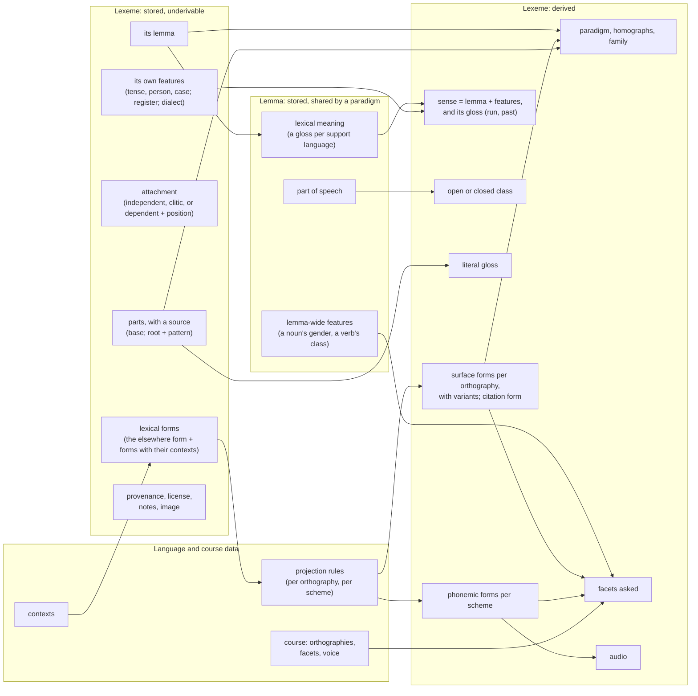

# The lexeme, diagrammed

- Status: working notes, 2026-11-18, beside [lexemes.md](lexemes.md) (the discussion and its decisions).
- Uses the proposed renames (lexemes.md §2): **lemma** for the lexical meaning, **lexical form** for the
  fully specified form, **surface form** for a projection, **features** for cells and properties.

## What is stored, and what is derived

### Stored on the lemma (shared by every lexeme of a paradigm)

| | Examples |
|---|---|
| lexical meaning, as a gloss per support language | RUN "run"; HOUSE "house" |
| part of speech | VERB, NOUN |
| lemma-wide features | *casa*: feminine; *pensar*: e→ie |

### Stored on the lexeme (underivable)

| | Examples |
|---|---|
| its lemma | *ran* → RUN |
| its own features | *ran*: past; *nedha*: krama; *carro*: Cuban |
| attachment | independent; clitic (*me*); dependent + position (‑ga, suffix) |
| lexical forms: the elsewhere form, plus forms with their contexts | ‑ga; ‑ka after k; ‑qa after q |
| parts, with a source (where it has them) | *writer* (occupation) ← *write* + ‑er; مَكْتَب ← ك‑ت‑ب + مَفْعَل |
| provenance, license, notes, image | |

### Derived

| | From |
|---|---|
| surface forms per orthography, with variants; the citation form | lexical forms + projection rules |
| phonemic forms per scheme | lexical forms + projection rules |
| audio | phonemic forms |
| sense, and its gloss (*ran*: "run (past)") | lemma + its own features |
| open or closed class | part of speech |
| inflectional or derivational (an affix) | its lemma: a feature value, or a function making a new lemma |
| paradigm | lexemes sharing its lemma |
| homographs | lexemes sharing its surface forms |
| family | parts |
| literal gloss | parts and their glosses |
| facets asked | surface and phonemic forms (where they're unpredictable), lemma-wide features needing evidence, the course's orthographies, facets and voice |

## Worked examples

| | *casa* | ‑ga (uz) | *fue* (*ser*) | *me* (es) |
|---|---|---|---|---|
| **lemma** | HOUSE (NOUN, feminine) | dative: Case=Dat, "to" | BE (*ser*) | 1SG pronoun |
| **own features** | none | none | preterite, 3sg | object case |
| **attachment** | independent | dependent, suffix | independent | clitic |
| **lexical forms** | *casa* | ‑ga; ‑ka after k; ‑qa after q | *fue* | *me* |
| **parts** | none | none | none | none |
| *derived* | *casas* by rule (a combination); gloss "house" | closed; inflectional; gloss "to (dative)" | gloss "was"; a homograph of *fue* (*ir*) | paradigm with *yo*, *mí*; joined in *dame* by the orthography's projection |

## What diagramming surfaced

1. **Features split by where they're stored, not by UD's lexical / inflectional line.** Register and dialect
   vary within a lemma (*mangan* / *nedha* / *dhahar*; *carro* / *coche*), so they sit on the lexeme, like
   tense. Lemma-wide features (part of speech, a noun's gender, a verb's class) sit on the lemma.
2. **The gloss belongs to the lemma.** A lexeme's gloss is derived from the lemma's and its own features,
   with an override where that reads badly.
3. **An affix's lemma says what kind it is.** ‑ga's lemma is a feature value (Case=Dat), so it's
   inflectional; ‑er's is a function that makes a new lemma, so it's derivational. Nothing to store.
4. **Open or closed comes from the part of speech**, as UD groups its tags, with a language override where
   needed.
5. **Where do lexemes live?** Today KCs belong to a course. With surface forms projected per orthography,
   a language-wide lexicon that courses draw on would let two courses of one language share lexemes.
6. **Next: combinations.** Including multiword lexemes whose part inflects (fa زمین خوردن "fall", زمین
   خوردم "I fell"), where a lexeme and a combination meet.
