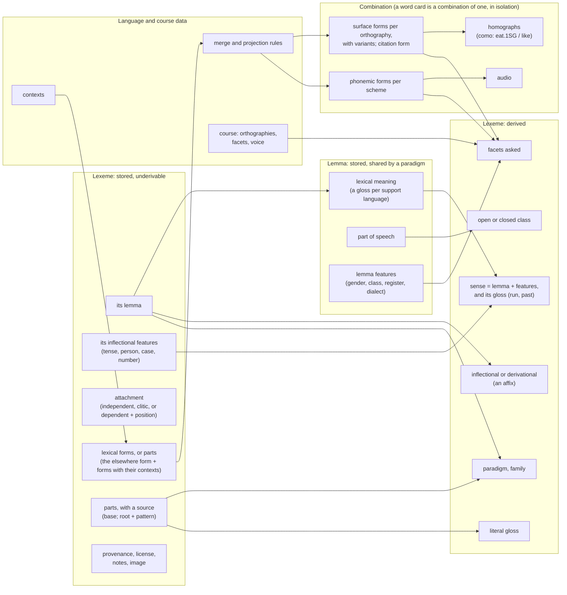
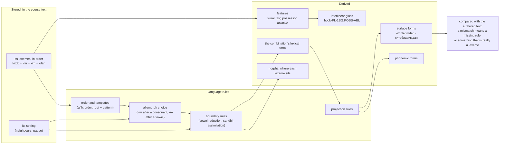
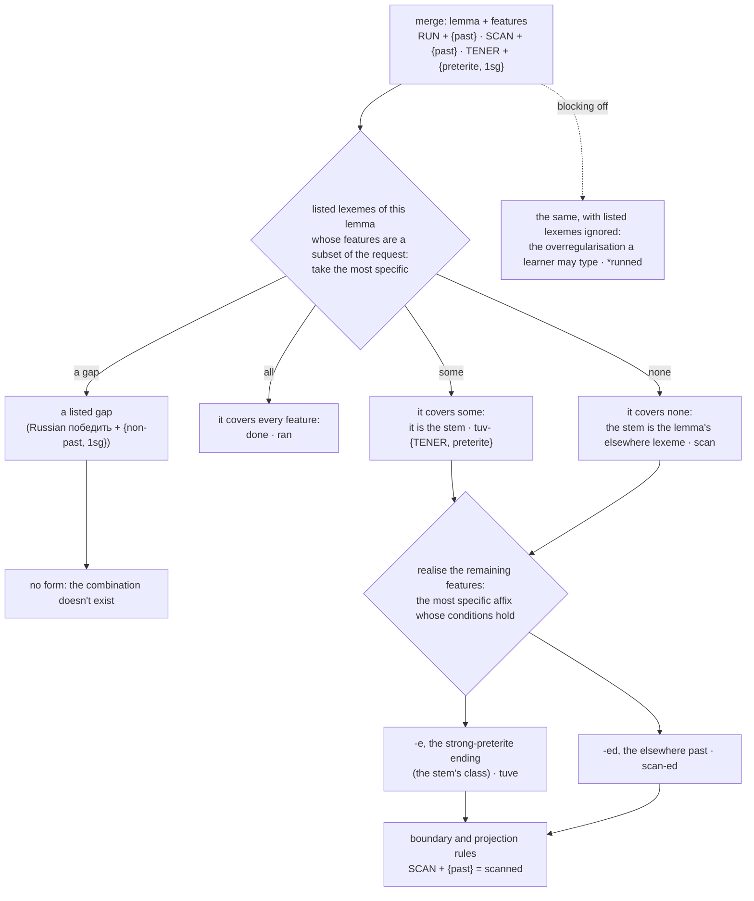

# The lexeme, diagrammed

- Status: working notes, 2026-11-18, beside [lexemes.md](lexemes.md) (the discussion and its decisions).
- Uses the proposed renames (lexemes.md §2): **lemma** for the lexical meaning, **lexical form** for the
  fully specified form, **surface form** for a projection, **features** for cells and properties.

## Naming: an open question (2026-11-19)

The objects are now concept > lemma > lexeme > allomorph. But what we call a **lemma** (a concept plus lexical
features, owning a paradigm of forms) is what linguistics calls a **lexeme**, while our **lexeme** is the
listed unit (Di Sciullo and Williams' listeme). So the terms are now inverted against the textbook in two
places, and "lemma" also means the citation form in UD (`LEMMA`), in the code (ADR 0061) and in the glossary.

Proposed: call the paradigm-owning object a **paradigm** (the paradigm of SER, with its part of speech,
class, register, dialect) and let **lemma** keep its ordinary sense, the citation form. The chain becomes
concept > paradigm > lexeme > allomorph, and "lexeme" is the only term that departs from the textbook, as
already documented.

A second option, raised by the owner's argument that 東西 "thing", *darse cuenta*, زمین خوردن and *writer*
(the occupation) are morphemes: Bloomfield (1933) defines a morpheme as a form with no partial
phonetic-semantic resemblance to any other form, and 東西 "thing" resembles 東 and 西 only in sound. If the
listed unit is the **morpheme** in that sense, every term can keep its textbook meaning:

**concept** > **lexeme** (owns a paradigm: SER, *nedha*'s) > **morpheme** (the listed sign: *kitob*, ‑dan, *ran*,
東西, *darse cuenta*) > **allomorph** (its forms by context); **lemma** = the citation form.

The stretches, to document: a portmanteau (*ran*, run + past in one form; Hockett's portmanteau morph); a
morpheme whose form is a combination of other morphemes' forms (*me di cuenta* inflects *dar* inside it);
and semi-transparent listed items (*writer*, 大學), which do resemble their parts (that is why their literal
glosses help), so they are morphemes by being listed, not by Bloomfield's test.

## What is stored, and what is derived

### Stored on the lemma (shared by every lexeme of a paradigm)

| | Examples |
|---|---|
| lexical meaning, as a gloss per support language | RUN "run"; HOUSE "house" |
| part of speech | VERB, NOUN |
| lemma features: constant across its paradigm | *casa*: feminine; *pensar*: e→ie; *nedha*: krama; *carro*: Cuban |

### Stored on the lexeme (underivable)

| | Examples |
|---|---|
| its lemma | *ran* → RUN |
| its inflectional features: what varies across the paradigm | *ran*: past; *fue*: preterite 3sg |
| attachment | independent; clitic (*me*); dependent + position (‑ga, suffix) |
| lexical forms: the elsewhere form, plus forms with their contexts | ‑ga; ‑ka after k; ‑qa after q |
| parts, with a source (where it has them) | *writer* (occupation) ← *write* + ‑er; مَكْتَب ← ك‑ت‑ب + مَفْعَل |
| provenance, license, notes, image | |

### Derived on the lexeme

| | From |
|---|---|
| sense, and its gloss (*ran*: "run (past)") | lemma + its own features |
| open or closed class | part of speech |
| inflectional or derivational (an affix) | its lemma: a feature value, or a function making a new lemma |
| paradigm | lexemes sharing its lemma |
| family | parts |
| literal gloss | parts and their glosses |
| facets asked | the forms of its combinations (where they're unpredictable), lemma-wide features needing evidence, the course's orthographies, facets and voice |

### Derived on combinations, never on a lexeme (Decided)

Merge and projection rules work on combinations: contexts, boundaries and order only exist there. A
lexeme's "own" surface form is the surface form of a **combination of one**.

| | Examples |
|---|---|
| surface forms per orthography, with variants | *kitoblarimdan*; *dámelo* |
| the citation form: a combination of one, with the lemma's citation features, in isolation | *run*; *ichmoq*; ‑ga shown as "‑ga / ‑ka / ‑qa" by the citation convention for dependents |
| phonemic forms per scheme | |
| audio | a word clip is a combination of one in a carrier context (fa's carrier, yue's 跟住我讀) |
| homographs | *como* is EAT + present 1sg and also "like, as": combinations, not lexemes |

## Worked examples

| | *casa* | ‑ga (uz) | *fue* (*ser*) | *me* (es) |
|---|---|---|---|---|
| **lemma** | HOUSE (NOUN, feminine) | dative: Case=Dat, "to" | BE (*ser*) | 1SG pronoun |
| **own features** | none | none | preterite, 3sg | object case |
| **attachment** | independent | dependent, suffix | independent | clitic |
| **lexical forms** | *casa* | ‑ga; ‑ka after k; ‑qa after q | *fue* | *me* |
| **parts** | none | none | none | none |
| *derived* | gloss "house"; *casas* is a combination | closed; inflectional; gloss "to (dative)" | gloss "was"; a homograph of *fue* (*ir*) | paradigm with *yo*, *mí*; joined in *dame* by the orthography's projection |

## What diagramming surfaced

1. **Decided (2026-11-19): every lexical feature is on the lemma**, register and dialect included; a
   lexeme carries only inflectional ones. The line is what stays constant across a paradigm: *nedha* and
   *dhahar* each have their own inflected forms, as *carro* and *coche* have their plurals. That is UD's
   lexical / inflectional line after all (an earlier draft put register and dialect on the lexeme).
   - So *mangan*, *nedha* and *dhahar* are three lemmas, and *carro* and *coche* two. Decided: what they
     share is a **concept** (EAT, CAR), the object glosses belong to; a register or dialect question ("which
     would you say to your grandmother?") asks among a concept's lemmas, and a register or dialect slip is
     another lemma of the same concept. Two lemmas of one concept with every feature alike are the hole
     noted in lexemes.md §8.
2. **The gloss belongs to the concept** (Proposed; first the lemma). A lemma's gloss is the concept's plus
   its features ("eat (krama)"), a lexeme's adds its inflectional ones ("run (past)"), with an override where
   that reads badly.
3. **An affix's lemma says what kind it is.** ‑ga's lemma is a feature value (Case=Dat), so it's
   inflectional; ‑er's is a function that makes a new lemma, so it's derivational. Nothing to store.
4. **Open or closed comes from the part of speech**, as UD groups its tags, with a language override where
   needed.
5. **Decided: one lexicon per language**, which every course of that language draws on; a language with
   several orthographies projects them all from it. Where it could bite:
   - an orthography whose spellings no rule gives (simplified from traditional Chinese merges 發 and 髮 into
     发; the reverse can't be derived), so the lexical form must hold the fuller one;
   - two courses wanting different analyses of one lexeme: a question of who owns the lexicon and signs it
     off;
   - provenance and review per lexeme, across courses, instead of per course file;
   - bundles carry only the lexemes a course uses.
   Varieties (Cuban, Beirut) live in one lexicon through dialect features; different languages that share a
   script (lzh and yue, hbo and Modern Hebrew) have separate lexicons.
6. **Next: combinations** (below).

## A lexeme's manifestations (allomorphs Decided 2026-11-19)

A lexeme shows up in two different ways, and only one needs an object:
- **Its stored forms: an object, the allomorph** (the term in lexemes.md §2). Each holds a lexical form, its
  context (none for the elsewhere form), which radical any fixed letter stands for, and its source. They are
  parts of the lexeme, stored with it, and learned one by one (each is a part no rule gives).
- **Its forms in combinations, the word forms** (*kitoblarimdan*, *kitobga*): values, not objects. A word
  form is a combination of one (a lexeme plus inflectional features), identified by its content, so data
  derived for it (a clip, a homograph mark) is keyed by that content, the way clips said alike already share
  a file.

## What the learner learns (Proposed)

**The lexeme is the primary unit of what is taught and stored:** every listed pairing of form and meaning a
learner has to memorise. But learned knowledge has three sides, and lexemes are one of them:

| Kind | What it is | Examples |
|---|---|---|
| **meaning** | lemmas (lexical meaning, with lemma-wide features) and features (grammatical meaning) | RUN; *casa* is feminine; past; dative; krama |
| **form** | lexemes: the listed forms that realise meanings | *run*, *ran*, ‑ga, *tuv-*, *nedha* |
| **rule** | productive patterns: affixation, allomorph choice, boundary and projection rules (letters and marks included) | ‑ga → ‑qa after q; the e→ie pattern; reading unpointed Hebrew |

- **Most lemmas have exactly one lexeme** (*casa*, *kitob*, 呀), so the split is invisible. It shows where a
  lemma has several listed members: *run* / *ran*, *ser*'s forms, *mangan* / *nedha* / *dhahar*, *carro* /
  *coche*.
- **Meaning is learned once per lemma.** A learner who knows *run* doesn't relearn RUN for *ran*; *ran* adds a
  form for a feature. Recognising *ran* is evidence for RUN; producing it is evidence for the lexeme *ran*
  and the feature past.
- **Features are to grammar what lemmas are to vocabulary**: units of meaning, realised by lexemes (‑ga for
  dative; ‑ó, fused, for preterite 3sg) or by nothing (uz COP.3SG).
- **Order follows:** a lemma's elsewhere lexeme before its listed members (*run* before *ran*), as a base
  before its derivatives.
- **The word list groups by lemma**, its listed lexemes beneath like principal parts (*ser*: *soy*, *eres*, *es*,
  *fue*…).
- **Decided: to have learned something is to have learned every part of it that can't be derived**, for
  every kind of thing:
  - **a lexeme:** its forms (each with its context), its sense, its features, every unpredictable edge;
  - **a lemma:** its meaning, its lemma-wide features, and every listed lexeme of its paradigm. Knowing *fue*
    is not knowing BE: *soy*, *eres*, *es*… are parts of it no rule gives. Evidence of the meaning can come
    through any of its lexemes; each listed form needs its own;
  - **a rule:** every branch of it, each context it distinguishes (‑ka after k *and* ‑qa after q), shown on
    items the learner can't have memorised it on;
  - **a feature** (Proposed, 2026-11-19): only an *inherent* feature is learned as a feature, and what is
    learned is **when to use it**, not how to spell it (forms belong to lexemes and rules). Preterite vs
    imperfect (*comí* / *comía*), krama vs ngoko, uz ‑di vs ‑ibdi: a learner can know every form and still
    choose wrong. Its parts are its uses (the imperfect's habitual, ongoing-in-the-past, backdrop, polite
    *quería*), each introduced and shown on its own where no core meaning predicts it. Shown both ways:
    choosing it from a situation (a prompt tagged "(every day)", never "(imperfect)", §12 of lexemes.md) and
    reading it off a form ("*comía*: once, or habitually?"). A *contextual* feature (agreement, a case a
    verb governs, the subjunctive *querer que* forces) is not learned as a feature: it is a rule plus a
    lexical feature of a lemma (*casa* is feminine; *querer que* takes the subjunctive);
  - **a combination:** nothing of its own. It is derivable, so it is learned when its parts are.
- **Proposed: exactly what counts**, every item under ADR 0100's rule for a skill shown (a first try, right,
  not self-rated, on a later local date than the part was met and than it was last missed), over the parts
  introduced so far:
  - **A lexeme:**
    1. its sense recognised (its form → its meaning) and produced (its meaning → its form);
    2. each stored form produced in its own context (‑ka after k; *el* before *agua*), where no rule gives it;
    3. each lexical feature that needs it (*casa* feminine: *la casa* produced from the meaning, not handed
       over by a word bank);
    4. each edge the course asks and the profile marks unpredictable: listening, reading aloud, spelling,
       vocalising.
  - **A feature** is learned as its **contrast** (Decided 2026-11-19: aspect is preterite against imperfect,
    a structuralist unit, and the right one here), since a learner who
    always picks one value would otherwise get every card for it right. For each use of each value
    introduced (preterite: a completed event, a sequence; imperfect: habitual, ongoing, description, polite):
    1. chosen right where the situation calls for it, the alternative on offer or typed;
    2. read right off the form;
    3. each on at least two different sentences with different lemmas carrying the feature, so a memorised
       sentence can't stand in for the use.

    A wrong value counts against the use that was called for, and only where grading pins it (a minimal-pair
    card, or a typed answer with the right lemma in the wrong cell).

    A contrast belongs to its language, even where UD gives its values the same names: Spanish preterite
    against imperfect, English simple against progressive, Biblical Hebrew wayyiqtol against qatal. Two
    languages' "past" are two features, and a learner whose own language lacks a contrast meets it through
    the prompt's situation (lexemes.md §12).
- Proposed: **"every part" means every part introduced so far**, of those the course asks for this learner.
  A course that never teaches *sois* can still teach *ser* to the end, and a lemma whose new irregular form
  arrives in a later unit goes back to learning until that form is shown, as a miss sends a word back now
  (ADR 0100, D3).
- Proposed: the word list shows a lemma's progress (*ser*: meaning, 5 of 9 forms), not only learned or not.

## Combinations

A combination is derivable by definition: whatever isn't is a lexeme (lexemes.md §3). Only its lexemes are
stored, in the course text; everything else is derived, and the derived surface form is checked against
what the author wrote.

**Combining is more than concatenating.** It works on lexical forms, then projects:
- **order and templates:** affix order; a root interleaved with its pattern;
- **allomorph choice by context:** uz ‑im after a consonant, ‑m after a vowel; ‑qa after q;
- **boundary rules on the lexical form:** Hebrew vowel reduction (דָּבָר + ‑ִים → דְּבָרִים), sandhi;
- **projection rules on the result:** Spanish *da* + *me* + *lo* keeps its stress on *da*, and the
  orthography writes *dámelo* because that stress is now antepenultimate; Persian کتاب + ‑ها is written
  with a ZWNJ; chg puts one before ‑dur.

**What is derived:**
- the combination's lexical form, surface forms and phonemic forms;
- its features: the union of its lexemes' (plural, 1sg possessor, ablative);
- its interlinear gloss (book‑PL‑1SG.POSS‑ABL), mechanically. A natural translation ("from my books") is
  the sentence's job, authored with its accept sets;
- its morphs: where each lexeme's exponent sits. The combining rules must keep track of this.

**A mismatch with the authored text** means a missing rule, or a "combination" that is really a lexeme.
That is the lint from lexemes.md §3.7.

**The span is open-ended.** A word (*kitoblarimdan*) is a combination; so is a phrase (*the writer of X*) and
a sentence. Constructions are rules at the phrase level: apc's *used to* is a periphrastic way of filling a
feature. A construction whose meaning isn't derivable is a lexeme with slots.

### Order (Proposed)

**Linear order can be dropped from a combination; hierarchy can't.**
- **Inflection:** a combination is a lexeme plus features (kitob + {plural, 1sg possessor, ablative}). The
  language's template orders the exponents, as realizational morphology has it, so nothing is stored but
  the features.
- **Order rules are stated once per language, never per combination:** affix templates and position
  classes, clitic clusters (Spanish *se* > 2nd > 1st > 3rd: *se te lo*), clitic placement by host (*me lo
  da*, *dámelo*), head direction.
- **Hierarchy carries meaning, and the same order can hide two:** *un‑lock‑able* is [un‑[lock‑able]] "can't
  be locked" or [[un‑lock]‑able] "can be unlocked"; stacked causatives and passives scope by their order
  (Baker's Mirror Principle). So a combination stores its structure, which affix or word applies to what,
  and rules linearise it: Merge without order, then linearisation.
- **Free word order isn't underivable either:** where several orders are grammatical, each is a
  linearisation. Information structure (topic, focus) would pick one; a prompt that doesn't specify it
  accepts them all (ADR 0085).
  - **The payoff:** order variants in accept sets are generated, not hand-listed (hbo's subject and
    predicate orders, ADR 0084). Generated at compile time, so the grader stays literal (ADR 0085).
- **Where order is data: the utterance.** An attested text (a Bible verse, a Perseus passage, a story line)
  is one linearisation an author chose, and its order is a fact about that text. So: a combination is
  structure; an utterance is a combination plus the order it was said in.
- Written order isn't always spoken order even within a word: Thai and Lao store preposed vowels in visual
  order, an exception to Unicode's logical order. Projection rules handle it.

### Blocking: where *ran* is stored, and how it's found (Proposed)

**Merge takes a lemma and features (RUN + {past}); realising them picks the forms.**

**The irregular lexeme is the exception table.** *ran* is already stored as lemma RUN + {past}, so "the
past of *run* is *ran*" is written once, on *ran*, and nowhere else.

**The lookup is the Elsewhere Condition** (Pāṇini's principle, in Stump's Paradigm Function Morphology; the
Subset Principle in Distributed Morphology): the most specific item wins.

1. Index the lexicon at compile time by lemma. Among a lemma's listed lexemes, take those whose features
   are a subset of the request, and the most specific of them.
2. If it covers every feature, that's the answer: *ran*.
3. If it covers some, it's the stem: *tuv-* is TENER + {preterite}. Its own lexical features (a
   strong-preterite stem) condition what comes next.
4. If it covers none, the stem is the lemma's elsewhere lexeme: *scan* (SCAN + {past} still ends as
   *scanned*, after steps 5 and 6).
5. The remaining features are realised by affixes, again the most specific whose conditions hold: the
   strong-preterite ‑e (*tuve*) beats the regular ‑í; the elsewhere ‑ed applies to *scan*.
6. Then boundary and projection rules: *scanned*.

**Three ways a merge can "fail", each stored differently:**
- **Blocked** (RUN + past): not a failure. The lookup returns *ran*; *runned* is never built.
- **Conditions not met** (*\*greenen*, *\*unsad*): a rule's conditions don't hold, so it produces nothing.
  Nothing is stored.
- **An arbitrary gap** (Russian победить has no 1sg non-past): stored on the lemma as a feature set with no
  form, a listed item that blocks the rule and supplies nothing.

**Blocking off gives the learner's error.** Run the same realisation ignoring listed lexemes and RUN + past
comes out *runned*: exactly the overregularisation a learner types. The compiler can put those forms in the
bundle beside the right answer, so the grader can say "right tense, irregular verb" while staying literal.

**Merge runs at compile time**, in the pipeline: accept sets, overregularisations and wugs are generated
there, and the bundle carries the results.

### Merge all the way up (Proposed)

The owner would like Merge to reach phrases and sentences. Proposed: yes as the architecture, with coverage
growing rule by rule, so it is never all or nothing.
- **An utterance's structure is annotated as a UD dependency tree** (heads and relations), which carries the
  hierarchy linearisation needs; Merge's binary sets aren't needed for that. We already use UD's parts of
  speech and features, and a parser (Stanza) can draft the trees for a reviewer to correct.
- **Each language's linearisation rules start empty.** With none, only the authored order is generated, which
  is today's behaviour; each rule added (adjective after noun, clitic clusters, subject–predicate in hbo)
  generates more orders for accept sets, at compile time.
- **The risk is over-generation**: a wrong rule accepts wrong answers. So every rule has conformance vectors,
  and generated variants carry `generated` provenance for review, like wug items.
- **What it buys:** order variants and agreement in accept sets generated instead of listed; credit
  assignment from structure (which word a slip belongs to); a check that every authored sentence derives
  from its annotation.

### Where lexemes and combinations meet

Some lexemes have an underivable meaning but a derivable form: *writer* (the occupation) is spelled *write*
+ ‑er; fa زمین خوردن "fall" is زمین + خوردن; *darse cuenta*; *kick the bucket*.
- **Such a lexeme stores its parts, not a lexical form**, and its form is combined from them like any
  combination's. Only its meaning is listed.
- **One part is where inflection goes:** زمین خوردم "I fell" inflects خوردن; *me di cuenta* inflects *dar*;
  *kicked the bucket* inflects *kick*. The lexeme names that part.
- **Parts now do two jobs:** the literal gloss (lexemes.md §10) and the form, inflection included.
- So a lexeme stores **either lexical forms or parts**: forms where the form is underivable (*ran*, *casa*),
  parts where only the meaning is.
